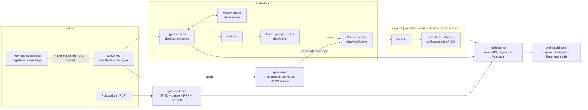
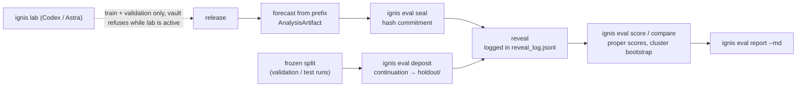

# IGNIS

**An evidence-linked laboratory for NASA microgravity combustion research.**
NASA Space Apps 2026 · all-Rust core · Apache-2.0

IGNIS starts from NASA Physical Sciences Informatics (PSI) experiments and publications, makes them
searchable and comparable, and, where the measurements are good enough, lets a researcher give a model
only the *beginning* of a recording, ask for a forecast with uncertainty, choose one more observation
to inspect, and then check the forecast against the real continuation that was kept sealed.

The contribution is the complete loop, not the number of neural networks:

> **evidence → calibrated measurement → forecast from a causal prefix → choice of a useful observation
> → sealed prediction → verification on the real continuation → reproducible report**

> [!IMPORTANT]
> **No model has been trained on NASA data yet.** Everything below that says "fit" or "release" has
> been exercised on synthetic data and on dry-run plans over the real cohorts. The pipeline that will
> produce NASA-trained releases is in place; the releases themselves are not.

## Three experts, each with a narrow domain

Each predictor answers one physically defined question. If no expert applies, IGNIS answers from the
evidence and gives no fabricated number.

| Expert | Input (causal prefix) | Predicts | Does **not** predict |
|---|---|---|---|
| **FLEX** `flex.v3` | Free-floating methanol droplet, reconciled conditions, diameters up to the cutoff | Liquid diameter over time; distribution of the end of the observed phase (extinction / disruption) | Pure-methanol mass, temperature or species fields, solid-material fires |
| **ACME** `acme_<normal\|inverse>.hazard` | Configuration (normal and inverse fitted separately), initial conditions, protocol, "still burning at cutoff" | Time and cause of the end of the established flame under the observed experimental policy | Natural flame lifetime without intervention, when that is not identified by the data |
| **BASS** `bass.operator` | One qualified material/geometry/protocol, calibrated contours, known controls | Continuation of the leading visible flame front | Pyrolysis, temperature, material certification, other surfaces |

Every expert ships with baselines (`flex.v1`, `flex.d2_population`, `flex.d2_prefix`,
`acme_*.{constant,piecewise,linear}_baseline`, `bass.persistence`, `bass.constant_velocity`) and is
compared against them on exactly the same cases. `ignis fit list` prints what the build contains.

## Architecture



The sealed-evaluation path keeps the continuation out of reach until a forecast is committed:



Evidence text is explanation, never a predictor input: `ignis evidence firewall` proves from the cargo
dependency graph that no fitting crate depends on `ignis-evidence`.

## Quickstart

Requires Rust (stable; developed with cargo 1.94) and, for the dashboard, Node.js. On Windows use Git
Bash. Network access is needed only for `sources inspect` and `sources samples`.

```bash
cargo build --release -p ignis-cli
export PATH="$PWD/target/release:$PATH"      # the binary is target/release/ignis(.exe)
ignis --help

# 1. Sources: metadata + file listing (read-only), then the bounded sample set (< ~150 MB)
ignis sources inspect PSI-69 PSI-159 PSI-25 PSI-26
ignis sources samples

# 2. Curation: records → cohort → (frozen) split → views
ignis data ingest
ignis data cohort build flex                  # prints the inclusion/exclusion flow table
ignis data views sha256:9e31b1aa6b56b2086aac85776d27778bb1680a83fcdfc543dad62e0385da637e --time-load

# 3. Fitting is a dry-run plan unless --execute
ignis fit run flex.v3 \
  --cohort sha256:9e31b1aa6b56b2086aac85776d27778bb1680a83fcdfc543dad62e0385da637e \
  --split  sha256:660b7d9ede629b3009b4b761ea9e5875560719566e3dea21112f607cddd49894
ignis fit run flex.v3 --fixture synthetic --set fit.method=map --execute   # ~5 s synthetic smoke test

# 4. API + dashboard (two terminals)
ignis serve --dev                             # http://127.0.0.1:8787/api, synthetic fixture at /api/fixtures
npm ci --prefix web && npm --prefix web run dev   # http://localhost:5173
```

The cohort and split ids above are the ones currently committed in [`data/splits/`](data/splits/);
the splits are frozen, so `ignis data split freeze` refuses to re-freeze them. The full walkthrough,
including review, evaluation, vision and Runpod, is in [docs/GUIDE.md](docs/GUIDE.md).

## Status

Measured numbers are from the development laptop; "synthetic" means generated data, not NASA data.

| Area | State | Notes |
|---|---|---|
| Python → Rust port | done, verified | Log-likelihoods and gradients within ~1e-12 of the previous JAX code; data ingest byte-identical; vision output identical on a real BASS clip |
| NASA sources and manifests | done | PSI-69 (FLEX), PSI-159 (ACME), PSI-25/26 (BASS); every file has a sha256 Source record; CC0 sample set |
| Curation and cohorts | done on real samples | FLEX 114 free-floating methanol runs (split 27/9/9 groups); ACME normal 129, inverse 131 runs; BASS planar SIBAL candidate 25 runs in only 4 groups (2/1/1): **not qualified**. FLEX view load ~10 ms (was ~3.5 s) |
| Review queue | automated adjudication built, **not run yet** | 290 items: FLEX 125, ACME normal 33, ACME inverse 20, BASS 112. Two independent headless Claude passes with code-checked evidence; disagreements stay unresolved ([team workflow](docs/TEAM.md)) |
| FLEX experts | implemented, synthetic-verified | flex.v3 NUTS on the real cohort not run yet (planner: ~9 h CPU for 68 train runs, 33,137 observations). flex.v1 NUTS on synthetic data is still `insufficient_inference` (R-hat 1.017, 1.5 % divergences): **open issue** |
| ACME experts | implemented, synthetic-verified | MAP fit 0.08 s (was 14.5 s); NUTS 4 chains 13 s, qualified, R-hat 1.006 (previously out of memory) |
| BASS experts | implemented, synthetic-verified | 5-member ensemble fit 5.3 s (was 174 s); no contours from the real cohort videos yet |
| Vision metrology | implemented | Container-PTS decode, calibration, causal classical segmentation, SAM2.1 sidecar; 403 frames/s (was 42) |
| Sealed evaluation and lab | implemented, tested | Seal → reveal → score → compare with cluster bootstrap; no NASA release has been scored |
| Observation choice (VOI) | CLI implemented | `ignis decide rank / replay`; the API's `/acquisition` hook is not wired in the binary yet |
| Evidence retrieval | lexical + RRF + firewall done; dense/rerank being moved to the DeepInfra API | Qwen3-Embedding-8B and Qwen3-Reranker-8B, key from `DEEPINFRA_API_KEY`, dry-run by default |
| Accelerators | implemented, optional | Encoder + spline flows; not needed by any expert, not trained on NASA data |
| API and dashboard | implemented | In-process forecasts, typed refusals, VOI scoring; `ignis infer forecast` reaches the same artifact from the CLI; the dev fixture is synthetic and labelled as such |
| Research runtime (`/api/v1`, Codex, MCP tools, runner) | implemented, tested offline | Episodes, resumable SSE, jobs, artifacts; Codex App Server bridge; tools over MCP; isolated analysis runner (not yet verified under gVisor). FLEX/ACME/BASS model tools are off by default (`--enable-models`) |
| Deployment | written, **not provisioned** | Origin on a Google Compute Engine VM (Space Apps Google Cloud credit), Cloudflare Worker/Access/Tunnel/R2 in front, domain from the Space Apps offer. Runbook: [infra/README.md](infra/README.md) |
| International data | manifests only | JAXA GCEM, ZARM FLARE (CC BY-NC), ESA HREDA (login-gated, metadata only), Mendeley catalogue; never mixed into NASA cohorts |

Nothing expensive runs by default: fits, bulk downloads, video decoding and paid API calls print a plan
and stop unless `--execute` is given with a resource profile from [`configs/resources/`](configs/resources/).
Executed jobs are recorded in `runs/jobs/`. Nothing in the repository provisions, stops or deletes cloud
resources.

## Documentation

| Document | For |
|---|---|
| [docs/GUIDE.md](docs/GUIDE.md) | Operator guide: every step with exact commands |
| [docs/REPOMAP.md](docs/REPOMAP.md) | Repository map, crate graph, data lifecycle, "where do I change X" |
| [docs/TEAM.md](docs/TEAM.md) | Team and lanes (Romanian): who owns what, presentation roles, test-partition rules |
| [AGENTS.md](AGENTS.md) | Operating guide for every coding agent: architecture, ownership, rules, commands |
| [docs/implementation/](docs/implementation/) | C0 contracts, integration/ownership, workboard and the four lane handoffs (Romanian) |
| `crates/*/README.md` | One page per crate, e.g. [ignis-core](crates/ignis-core/README.md) |
| [web/README.md](web/README.md) · [sidecar/sam2/README.md](sidecar/sam2/README.md) | Dashboard and SAM2 sidecar |

Everything is Rust except the SAM2 sidecar (Python/PyTorch) and the web client (TypeScript/React).
