# IGNIS

**Will it burn? Ask NASA's fire data anything.**

IGNIS is a research workspace and agent harness for NASA's microgravity combustion data. It reads
all 19 ISS combustion investigations in NASA's Physical Sciences Informatics system (41,004 files,
856 curated runs), places every test against the air a crew will breathe (ISS and Earth, Moon base
and rovers, spacesuit), and answers questions in plain language with the source behind every number.

Its core is forecasting by **weight-space programming (WSP)**: instead of training black-box
networks, a frontier model (Claude Fable 5.2) writes every model weight by hand from physics, NASA
papers and the train partition, so every weight carries a written reason and a wrong forecast is
fixed by rewriting one number. Scored on held-out NASA flight tests, these written models beat the
published laws and peer-reviewed models they were compared with in most investigations, and beat
optimizer-fitted models where those exist (FLEX methanol: 18.5 µm against 42.7 µm for the best fitted
model and 31.6 µm for the d² law on the sealed test). A fabric-fire model written from 2 cm ISS strips forecast NASA's
40 cm Saffire spacecraft fires 4.3 times more accurately than the baseline without changing a single
weight. Inside the IGNIS harness, every language model we tested answers NASA questions better and
cheaper than on its own.

This repository is both the product (Rust server, MCP tool host, React app) and the research record:
the formulas, the experiments generation by generation, the prompts, the comparisons and the
commands to reproduce them. Built for NASA Space Apps 2026 ("Flame in Freefall").

## Results

### Better than the published science

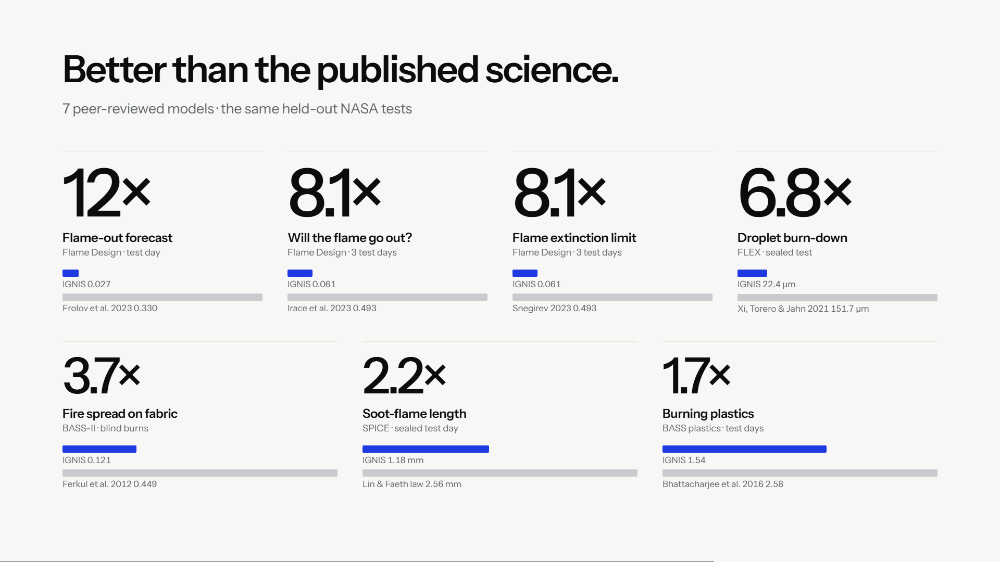

The same held-out NASA tests, scored for IGNIS's hand-written releases and for seven published
models rebuilt from their papers. Equations, case lists, metrics and reproduction commands:
[docs/research/COMPARISONS.md](docs/research/COMPARISONS.md).

#### The papers we compared against

| Paper or law | What it predicts | NASA test scored on | IGNIS | Theirs | Better by |
|---|---|---|---|---|---|
| Frolov, Ivanov, Frolov, Semenov, "Spherical Diffusion Flames of Ethylene in Microgravity: Multidimensional Effects", *Fire* 6(8) (2023) 285, [doi:10.3390/fire6080285](https://doi.org/10.3390/fire6080285) | When each spherical flame goes out (transient detailed-chemistry model) | Flame Design test day, normal flames | **0.027** | 0.330 | **12.2×** |
| Irace, Waddell, Constales, Sunderland, Axelbaum, "Critical temperature and reactant mass flux for radiative extinction of ethylene microgravity spherical diffusion flames at 1 bar", *Proc. Combust. Inst.* 39 (2023) 1905–1913, [doi:10.1016/j.proci.2022.07.043](https://doi.org/10.1016/j.proci.2022.07.043) | Radiative extinction (R = r_ss/r_ext) | Flame Design test days, 83 cases | **0.061** | 0.493 | **8.1×** |
| Snegirev, "On radiative extinction of microgravity diffusion flames", *Combust. Flame* 248 (2023) 112499, [doi:10.1016/j.combustflame.2022.112499](https://doi.org/10.1016/j.combustflame.2022.112499) | Pre-extinction radius and steady-burning criterion | Flame Design test days, 83 cases | **0.061** | 0.493 | **8.1×** |
| Xi, Torero & Jahn, "Data driven forecast of droplet combustion", *Proc. Combust. Inst.* 38 (2021) 4785–4793 | Droplet burn-down with a data-assimilated burning constant | FLEX sealed test, methanol, 64 cases | **22.4 µm** | 151.7 µm | **6.8×** |
| Ferkul, Olson, Johnston, T'ien, BASS-I spread-rate correlation (ASGSR 2012, NTRS 20130012832) | Flame spread rate on fabric | BASS-II burns measured blind | **0.121** | 0.449 | **3.7×** |
| Lin & Faeth, "Shapes of nonbuoyant round luminous laminar-jet diffusion flames in coflowing air", *AIAA J.* 37 (1999) 759–765 | Coflow jet flame length | SPICE test days | **1.18 mm** | 2.56 mm | **2.2×** |
| Space-charge-limited current with saturation (Lawton & Weinberg, *Electrical Aspects of Combustion*, 1969) | Ion current drawn from a flame by an electric field | E-FIELD test days, 788 voltage levels | **0.319 µA** | 0.575 µA | **1.8×** |
| Classical d² law (Godsave; Spalding, 1953) | Droplet diameter, D² = D₀² − Kt | FLEX sealed test, methanol / n-heptane | **18.5 / 32.2 µm** | 31.6 / 54.0 µm | **1.7×** |
| Bhattacharjee, Simsek, Olson, Ferkul, *Combust. Flame* 163 (2016) 472–477, [doi:10.1016/j.combustflame.2015.10.023](https://doi.org/10.1016/j.combustflame.2015.10.023) | Critical flow velocity for radiative quench | BASS plastics test days | **1.54 cm/s** | 2.58 cm/s | **1.7×** |
| Roper, flame-length correlation for circular ports, *Combust. Flame* 29 (1977) 219–226 | Laminar jet flame length | CLD Flame test days | **0.115** | 0.144 | **1.3×** |
| Four optimizer-fitted FLEX models (best: `flex.v3`) | Droplet diameter | FLEX sealed test, methanol | **18.5 µm** | 42.7 µm | **2.3×** |

Lower is better in every row. Burner-flame rows are the integrated Brier score, the FLEX and Xi row
the mean absolute error of the forecast median, the d² and fitted-model rows CRPS.

### Written from a 2 cm strip, right on a 40 cm fire

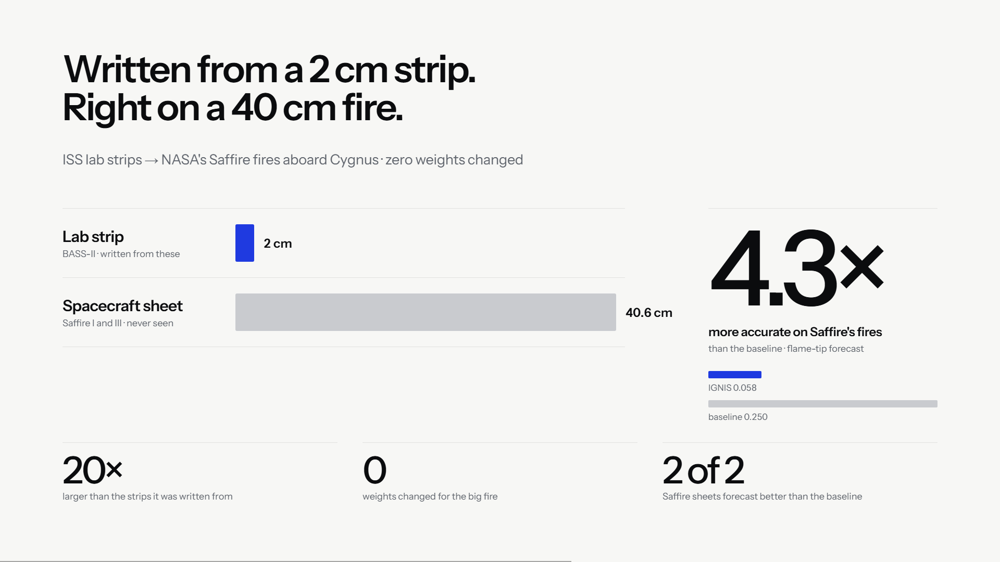

The BASS-II fabric model, written from 2 cm strips burned on the ISS, forecast the flame tip of
NASA's 40.6 cm Saffire I and III sheets aboard Cygnus 4.3 times more accurately than the baseline,
with zero weights changed. Details: [docs/wsp/EXPERIMENTS_GEN6-ON.md](docs/wsp/EXPERIMENTS_GEN6-ON.md).

### Any model gets better inside IGNIS

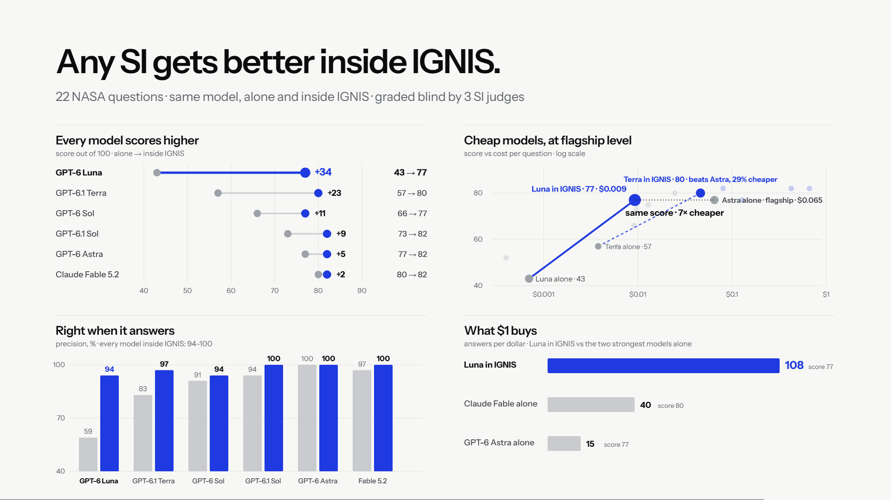

22 NASA questions, the same model alone and inside IGNIS, graded blind by three model judges. Every
model scores higher inside IGNIS, and the weaker the model the larger the gain: GPT-6 Luna goes from
43 to 77 and matches the flagship GPT-6 Astra alone (77) at a seventh of the cost per question.
Precision inside IGNIS is 94 to 100 %, and every trap question (an invented run, a false premise) is
handled. Protocol, questions and per-model
tables: [docs/research/HARNESS_BENCHMARK.md](docs/research/HARNESS_BENCHMARK.md).

## The WSP pipeline

```mermaid
flowchart LR
  A[NASA PSI listings<br/>and files] --> B[Manifests, records,<br/>conditions table]
  B --> C[Frozen splits<br/>train / validation / sealed test]
  C --> D[Physics dossiers and<br/>train analysis by subagents]
  D --> E[Author model writes<br/>literal weights .wsp]
  E --> F[Release assembly<br/>content-addressed sha256]
  F --> G[Development scores<br/>registered validation look]
  G -->|adopt or veto, never tune| H[Served release<br/>with model card]
  H --> I[Final test once<br/>and published comparators]
```

Every parameter is a number the author model typed, with a physical meaning. A candidate is
committed before its validation score exists; validation adopts or vetoes it and never tunes it; the
test partition is opened once. How it works: [docs/wsp/WSP_GUIDE.md](docs/wsp/WSP_GUIDE.md). The
derived equations of every release: [docs/research/FORMULAS.md](docs/research/FORMULAS.md). The
experiments, generation by generation: [generations 1 to 5](docs/wsp/EXPERIMENTS_GEN1-5.md) and
[generation 6 onward](docs/wsp/EXPERIMENTS_GEN6-ON.md). The prompts and briefs used:
[docs/research/PROMPTS.md](docs/research/PROMPTS.md). End-to-end reproduction:
[docs/research/REPRODUCE.md](docs/research/REPRODUCE.md).

## Research foundations

IGNIS builds on the emerging literature on weight-space programming and on LLM-driven scientific
modelling. The papers that shaped it (full annotated bibliography with what each found and how it
bears on IGNIS: [docs/wsp/RELATED_WORK.md](docs/wsp/RELATED_WORK.md)):

- Hu et al., *Exploring Weight-Space Programming: Capabilities, Generalization, and Limitations*, [arXiv:2611.09382](https://arxiv.org/abs/2611.09382)
- von Csefalvay et al., *IWIBench: Evaluating Gradient-Free Model Driven Intra-weight Injection*, [arXiv:2611.08647](https://arxiv.org/abs/2611.08647)
- Kundu, Ghosh, Honavar, *Weight-Space Programming of Variational Quantum Circuits*, [arXiv:2611.11537](https://arxiv.org/abs/2611.11537)
- Lindholz et al., *Weight-Space Programming for Medical Imaging: Do We Still Need Training Data?*, [arXiv:2611.12066](https://arxiv.org/abs/2611.12066)
- Nusrat & Nusrat, *Weight-space programming for auditing clinical decision networks*, [arXiv:2611.05341](https://arxiv.org/abs/2611.05341)
- Varam, Aminosharieh Najafi, Atienza, *Mixed Signals: Weight-Space Programming for EEG and ECG*, [arXiv:2611.13758](https://arxiv.org/abs/2611.13758)
- Weiss, Goldberg, Yahav, *Thinking Like Transformers* (RASP), [arXiv:2106.06981](https://arxiv.org/abs/2106.06981); Lindner et al., *Tracr*, [arXiv:2301.05062](https://arxiv.org/abs/2301.05062)
- Novikov et al., *AlphaEvolve*, [arXiv:2506.13131](https://arxiv.org/abs/2506.13131); Shojaee et al., *LLM-SR*, [arXiv:2404.18400](https://arxiv.org/abs/2404.18400)
- Udrescu & Tegmark, *AI Feynman*, [arXiv:1905.11481](https://arxiv.org/abs/1905.11481); Brunton, Proctor, Kutz, *SINDy*, [arXiv:1509.03580](https://arxiv.org/abs/1509.03580); Bakarji et al., *Buckingham Pi*, [arXiv:2202.04643](https://arxiv.org/abs/2202.04643)
- Yin et al., *APHYNITY*, [arXiv:2010.04456](https://arxiv.org/abs/2010.04456); Rackauckas et al., *Universal Differential Equations*, [arXiv:2001.04385](https://arxiv.org/abs/2001.04385)
- Kvamme & Borgan, *Continuous and discrete-time survival prediction with neural networks*, [arXiv:1910.06724](https://arxiv.org/abs/1910.06724)
- Blum & Hardt, *The Ladder: A Reliable Leaderboard for Machine Learning Competitions*, [arXiv:1502.04585](https://arxiv.org/abs/1502.04585)

The combustion science IGNIS forecasts and compares against (Xi, Torero & Jahn 2021; Irace et al.
2023; Frolov et al. 2023; Snegirev 2023; Ferkul et al. 2012; Lin & Faeth; Bhattacharjee et al. 2016)
is cited with its equations in [docs/research/COMPARISONS.md](docs/research/COMPARISONS.md).

## Contents

- [Results](#results)
- [The WSP pipeline](#the-wsp-pipeline)
- [Research foundations](#research-foundations)
- [What it does](#what-it-does)
- [Quick start](#quick-start)
- [Architecture](#architecture)
- [Repository layout](#repository-layout)
- [Documentation](#documentation)
- [Contributing](#contributing)
- [Data, results and interpretation](#data-results-and-interpretation)
- [License and data rights](#license-and-data-rights)

## What it does

| | |
|---|---|
| | **Ask a question.** The home page takes a question in plain language. Each question starts a research episode with its own ordered, resumable event log. |
| 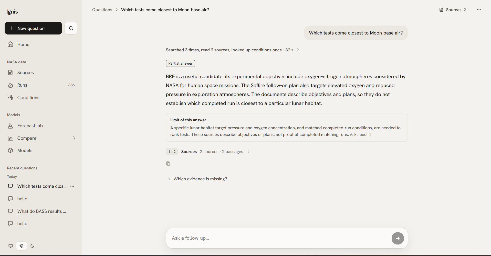 | **Answer with sources and steps.** The answer is built from typed claims. Each claim links to the passage, row or artifact behind it. The tool calls, jobs and artifacts that produced it stay visible beside it. |
| | **Evidence search.** Search over the parsed corpus of PSI and NTRS documents: SQLite FTS5, plus dense retrieval and reranking when configured. Beside the results, the NASA original opens at the hit's page with the passage marked. |
| 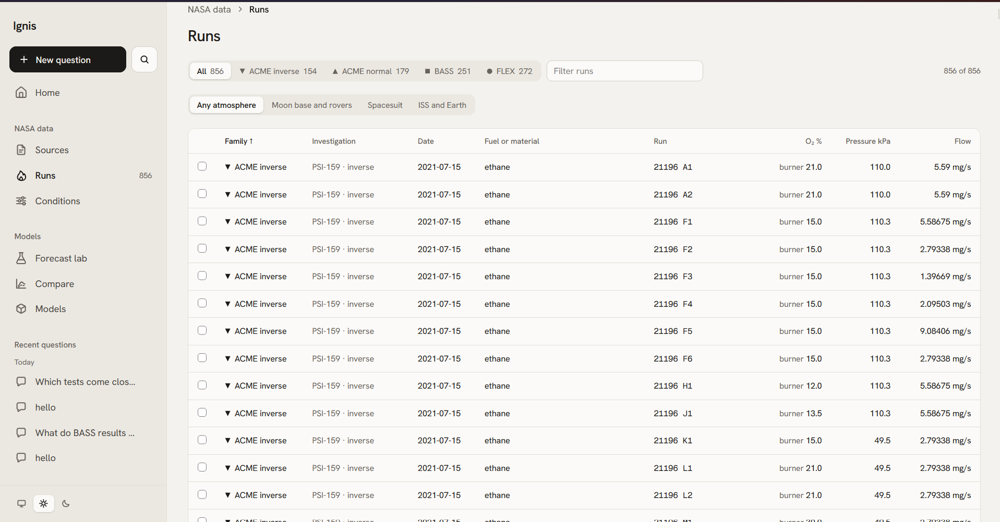 | **Runs.** The curated experimental runs by family (FLEX, ACME, BASS), with date and atmosphere. You can filter them and select runs to compare. |
| 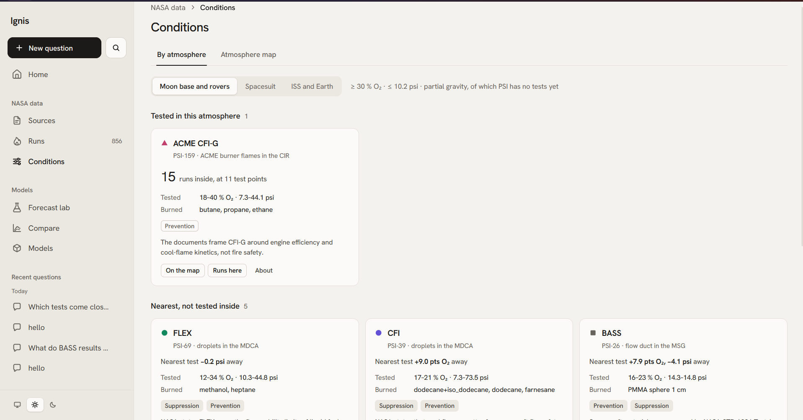 | **Conditions by crew atmosphere.** The conditions table across investigations, grouped by crew atmosphere (ISS and Earth, spacesuit, Moon base and rovers). Each group shows which investigations tested inside it, which came nearest and by how much, and which tests NASA's tables cannot place. |
| 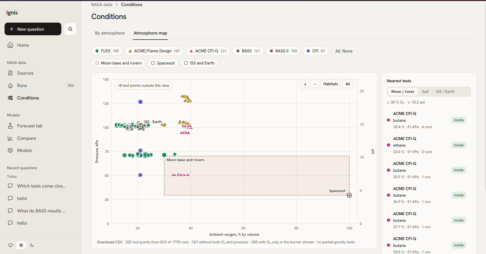 | **Atmosphere map.** Every test point plotted by oxygen concentration against pressure, with the reference atmospheres marked. |
| 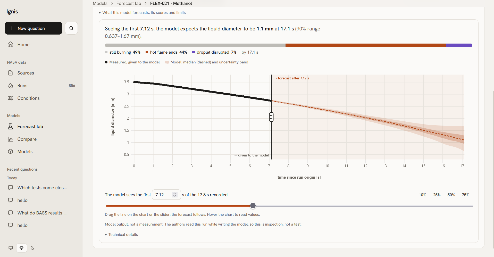 | **Forecast lab.** Pick a release, a run and a cutoff, then forecast the continuation from the causal prefix, with its uncertainty. The run's partition is shown before anything runs. A forecast is sealed before the measured continuation is revealed. |
| 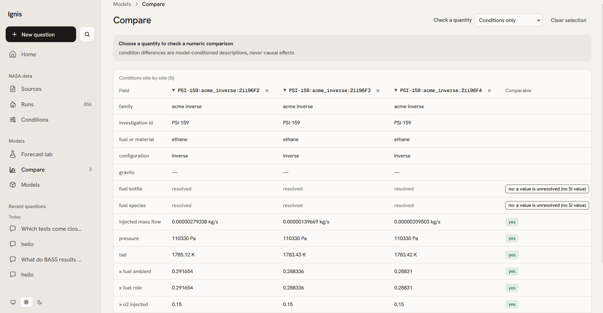 | **Compare.** Put several runs side by side on the same axes. |
| 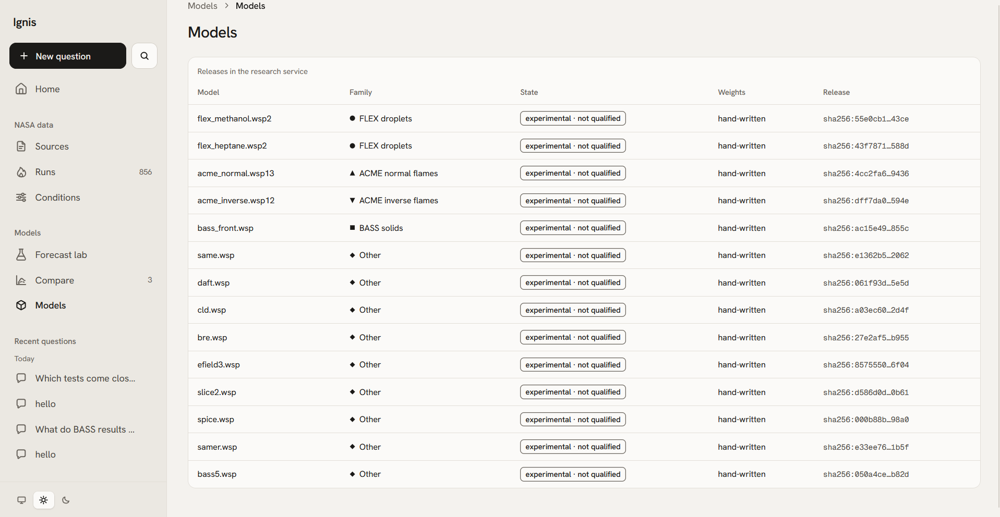 | **Models.** Model releases with their qualification state and how each was made. Every experimental release is marked not qualified. The served hand-written releases also carry model cards (investigation, what it forecasts, inputs, zero-shot or data-informed, development scores with their source, limits). |

The client has three data modes: a browser mock that replays the C0 contract fixtures, the
server's synthetic fixture origin (`ignis serve --dev`), and live data. Synthetic origin is labelled
on every view.

## Quick start

### Prerequisites

| Tool | Version | Source |
|---|---|---|
| Rust | 1.99.1 with `rustfmt` (rustup installs it automatically) | [`rust-toolchain.toml`](rust-toolchain.toml) |
| Node.js and npm | not pinned. The web tests run `.ts` files with `node --test`, which needs built-in type stripping (Node.js 22.18 or later); developed on Node.js 25 | [`web/package.json`](web/package.json) (Vite 6, TypeScript 5.9, React 18) |
| Git Bash | Windows only: the docs and scripts use POSIX shell syntax | [docs/GUIDE.md](docs/GUIDE.md) §1 |

Optional:

- LLVM/clang, for the `pdf` feature (MuPDF). Only `ignis evidence ingest` of PDFs needs it.
- Python 3.11 to 3.13 with `uv`, for the SAM2, PDFium and Docling sidecars.
- Docker, for the isolated analysis runner.
- A Codex App Server or Claude Code binary, for a real agent runtime (see
  [tools/codex/README.md](tools/codex/README.md)).

### Clone and build

```bash
git clone https://github.com/MirceaGodiac/ignis.git
cd ignis
cargo build --release -p ignis-cli          # one binary: target/release/ignis (ignis.exe on Windows)
export PATH="$PWD/target/release:$PATH"
ignis --help

npm ci --prefix web                         # once
```

With PDF ingest: `cargo build --release -p ignis-cli --features pdf`. On Windows, set `CLANG_PATH`
and build from a Visual Studio `vcvars64` shell.

Run every command from the repository root. Configs, data and artifacts resolve relative to it,
or to the `IGNIS_*` variables listed in [docs/REPOMAP.md](docs/REPOMAP.md#data-and-artifact-lifecycle).

### Run locally

The quickest path needs no NASA data and no agent runtime:

```bash
# terminal 1: API on http://127.0.0.1:8787 (synthetic fixture origin under /api/fixtures)
ignis serve --dev

# terminal 2: client on http://localhost:5173 (proxies /api to IGNIS_PORT, default 8787)
npm --prefix web run dev
```

The same two processes are defined as `ignis-server` and `ignis-web` in
[`.claude/launch.json`](.claude/launch.json). On startup the server prints each service it could
not configure, for example `KnowledgeService not configured: no evidence catalog at ...`.
`GET /api/v1/capabilities` reports the same thing to the client.

To build the data the live services read, run the steps of
[`infra/scripts/build-data.sh`](infra/scripts/build-data.sh) locally (network access to NASA
servers required):

```bash
ignis sources inspect PSI-69 PSI-159 PSI-25 PSI-26
ignis sources samples                       # bounded NASA sample set
ignis data ingest                           # typed records in data/work/records
ignis data conditions                       # conditions table (Conditions page, atmosphere map)
ignis evidence corpus fetch --execute       # evidence corpus documents
ignis evidence corpus ingest                # needs a build with --features pdf
ignis data bundle flex                      # builder bundles, also acme_normal and acme_inverse
```

The script also fetches the experimental tables that `ignis data conditions` reads for the other
investigations. Copy that loop from the script. To attach a real agent runtime, use
`tools/codex/setup.sh` and then `tools/codex/serve.sh` (PowerShell: `tools\codex\*.ps1`). For an
offline runtime, build the fake with `cargo build -p ignis-research --bin ignis-fake-codex`,
then pass `--codex-bin target/debug/ignis-fake-codex` (`.exe` on Windows), as in the
`ignis-server-fake-codex` launch entry. Expensive or networked commands print a plan and stop
unless you pass `--execute`. The operator walkthrough (review, fitting, sealed evaluation, vision,
Runpod) is [docs/GUIDE.md](docs/GUIDE.md).

### Run the tests

```bash
cargo fmt --all -- --check
cargo check --workspace --all-targets
cargo test --workspace                      # offline; live-API tests are opt-in
cargo test -p ignis-core                    # contracts, schema drift, fixtures, partition isolation

npm --prefix web run check:types            # fails if web/src/contracts/generated.ts is stale
npm --prefix web run typecheck
npm --prefix web test
npm --prefix web run build

npm ci --prefix infra/worker && npm --prefix infra/worker test   # edge Worker (vitest)
```

There is no CI. The GitHub Actions workflow is disabled by decision. Run the commands that apply
to your change locally and list them, with their results, in the pull request.

## Architecture

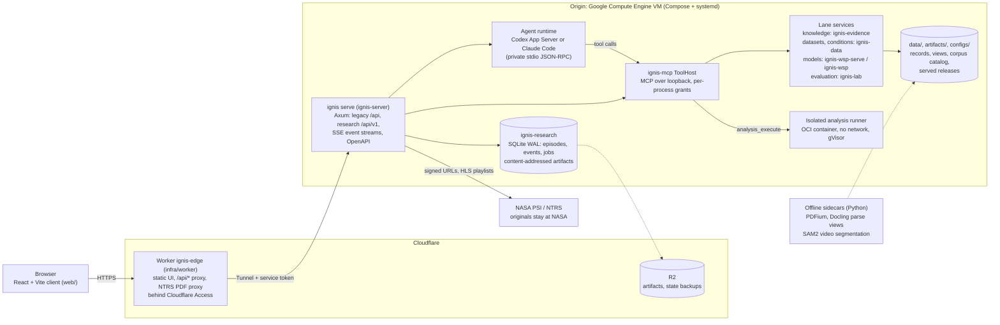

- **One composition root.** `crates/ignis-cli/src/main.rs` builds the single `ignis` binary. It
  collects the experts and passes in the lane services. The server, lab and trainer depend on no
  model crate.
- **One implementation per tool.** HTTP routes, MCP tools and CLI commands are thin adapters over
  the same service traits (`ignis_core::services`). `ignis-mcp`'s `ToolHost` is the only dispatcher
  for agent tools.
- **The agent runtime owns the loop.** IGNIS owns episodes, scope, jobs, artifacts, data, models and
  evaluation. The runtime starts from the harness bundle compiled from `harness/`
  (`investigator.md` and `skills/`).
- **Scope is host-derived.** Every request carries an `ExecutionScope` derived by the host from the
  Access identity. It is never taken from a request body, tool argument or prompt.
- **Evidence never feeds a predictor.** `ignis evidence firewall` checks the cargo dependency graph:
  the protected crates in `configs/evidence/firewall.toml` must not depend on `ignis-evidence`.

Crate graph, request paths and the data lifecycle: [docs/REPOMAP.md](docs/REPOMAP.md). Decisions
and their rationale: [docs/ARCHITECTURE.md](docs/ARCHITECTURE.md) and
[docs/implementation/ARCHITECTURE.md](docs/implementation/ARCHITECTURE.md).

## Repository layout

| Path | Purpose |
|---|---|
| [`crates/`](crates/) | Rust workspace, one binary `ignis` (crates listed below) |
| [`web/`](web/) | React 18 + TypeScript + uPlot client (Vite); types generated from `schemas/` |
| [`infra/`](infra/) | Deployment: Compose and systemd for the origin VM, server and runner images, Cloudflare Worker, build, backup, restore and autodeploy scripts |
| [`sidecar/`](sidecar/) | Python sidecars: `pdfium` and `docling` (offline PDF parse views), `sam2` (SAM2.1 video segmentation for `ignis-vision`) |
| [`harness/`](harness/) | Agent instructions (`investigator.md`) and skills, compiled into the binary as the default harness bundle |
| [`configs/`](configs/) | Resource profiles, training defaults, model configs and served releases, evaluation landmarks, evidence, vision and LLM pricing configs |
| [`data/`](data/) | Committed manifests (one rights-bearing record per NASA file), corpus manifest and snapshots, frozen splits, dataset bundle manifests, review adjudications, gold labels; raw and derived data are gitignored |
| [`schemas/`](schemas/) | JSON Schemas exported from the `ignis-core` contracts, plus `evidence_catalog.sql` |
| [`fixtures/`](fixtures/) | Synthetic C0 contract fixtures and the dev harness task set (`origin = synthetic_fixture`) |
| [`benchmarks/`](benchmarks/) | Parser benchmark (R7a) behind the PDFium + Docling choice |
| [`tools/`](tools/) | Agent-runtime setup (`codex`), diagnostics, runner image build, Runpod sync, WSP and web helper scripts, historical parity scripts |
| [`docs/`](docs/) | Operator guide, repository map, team, design and implementation records, WSP results, demo |
| `.claude/launch.json` | Local dev-server definitions (client 5173, server 8787, fake and real Codex variants) |
| `artifacts/`, `runs/`, `holdout/`, `target/` | Gitignored runtime roots: releases and analyses, job ledger and server state, sealed continuations, build output |

| Crate | Purpose |
|---|---|
| [`ignis-core`](crates/ignis-core/) | The single authority for shared contracts and their JSON Schemas, service traits, causal prefixes, views, the `Expert` interface, the release registry, resource guard and job ledger, and the shared forecast path |
| [`ignis-science`](crates/ignis-science/) | Shared numerics for the experts: reverse-mode AD, transforms, Student-t, quadrature, hazards, flows, optimisers, NUTS, diagnostics |
| [`ignis-flex`](crates/ignis-flex/) | FLEX droplet experts (physics-neural model, V1 and D² baselines) with candidate-measurement models for VOI |
| [`ignis-acme`](crates/ignis-acme/) | ACME competing-risk hazard experts, normal and inverse configurations fitted separately, with baselines |
| [`ignis-bass`](crates/ignis-bass/) | BASS visible-front operator ensemble and baselines |
| [`ignis-accel`](crates/ignis-accel/) | Optional inference accelerators (encoder and spline-flow proposals); no expert needs them |
| [`ignis-train`](crates/ignis-train/) | Model-agnostic `ignis fit` and `ignis decide` drivers (observation-value ranking) |
| [`ignis-wsp`](crates/ignis-wsp/) | Literal weight-space programming: edit language, specs, assembly of hand-written releases, strict forwards (`ignis wsp`) |
| [`ignis-wsp-serve`](crates/ignis-wsp-serve/) | The hand-written releases a deployment serves (`configs/models/served/served.json`), verified at startup, as one `ModelService` |
| [`ignis-data`](crates/ignis-data/) | NASA PSI and international sources, NTRS, manifests, ingest, cohorts, frozen splits, Parquet views, conditions table, dataset bundles, media indexes, review queue (`ignis sources`, `ignis data`) |
| [`ignis-evidence`](crates/ignis-evidence/) | Corpus manifest and snapshots, PDF parse views with locators, SQLite FTS5 catalog, retrieval, wiki, labels, outlines, web discovery, the leak firewall; the `KnowledgeService` (`ignis evidence`) |
| [`ignis-vision`](crates/ignis-vision/) | BASS visual metrology: PTS-exact decode, calibration, causal segmentation (classical or SAM2 sidecar), contours (`ignis vision`) |
| [`ignis-lab`](crates/ignis-lab/) | Sealed evaluation vault and proper scores, CLI forecasts through the API path, release inspection, probes and edits (`ignis eval`, `ignis infer`, `ignis lab`) |
| [`ignis-research`](crates/ignis-research/) | Durable runtime state (episodes, event logs, jobs with leases, uploads), artifact stores (local, R2), the isolated runner, and the Codex and Claude Code bridges |
| [`ignis-mcp`](crates/ignis-mcp/) | The IGNIS agent tools: `ToolHost`, the loopback MCP server, `answer_submit` validation, tool schemas |
| [`ignis-server`](crates/ignis-server/) | Axum API started by `ignis serve`: legacy `/api`, research `/api/v1`, SSE, source access, state backup and restore, metrics, harness runs |
| [`ignis-cli`](crates/ignis-cli/) | `main.rs`: the `ignis` binary, wiring every command group and collecting experts and services |

## Documentation

**Research**

| Document | Covers |
|---|---|
| [docs/wsp/WSP_GUIDE.md](docs/wsp/WSP_GUIDE.md) | How weight-space programming works, end to end |
| [docs/wsp/models/](docs/wsp/models/README.md) | One page per served WSP model: task, mechanism, authoring, weights, scores, lineage |
| [docs/research/FORMULAS.md](docs/research/FORMULAS.md) | The derived equations of every release |
| [docs/research/COMPARISONS.md](docs/research/COMPARISONS.md) | Head-to-heads against published models, with reproduction commands |
| [docs/wsp/EXPERIMENTS_GEN1-5.md](docs/wsp/EXPERIMENTS_GEN1-5.md) · [EXPERIMENTS_GEN6-ON.md](docs/wsp/EXPERIMENTS_GEN6-ON.md) | Every experiment, generation by generation |
| [docs/research/PROMPTS.md](docs/research/PROMPTS.md) | The prompts and briefs used for the experiments and the harness |
| [docs/research/HARNESS_BENCHMARK.md](docs/research/HARNESS_BENCHMARK.md) | The harness benchmark: questions, protocol, results |
| [docs/research/REPRODUCE.md](docs/research/REPRODUCE.md) | Reproduce releases, scores, comparators and the benchmark |
| [docs/wsp/RELATED_WORK.md](docs/wsp/RELATED_WORK.md) | Annotated bibliography |

**Product and engineering**

| Document | Covers |
|---|---|
| [docs/screens/](docs/screens/README.md) | Every screen of the app, top-down: what it does, its data, its flows |
| [docs/WEB.md](docs/WEB.md) | The web app: views, routing, data modes, running and building |
| [docs/ARCHITECTURE.md](docs/ARCHITECTURE.md) | System architecture and design decisions |
| [docs/HARNESS.md](docs/HARNESS.md) | Agent harness: runtimes, instructions, skills, tools, answer grounding, traces |
| [docs/DATA_PIPELINE.md](docs/DATA_PIPELINE.md) | From NASA bytes to records, cohorts, splits, views, corpus and conditions |
| [docs/REPRODUCIBILITY.md](docs/REPRODUCIBILITY.md) | Rebuilding data, releases and results from committed manifests and configs |
| [docs/DEPLOYMENT.md](docs/DEPLOYMENT.md) | Deploying the origin VM and the edge Worker |
| [docs/CONFIGURATION.md](docs/CONFIGURATION.md) | Flags, `IGNIS_*` environment variables and config files |
| [.env.example](.env.example) | Example local environment |
| [CONTRIBUTING.md](CONTRIBUTING.md) | How to contribute |
| [docs/REPOMAP.md](docs/REPOMAP.md) | Per-directory and per-crate map, crate graph, request paths, data lifecycle, where to change what |
| [docs/GUIDE.md](docs/GUIDE.md) | Operator guide: every CLI step with exact commands |
| [AGENTS.md](AGENTS.md) | Operating rules for coding agents (architecture, ownership, non-negotiable rules, commands) |
| [PRODUCT.md](PRODUCT.md) · [DESIGN.md](DESIGN.md) | Product purpose and users; visual design system |
| [infra/README.md](infra/README.md) | Deployment runbook: identity, credentials, runner, release and rollback, backups, status |
| [docs/implementation/](docs/implementation/) | Contracts, integration and ownership, workboard, lane plan (`LANES_V2.md`), access, lane handoffs |
| [docs/design/IGNIS_MASTER_V2.md](docs/design/IGNIS_MASTER_V2.md) | Master system design (Romanian), authoritative for direction |
| [docs/wsp/](docs/wsp/) | Hand-written weights: protocol, results per generation, model cards, the NASA file atlas |
| [docs/TEAM.md](docs/TEAM.md) | Team and lanes (Romanian), test-partition rules |
| [docs/IGNIS_V3.1.md](docs/IGNIS_V3.1.md) | Historical scientific reference (equations, early plan) |
| `crates/*/README.md` | One page per crate, for example [ignis-core](crates/ignis-core/README.md) |
| [web/README.md](web/README.md) · [sidecar/](sidecar/) | Client and sidecars |

## Contributing

See [CONTRIBUTING.md](CONTRIBUTING.md). Contributors and coding agents follow
[AGENTS.md](AGENTS.md). The short version:

- Make one change per pull request, on a short-lived branch from `main`.
- A type that crosses a lane boundary lives in `crates/ignis-core/src/contracts/`. A contract
  change ships its producer, fixture, consumer and regenerated schemas and TypeScript types in the
  same PR (`ignis schemas export`, then `npm --prefix web run gen:types`).
- Domain logic lives in a library crate behind a service trait. HTTP, MCP and CLI stay thin.
- List the commands you actually ran and their results. Never write PASS for something you did
  not run.

## Data, results and interpretation

These rules come from [AGENTS.md](AGENTS.md) and are enforced in code where possible:

- **Data, results and interpretation stay separate.** An original value keeps its raw value, raw
  unit, SI value and locator. Computations are artifacts with their inputs and code identity. Model
  outputs are `model_output`, never measurements. LLM interpretation is an `interpretation` claim.
  The model's own knowledge is a `background` claim: labelled, unverified, never presented as a NASA
  result. Missing, conflicting and not-applicable values are explicit statuses, never zero.
- **Never claim "validated".** Do not claim "validated", "superior harness" or "complete corpus"
  because tests passed. Do not state latency or throughput you did not measure. Fixtures are
  `origin = synthetic_fixture` and never count as NASA results.
- **Protect the test partition.** The splits in `data/splits/` are frozen. Nobody, person or agent,
  passes `--final-test`, reads `holdout/`, or scores or compares on the test partition before the
  single final evaluation. Only an evaluation scope can read it
  (`ExecutionScope::require_partition`). Every reveal is logged in
  `runs/evaluation/reveal_log.jsonl`.
- **Releases are immutable.** `artifacts/models/` is content-addressed. A change is a new release.
- **Secrets** stay out of the repository (`.env` and `*.key` are gitignored).
  [docs/implementation/ACCESS.md](docs/implementation/ACCESS.md) says where they live.

## License and data rights

- **Code.** The workspace declares `license = "Apache-2.0"` in [`Cargo.toml`](Cargo.toml). The
  repository has no `LICENSE` file yet.
- **Third-party components.** The optional `pdf` feature links MuPDF, which is AGPL-3.0 or
  commercial. The server image in `infra/server/Dockerfile` is built with that feature. PDFium
  (used by `sidecar/pdfium`) is BSD-3/Apache-2.0. The licences of the pinned Codex and Claude Code
  binaries and of the SAM2 checkpoint apply to those artifacts.
- **NASA data.** Every fetched file has a `Source` record in `data/manifests/` with its sha256 and
  a `rights` object (licence, status and the locator of the statement it was read from). Most PSI
  files carry `CC0-1.0`, status `verified`. PSI-10's licence field is blank and is recorded as
  `restricted`. NTRS documents carry NASA's own rights statements. Originals stay at NASA: the
  server stores documents and sensor text, while images and video are streamed from NASA through
  signed URLs.
- **International data.** Each international dataset is a separate investigation and is never mixed
  into NASA cohorts. Their rights are recorded per dataset in
  [`data/manifests/intl/compatibility.json`](data/manifests/intl/compatibility.json). For example,
  ZARM-FLARE is CC BY-NC 4.0, and ESA HREDA is login-gated, so only its metadata is held.
