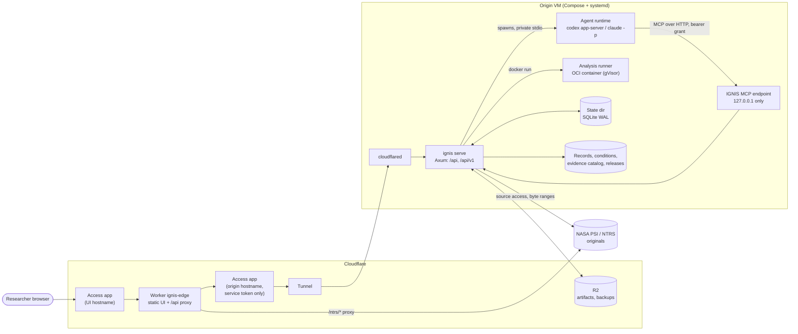
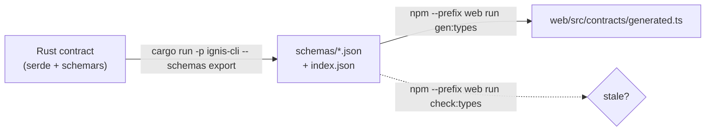
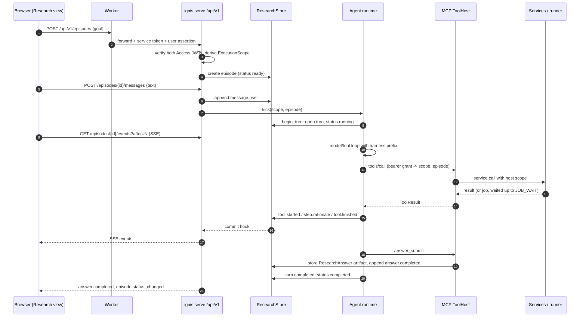
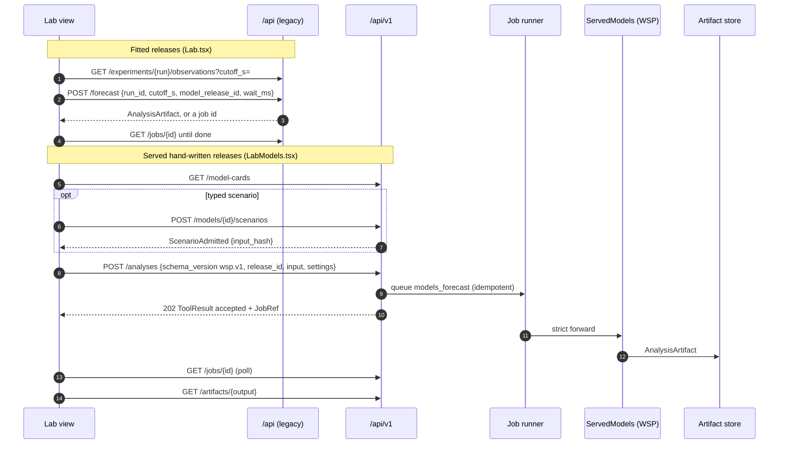
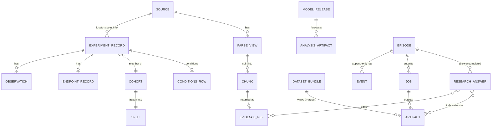
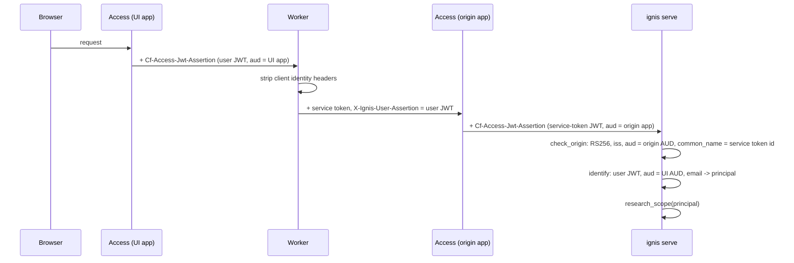

# IGNIS system architecture

| | |
|---|---|
| **Scope** | The deployed research workspace: web app, edge Worker, origin server, research runtime, data, evidence and model services |
| **Audience** | Engineers changing any component; reviewers who need to know where a behaviour lives |
| **Companion docs** | [HARNESS.md](HARNESS.md) (the research agent harness), [GUIDE.md](GUIDE.md) (operator commands), [REPOMAP.md](REPOMAP.md) (repository map), [infra/README.md](../infra/README.md) (deployment runbook), [implementation/ARCHITECTURE.md](implementation/ARCHITECTURE.md) (decision records) |
| **Authority** | Code is the authority for what runs now. This page cites the files it was checked against; where it and the code disagree, the code wins and this page is wrong. |

## 1. Summary

IGNIS is an evidence-linked workspace for NASA microgravity-combustion data (FLEX, ACME, BASS and
the other PSI investigations). A researcher asks a question; an agent runtime (Codex App Server or
Claude Code) works it through IGNIS tools; every number in the answer is bound to a retrieved
passage, a computed artifact or a model release.

Three rules shape the whole system:

1. **One implementation per operation.** Domain logic lives in a library crate behind a service
   trait ([`ignis_core::services`](../crates/ignis-core/src/services.rs)). HTTP routes, MCP tools
   and CLI commands are thin adapters over the same call.
2. **Scope is host-derived.** Every service call receives an `ExecutionScope` that the host built
   from the authenticated caller. No request body, tool argument, prompt or document can name a
   scope, workspace or partition.
3. **Contracts are shared.** Every type that crosses a crate or the wire is defined once in
   [`crates/ignis-core/src/contracts`](../crates/ignis-core/src/contracts/), exported to JSON Schema
   and generated into TypeScript for the web.

## 2. System context



Sources: [infra/worker/src/index.ts](../infra/worker/src/index.ts),
[infra/deploy/compose.yaml](../infra/deploy/compose.yaml),
[crates/ignis-server/src/lib.rs](../crates/ignis-server/src/lib.rs).

## 3. Components

### 3.1 Component map

| Component | Responsibility | Code |
|---|---|---|
| Web app | React + TypeScript + Vite single-page app; hash routes; types generated from `schemas/` | [web/src](../web/src/) |
| Edge Worker `ignis-edge` | Serves the built UI as static assets, forwards `/api/*` to the origin, proxies NTRS downloads | [infra/worker](../infra/worker/) |
| Origin server `ignis serve` | Axum + Tokio host: legacy `/api`, research `/api/v1`, Access verification, job runner, MCP listener | [crates/ignis-server](../crates/ignis-server/) |
| Core contracts | Every cross-lane type, its `validate()` rules, JSON Schema export, service traits | [crates/ignis-core](../crates/ignis-core/) |
| Data | NASA sources and manifests, ingest into records, cohorts, splits, Parquet views, dataset bundles, conditions table | [crates/ignis-data](../crates/ignis-data/) |
| Evidence | Corpus parse views, SQLite FTS5 catalog, search/read/outline, graph, wiki, web discovery, lockbox | [crates/ignis-evidence](../crates/ignis-evidence/) |
| Models | Literal (hand-written) WSP forwards and the served-release `ModelService`; fitted experts and the legacy forecast path | [crates/ignis-wsp](../crates/ignis-wsp/), [crates/ignis-wsp-serve](../crates/ignis-wsp-serve/), [crates/ignis-core/src/analysis.rs](../crates/ignis-core/src/analysis.rs), `ignis-flex/-acme/-bass` |
| Research state | Episodes, event logs, jobs, uploads (SQLite), artifact stores (local / R2), traces, metrics, backups | [crates/ignis-research](../crates/ignis-research/) |
| Agent runtime bridges | Codex App Server and Claude Code adapters, harness bundle, MCP grants | [crates/ignis-research/src/runtime](../crates/ignis-research/src/runtime/) |
| MCP tool host | The tool dispatcher (`ToolHost`) and its MCP transport | [crates/ignis-mcp](../crates/ignis-mcp/) |
| Analysis sandbox | Runs agent-written Python in an isolated container | [crates/ignis-research/src/sandbox.rs](../crates/ignis-research/src/sandbox.rs), [infra/runner](../infra/runner/) |
| Evaluation | Sealed vault, scoring, comparison (models); harness benchmark runner | [crates/ignis-lab](../crates/ignis-lab/), [crates/ignis-server/src/harness_run.rs](../crates/ignis-server/src/harness_run.rs) |
| Sidecars | Offline PDF parse views: PDFium (text layer), Docling (structure, tables, OCR) | [sidecar/pdfium](../sidecar/pdfium/), [sidecar/docling](../sidecar/docling/) |

### 3.2 Web app views

Routes are hash routes, defined in [web/src/shell/router.ts](../web/src/shell/router.ts) and
rendered in [web/src/App.tsx](../web/src/App.tsx).

| Route | View | Reads |
|---|---|---|
| `#/` | [Home](../web/src/views/Home.tsx): the ask box and entry strips | legacy `/api/experiments`; `/api/v1/episodes` |
| `#/research[/<episode>]` | [Research](../web/src/views/Research.tsx): the thread, the trail of steps, the answer | `/api/v1/episodes*`, SSE `/events`, `/artifacts/*` |
| `#/conditions[?tab=habitats\|map]` | [Conditions](../web/src/views/Conditions.tsx): by crew atmosphere, atmosphere map | `POST /api/v1/conditions` |
| `#/runs` | [Runs](../web/src/views/Runs.tsx): one row per run, sortable conditions | legacy `/api/experiments` |
| `#/compare` | [Compare](../web/src/views/Compare.tsx): side-by-side conditions | legacy `/api/compare` |
| `#/lab[/<run>]` | [Lab](../web/src/views/Lab.tsx) and [LabModels](../web/src/views/LabModels.tsx): the forecast lab | legacy `/api/forecast`; `/api/v1/model-cards`, `/models/{id}/scenarios`, `/analyses` |
| `#/sources[?q=]` | [Sources](../web/src/views/Sources.tsx): corpus search with the original beside the hit | `POST /api/v1/search`, `/sources/{id}/*` |
| `#/models` | [Models](../web/src/views/Models.tsx): releases and qualification state | `/api/v1/models` |
| `#/original/<source>` | [Original](../web/src/views/Original.tsx): a NASA original at a locator, in its own tab | `/api/v1/sources/{id}/content` (`SourceAccess`; NTRS bytes through the Worker's `/ntrs/*` proxy) |

The research client has three modes ([web/src/research/client.ts](../web/src/research/client.ts),
[web/src/research/http.ts](../web/src/research/http.ts)): `live` (`/api/v1`), `fixtures`
(`/api/fixtures/v1`, served by `ignis serve --dev`) and an in-browser `mock`.

### 3.3 Edge Worker `ignis-edge`

The Worker owns no research state, jobs or SQLite ([index.ts](../infra/worker/src/index.ts)).

- Static assets come from `web/dist` (`assets.directory` in
  [wrangler.jsonc](../infra/worker/wrangler.jsonc)); `/api/*` and `/ntrs/*` always run the Worker
  first (`run_worker_first`).
- `forward()` refuses a request without `Cf-Access-Jwt-Assertion` (401), strips client-supplied
  identity headers (`x-ignis-user-assertion`, `cf-access-*`, `cookie`, `authorization`), copies the
  user's assertion into `X-Ignis-User-Assertion`, and adds the origin service token
  (`ORIGIN_CLIENT_ID` / `ORIGIN_CLIENT_SECRET`, set with `wrangler secret put`).
- Bodies are passed through as streams, so SSE, artifacts and uploads are not buffered.
- `/ntrs/api/citations/<id>/downloads/<file>` streams one NTRS download same-origin (NTRS sends no
  CORS headers), with `Range` passed through and nothing cached.

### 3.4 Origin server and `/api/v1`

`ignis serve` composes everything in [crates/ignis-server/src/lib.rs](../crates/ignis-server/src/lib.rs).
It nests the legacy API at `/api` ([api.rs](../crates/ignis-server/src/api.rs)) and the research
runtime at `/api/v1` ([v1/mod.rs](../crates/ignis-server/src/v1/mod.rs)). With `--dev`, a second,
separate `/api/v1` instance over the C0 contract fixtures is mounted at `/api/fixtures/v1`, with its
own state directory and MCP grants. When `web/dist/index.html` exists, the same process serves the
UI. `/livez` is a liveness probe with no data and no identity.

Transport limits: the v1 command router has a 30 s timeout and a 1 MiB body limit; the event stream,
upload bytes and dataset view bytes have their own routers without the request timeout. The whole app
has a concurrency limit of 256 and response compression.

The OpenAPI document is generated by `aide` from the handlers and the contracts' `schemars`
derives, served at `GET /api/v1/openapi.json`.

#### `/api/v1` routes

| Area | Routes | Handler file |
|---|---|---|
| Capabilities | `GET /capabilities` | [v1/mod.rs](../crates/ignis-server/src/v1/mod.rs) |
| Episodes | `POST/GET /episodes`, `GET /episodes/{id}`, `POST /episodes/{id}/messages`, `POST /episodes/{id}/{pause\|resume\|cancel}`, `POST /episodes/{id}/approvals/{approval_id}` | [v1/mod.rs](../crates/ignis-server/src/v1/mod.rs) |
| Event stream | `GET /episodes/{id}/events` (SSE; `Last-Event-ID` or `?after=`) | [v1/mod.rs](../crates/ignis-server/src/v1/mod.rs) |
| Artifacts | `GET /artifacts/{id}` (byte range or JSON Pointer), `GET /artifacts/{id}/meta` | [v1/mod.rs](../crates/ignis-server/src/v1/mod.rs) |
| Uploads | `POST /uploads/initiate`, `PUT /uploads/{id}/content`, `POST /uploads/complete` | [v1/mod.rs](../crates/ignis-server/src/v1/mod.rs) |
| Evidence | `POST /search`, `GET /sources/{id}/pages/{page}` | [v1/mod.rs](../crates/ignis-server/src/v1/mod.rs) |
| Source access | `GET /sources/{id}/content`, `/playlist.m3u8`, `/iframes.m3u8`, `/master.m3u8`, `/archive`, `/archive/entry` | [v1/sources/mod.rs](../crates/ignis-server/src/v1/sources/mod.rs) |
| Data | `GET /datasets`, `GET /datasets/{id}`, `GET /datasets/{id}/views/{view}` (streamed Parquet), `GET /runs`, `GET /runs/{id}`, `POST /conditions` | [v1/data.rs](../crates/ignis-server/src/v1/data.rs) |
| Models | `GET /models`, `GET /models/{id}`, `GET /model-cards`, `POST /models/{id}/scenarios` | [v1/mod.rs](../crates/ignis-server/src/v1/mod.rs), [v1/wsp.rs](../crates/ignis-server/src/v1/wsp.rs) |
| Jobs | `POST /analyses` (strict forecast as a job), `GET /jobs/{id}`, `POST /jobs/{id}/cancel` | [v1/mod.rs](../crates/ignis-server/src/v1/mod.rs) |
| Metrics | `GET /episodes/{id}/metrics`, `GET /metrics` | [v1/metrics.rs](../crates/ignis-server/src/v1/metrics.rs) |

Every error is an `ErrorEnvelope`. A service that is not configured answers
`503 capability_unavailable` and is listed as unavailable in `GET /capabilities`, never as an empty
scientific result.

#### Job runner

[v1/runner.rs](../crates/ignis-server/src/v1/runner.rs) is an in-process runner with 3 slots. It
claims queued jobs from the state store with a 30 s lease, heartbeats every 10 s, stores outputs in
the artifact store before marking a job `succeeded`, and on startup settles leases left by a previous
process: idempotent jobs re-queue, effectful ones go to `reconciling`. Job kinds today are
`models_forecast` and `analysis_execute`; interactive kinds are claimed before evaluation and
ingestion work.

### 3.5 Core contracts

[crates/ignis-core/src/contracts.rs](../crates/ignis-core/src/contracts.rs) holds the scientific
records (Source, ExperimentRecord, Observation, Split, ModelRelease, AnalysisArtifact, ...). The
family files under [contracts/](../crates/ignis-core/src/contracts/) hold the C0/K1 families:

| File | Family |
|---|---|
| [common.rs](../crates/ignis-core/src/contracts/common.rs) | ids, `Digest`, `ErrorEnvelope`, `ExecutionScope`, `ArtifactRef`, `InlinePayload` |
| [dataset.rs](../crates/ignis-core/src/contracts/dataset.rs) | `DatasetBundle`, `ConditionsQuery`, `ConditionsTable`, envelopes |
| [evidence.rs](../crates/ignis-core/src/contracts/evidence.rs) | `SearchRequest/Page`, `ReadRequest/Result`, outline, graph, wiki, web |
| [research.rs](../crates/ignis-core/src/contracts/research.rs) | episodes, events, jobs, `ToolResult`, `tool_catalog()`, answers, traces, metrics, capabilities |
| [wsp.rs](../crates/ignis-core/src/contracts/wsp.rs) | `ForecastRequest`, scenarios, model cards, literal-weight specs |
| [evaluation.rs](../crates/ignis-core/src/contracts/evaluation.rs) | evaluation requests/results, gold tasks |

Schemas flow one way:



The exported type list is `schema::all()` in [schema.rs](../crates/ignis-core/src/schema.rs); the
generator is [web/scripts/gen-types.mjs](../web/scripts/gen-types.mjs).

### 3.6 Data: ingest, records, conditions

[crates/ignis-data](../crates/ignis-data/) turns NASA PSI files into typed records.

- **Sources.** Every fetched file gets a `Source` record (sha256, version, rights) in
  `data/manifests/<inv>.jsonl`; listings and investigation metadata sit beside it
  ([sources/](../crates/ignis-data/src/sources/)). Bytes are never modified.
- **Records.** `ignis data ingest` writes per-family records (experiments, observations, endpoints)
  under `data/work/records/<family>/` ([families/](../crates/ignis-data/src/families/)).
- **Cohorts, splits, views.** Declared criteria give a content-addressed cohort; splits are grouped,
  frozen and committed in `data/splits/`; views are Parquet ([cohort.rs](../crates/ignis-data/src/cohort.rs),
  [views.rs](../crates/ignis-data/src/views.rs)).
- **Dataset bundles.** [dataset.rs](../crates/ignis-data/src/dataset.rs) builds `DatasetBundle`s
  (views `runs`, `conditions`, `endpoints`, `obs_<quantity>`) and `DatasetStore`, the one
  `DatasetService`. Builder bundles never contain `test`; the evaluator bundle is written under the
  lockbox root and opened only for an evaluation scope.
- **Conditions table.** [conditions.rs](../crates/ignis-data/src/conditions.rs) builds the
  `ConditionsTable` of the 19 flight investigations from NASA's experimental tables into
  `data/work/conditions/conditions_table.json`. Each cell keeps raw value, raw unit, SI value, status
  (`value`, `conflicting`, `missing`, `not_applicable`) and locator. Outcome columns are never read.

### 3.7 Evidence: corpus, search, catalog

[crates/ignis-evidence](../crates/ignis-evidence/) owns the knowledge side; `EvidenceService` in
[service.rs](../crates/ignis-evidence/src/service.rs) is the one `KnowledgeService`.

- **Catalog.** SQLite with FTS5 at `artifacts/evidence/evidence.sqlite`, DDL in
  [schemas/evidence_catalog.sql](../schemas/evidence_catalog.sql), opened read-only by the server
  ([catalog.rs](../crates/ignis-evidence/src/catalog.rs)). A publication can hold several parse views;
  search covers the active one.
- **Parse views.** MuPDF (behind the `pdf` cargo feature), PDFium and Docling views, imported with
  `ignis evidence import-view`. A PDFium view never displaces a Docling view.
- **Search.** Lexical BM25 with SIRA expansion ([sira.rs](../crates/ignis-evidence/src/sira.rs));
  dense retrieval and reranking run only where deployed and are otherwise reported `not_requested`.
  Each backend is reported `used`, `unavailable` (degraded) or `not_requested`.
- **Graph, wiki, web.** [graph.rs](../crates/ignis-evidence/src/graph.rs) (typed links between runs,
  sources, investigations, hardware, fuels, conditions), [wiki.rs](../crates/ignis-evidence/src/wiki.rs)
  (workspace notes with compare-and-swap revisions), [web/](../crates/ignis-evidence/src/web/)
  (opt-in web search and fetch, `IGNIS_ENABLE_WEB=1`).
- **Firewall.** `ignis evidence firewall` proves from the cargo graph that the fitting crates do not
  depend on this crate ([firewall.rs](../crates/ignis-evidence/src/firewall.rs)).

### 3.8 Models and forecasting

Two forecast paths exist, both strict (no fitting at request time):

| Path | Releases | Entry | Implementation |
|---|---|---|---|
| Served hand-written releases (WSP) | `configs/models/served/served.json` + content-addressed `models/<hex>/` | `POST /api/v1/analyses`, MCP `models_forecast` | [ignis-wsp-serve](../crates/ignis-wsp-serve/src/lib.rs) over [ignis-wsp](../crates/ignis-wsp/) |
| Fitted experts (legacy) | `artifacts/models/<hex>/` | `POST /api/forecast`, `ignis infer forecast` | [ignis_core::analysis](../crates/ignis-core/src/analysis.rs) with the injected `Expert`s |

`ServedModels::open` fails closed: every listed release must pass the registry checks, carry the id
that is the content hash of its record, and name a forward compiled into `ignis-wsp` whose
`forward_hash` matches its manifest. Model families are off unless the server runs with
`--enable-models` / `IGNIS_ENABLE_MODELS` ([lib.rs](../crates/ignis-server/src/lib.rs)); then the
model tools are not registered and `/capabilities` says why.

### 3.9 Research episodes, event log, SSE

[crates/ignis-research/src/store.rs](../crates/ignis-research/src/store.rs) is a SQLite store in
WAL mode with one writer connection.

- An **episode** is one investigation (`ResearchEpisode`): goal, status, runtime thread mapping, pins
  (corpus snapshot, model releases, harness).
- Its **event log** is append-only; `seq` is allocated inside the append transaction, so a committed
  log is gap-free. Listeners are notified after commit; the database is the replay authority.
- **SSE.** `GET /episodes/{id}/events` replays from `max(?after, Last-Event-ID)`, sends each event as
  `id: <seq>`, `event: <kind>`, `data: <ResearchEvent JSON>`, then waits on a commit notification
  (polling every 5 s anyway). A cursor below a compacted floor answers `410 Gone`. Reconnecting never
  re-executes tools. The web parser is [web/src/research/sse.ts](../web/src/research/sse.ts); it
  uses `fetch`, not `EventSource`, to see HTTP status and resume with `?after=`.
- **Jobs** are durable rows with lease, fencing token and heartbeat; an expired lease re-queues an
  idempotent job and moves any other to `reconciling`.

Event kinds and the status machine are described in [HARNESS.md](HARNESS.md#2-how-an-episode-runs).

### 3.10 MCP tool host

[crates/ignis-mcp](../crates/ignis-mcp/) has one synchronous dispatcher, `ToolHost`
([tools.rs](../crates/ignis-mcp/src/tools.rs)), over the injected services. The MCP transport
([http.rs](../crates/ignis-mcp/src/http.rs), `rmcp` streamable HTTP) is mounted on a loopback-only
listener (`--mcp-port` / `IGNIS_MCP_PORT`, `127.0.0.1`, default `0` = free port) at
`/<instance>/mcp`, and is never routed through the public API or the tunnel. The full tool catalog
is in [HARNESS.md](HARNESS.md#3-tool-catalog).

### 3.11 Agent runtimes

[crates/ignis-research/src/runtime](../crates/ignis-research/src/runtime/) maps an external agent
loop onto IGNIS episodes; IGNIS does not run its own agent loop.

| | Codex App Server | Claude Code |
|---|---|---|
| Selection | `--agent-runtime codex` (default) | `--agent-runtime claude` (`IGNIS_AGENT_RUNTIME`) |
| Process | One pinned `codex app-server` per workspace, private stdio JSON-RPC | One `claude -p` per turn, `--output-format stream-json` |
| Thread | One Codex thread per episode | A session id IGNIS chooses, then `--resume` |
| Harness injection | `developerInstructions` on `thread/start` / `thread/resume` | `--append-system-prompt-file` |
| Built-in tools | Public profile: no shell | `--tools ""`, `--permission-mode dontAsk` |
| Code | [bridge.rs](../crates/ignis-research/src/runtime/bridge.rs), [preflight.rs](../crates/ignis-research/src/runtime/preflight.rs) | [claude.rs](../crates/ignis-research/src/runtime/claude.rs) |

Configuration flags and credentials are in [v1/agent.rs](../crates/ignis-server/src/v1/agent.rs). A
missing binary or credential is reported in `/capabilities`; the server still starts and records
messages.

### 3.12 Analysis sandbox

`analysis_execute` runs a Python program once in a fresh OCI container
([sandbox.rs](../crates/ignis-research/src/sandbox.rs)):

- `--network none`, read-only root, `/tmp` in memory, uid/gid 65534, all capabilities dropped,
  `no-new-privileges`, budgets on memory, CPU, pids, wall time and file size;
- exactly three bind mounts: `/job` (program and `inputs.json`, read-only), `/in` (inputs resolved by
  reference under the caller's scope, read-only), `/out`;
- the image is pinned by image id; with `runsc` the program runs under gVisor, which the public
  deployment requires.

`Sandbox::preflight` runs a probe through the same path and refuses the sandbox unless the probe
observes the isolation. A sandbox that fails preflight is absent: the tool is not registered. Budget
defaults (from [v1/sandbox.rs](../crates/ignis-server/src/v1/sandbox.rs)): 600 s wall, 2048 MiB
memory, 2000 CPU millis, 256 pids, 256 MiB tmp, 1024 MiB output, 16 MiB per stream.

### 3.13 Sidecars

| Sidecar | Output | When it runs |
|---|---|---|
| [pdfium](../sidecar/pdfium/README.md) | `ignis.pdfium_view.v1`: text layer with paragraph and line boxes, no OCR | Offline batch; imported with `ignis evidence import-view` |
| [docling](../sidecar/docling/README.md) | `ignis.docling_view.v1`: structure, tables, figures, OCR | Offline batch, never on the request path; becomes the active view |
| [sam2](../sidecar/sam2/README.md) | Causal contour masks for BASS video | Driven over stdin/stdout by `ignis-vision` |

Parser comparison: [benchmarks/parsers/README.md](../benchmarks/parsers/README.md).

### 3.14 State store, artifacts and backups

| Store | Backend | Code |
|---|---|---|
| Research state (episodes, events, jobs, uploads, idempotency keys) | SQLite WAL in the state directory (`--state-dir`, default `runs/server`) | [store.rs](../crates/ignis-research/src/store.rs) |
| Artifacts | Local content-addressed store, or Cloudflare R2 (`IGNIS_ARTIFACT_BACKEND=r2` in the deployment) with the same layout | [artifacts.rs](../crates/ignis-research/src/artifacts.rs), [r2.rs](../crates/ignis-research/src/r2.rs) |
| Backups | Snapshot directory with a manifest; SQLite captured with `VACUUM INTO`; pushed to R2 | [backup.rs](../crates/ignis-research/src/backup.rs), [infra/scripts/backup.sh](../infra/scripts/backup.sh) |

Artifact publication is atomic: bytes stream to staging while hashed, are renamed (or uploaded) to
their content address, and only then is the manifest published. A returned `ArtifactRef` never points
at incomplete bytes. Snapshots leave out WAL side files, staging and credentials; restore refuses a
non-empty target, verifies hashes and runs `PRAGMA integrity_check`. R2 artifacts are not in the
snapshot: they are immutable in the bucket.

## 4. Request flows

### 4.1 Asking a research question



Key points, all verified in code:

- The episode is created first, then the question is posted as a message
  ([web/src/research/http.ts](../web/src/research/http.ts)); posting a message calls
  `AgentRuntime::kick` ([v1/mod.rs](../crates/ignis-server/src/v1/mod.rs)).
- `begin_turn` opens at most one turn per episode and moves it to `running` in one transaction
  ([store.rs](../crates/ignis-research/src/store.rs)). Messages that arrive during a turn go to the
  next one; messages already handed to a turn are never re-sent.
- The MCP grant, not the model, decides the scope and the episode a call serves
  ([grants.rs](../crates/ignis-research/src/runtime/grants.rs)).
- `answer_submit` resolves every citation against evidence this episode's retrieval tools returned
  ([answer.rs](../crates/ignis-mcp/src/answer.rs)). Details: [HARNESS.md §4](HARNESS.md#4-answer_submit-claims-and-answer-status).

### 4.2 A forecast in the Forecast lab

The lab has two panels that use different paths.



- A stored-run input is `{"kind": "stored_run", "run_id", "cutoff_s"}`; a typed scenario is first
  admitted as a synthetic prefix and then referenced by `{"kind": "prefix", "input_hash"}`
  ([LabModels.tsx](../web/src/views/LabModels.tsx), [ignis-wsp-serve](../crates/ignis-wsp-serve/src/lib.rs)).
- `POST /analyses` requires `RunModels` and `ReadData` and calls the same `ToolHost::submit_forecast`
  the `models_forecast` tool uses ([v1/mod.rs](../crates/ignis-server/src/v1/mod.rs)).
- A scientific refusal (input outside the release's domain, phase not established at the cutoff) is a
  stored artifact with its reason, not an HTTP error.
- The legacy panel also offers acquisition, seal and reveal (`/api/acquisition`, `/api/seal`,
  `/api/reveal`); on the registry origin `/seal` and `/reveal` answer `internal_route_disabled`
  unless the server runs with `--internal-routes` ([api.rs](../crates/ignis-server/src/api.rs)).

### 4.3 The Conditions page

```mermaid
sequenceDiagram
    autonumber
    participant C as Conditions page (MapView / ByAtmosphere)
    participant V as POST /api/v1/conditions
    participant D as DatasetStore
    participant T as conditions_table.json

    C->>C: show the reduced view kept in this browser, if any
    loop until next_cursor is empty
        C->>V: ConditionsQuery {keys: O2, pressure, fuel#59; include_unknown#59; page_size#59; cursor}
        V->>D: conditions_snapshot (before)
        V->>D: conditions(scope, query)
        D->>T: cached table
        D->>D: withhold runs of partitions the scope lacks
        V->>D: conditions_snapshot (after)
        V-->>C: ConditionsTable page, x-ignis-snapshot header
    end
    C->>C: reduce rows to test points; rank investigations against crew atmospheres
```

- The page reads every row with paging ([MapView.tsx](../web/src/views/MapView.tsx),
  `useConditionsView`) and keeps the reduced view in the browser for the next visit.
- The server reads the snapshot before and after the query; a change in between is a `409`, never a
  mixed answer ([v1/data.rs](../crates/ignis-server/src/v1/data.rs)).
- Rows of runs in a frozen-split partition the scope does not grant are withheld; envelopes of an
  investigation with withheld rows are recomputed from its visible rows
  ([dataset.rs](../crates/ignis-data/src/dataset.rs), [conditions.rs](../crates/ignis-data/src/conditions.rs)).
- The crew atmospheres (Moon base and rovers, spacesuit, ISS and Earth) and the "reaches" tolerance
  are defined client-side in [web/src/research/habitats.ts](../web/src/research/habitats.ts).

## 5. Data model



| Entity | Contract | Where it lives | Identity |
|---|---|---|---|
| Source record | `Source` ([contracts.rs](../crates/ignis-core/src/contracts.rs)) | `data/manifests/<inv>.jsonl` (+ `.listing.jsonl`, `.investigation.json`) | sha256 of the file bytes |
| Experiment, observation, endpoint records | `ExperimentRecord`, `Observation`, `EndpointRecord` | `data/work/records/<family>/` | run id (e.g. `PSI-69:053F001:2010-05-05`) |
| Cohort, split | `Cohort`, `Split` | `data/work/cohorts/`, `data/splits/<family>-<hex16>.json` | `sha256:` of criteria + members; split content hash |
| Dataset bundle | `DatasetBundle` ([dataset.rs](../crates/ignis-core/src/contracts/dataset.rs)) | built by `DatasetStore`; committed copy under `data/datasets/` | `content_digest` |
| Conditions table | `ConditionsTable` | `data/work/conditions/conditions_table.json` | `conditions_snapshot` digest (table + split files) |
| Evidence catalog | `SearchPage`, `EvidenceRef` ([evidence.rs](../crates/ignis-core/src/contracts/evidence.rs)) | `artifacts/evidence/evidence.sqlite` | evidence id; corpus snapshot id |
| Model release | `ModelRelease` | `configs/models/served/models/<hex>/` (WSP), `artifacts/models/<hex>/` (fitted) | content hash; immutable |
| Artifact | `ArtifactRef` ([common.rs](../crates/ignis-core/src/contracts/common.rs)) | local `objects/` + `manifests/`, or R2 | id from bytes + declared metadata |
| Episode, event | `ResearchEpisode`, `ResearchEvent` ([research.rs](../crates/ignis-core/src/contracts/research.rs)) | `episodes`, `events` tables of the state store | episode id; `(episode_id, seq)` |
| Job | `JobRef` | `jobs` table | job id; idempotent on `client_request_id` |
| Answer | `ResearchAnswer` | artifact referenced by `answer.completed` | answer id |

Value rules apply everywhere: an original value keeps raw value, raw unit, SI value and locator;
missing, conflicting and not-applicable are explicit statuses, never zero; experimental times are
seconds since an explicit `time_origin`.

## 6. Security model

### 6.1 Identity at the origin



[crates/ignis-server/src/v1/access.rs](../crates/ignis-server/src/v1/access.rs) implements
`--auth cloudflare-access`:

- Two Cloudflare-signed RS256 JWTs are verified against the team's keys from
  `<team>/cdn-cgi/access/certs`: the origin assertion (`aud` = origin AUD tag, `common_name` = the
  Worker's service-token client id) and the user assertion (`aud` = UI AUD tag, `email`). The
  issuer, `aud`, `exp` and `nbf` are checked with 30 s leeway; the two AUD tags must differ.
- No header is trusted on its own; the unsigned `Cf-Access-Authenticated-User-Email` is ignored.
- Keys are refetched on an unknown `kid` or when older than one hour, at most once per 30 s, and a
  refetch replaces the whole set.
- Every route behind Access (legacy `/api/*` and static files) needs the origin assertion
  (`require_origin` in [lib.rs](../crates/ignis-server/src/lib.rs)); `/api/v1` routes also verify the
  user's. A missing verifier configuration refuses every request.
- Local mode (`--auth local`) makes every request the principal `local`.

### 6.2 Scope

`research_scope` ([v1/io.rs](../crates/ignis-server/src/v1/io.rs)) maps a principal to its own
workspace (`ws_<sha256 prefix>`), role `research`, partition `train` only, and the capabilities
`ReadSources`, `ReadData`, `RunModels`, `WorkspaceWrite`, plus `ExecuteCode` only when the isolated
runner passed preflight. `ExecutionScope::validate` ([common.rs](../crates/ignis-core/src/contracts/common.rs))
refuses a non-evaluation scope that grants `test`, and `require_partition` refuses ungranted
partitions. Child scopes can only narrow. Records of another workspace are reported as not found.

### 6.3 Lockbox and test-partition withholding

| Layer | Rule | Code |
|---|---|---|
| Evidence | Outcome-bearing passages attributed to a run of an ungranted partition, or unattributed passages of a publication covering such runs, are withheld; the scope filter runs before any reranker | `Lockbox` in [service.rs](../crates/ignis-evidence/src/service.rs) |
| Conditions | Rows of runs in ungranted partitions are withheld; envelopes recomputed from visible rows | [dataset.rs](../crates/ignis-data/src/dataset.rs), [conditions.rs](../crates/ignis-data/src/conditions.rs) |
| Datasets | Builder bundles never hold `test`; the evaluator bundle opens only for an evaluation scope | [dataset.rs](../crates/ignis-data/src/dataset.rs) |
| Models | A test-partition run is refused (`scope_denied`) | `models_forecast` contract, [ignis-wsp-serve](../crates/ignis-wsp-serve/src/lib.rs) |
| Answers | A `background` claim naming a validation or test run is refused | [answer.rs](../crates/ignis-mcp/src/answer.rs) |
| Evaluation vault | Reveals need a seal; test needs `--final-test`; every attempt is logged | [ignis-lab/src/eval/vault.rs](../crates/ignis-lab/src/eval/vault.rs) |

The evidence service refuses to start without frozen splits, because an empty lockbox would seal
nothing (`open_default`).

### 6.4 Runtime and tool isolation

- The MCP endpoint is bound to `127.0.0.1` and rejects non-loopback `Host` headers. Each runtime
  process gets a host-issued bearer token (`IGNIS_MCP_TOKEN`); only its sha256 is kept. Codex adds a
  per-thread episode grant header (`x-ignis-episode-grant`), accepted only next to a live process
  token of the same scope ([grants.rs](../crates/ignis-research/src/runtime/grants.rs),
  [http.rs](../crates/ignis-mcp/src/http.rs)).
- The runtimes run without a shell or file tools; the Claude child gets a cleared environment.
- Agent-written code runs only in the sandbox (section 3.12); there is no host-process fallback.
- The origin container runs read-only with all capabilities dropped and `no-new-privileges`; it holds
  the Docker socket only to start runner containers, which never see it
  ([compose.yaml](../infra/deploy/compose.yaml)).

## 7. Deployment

| Piece | Where |
|---|---|
| UI + Worker | Cloudflare Workers Static Assets, `ignis-edge` ([wrangler.jsonc](../infra/worker/wrangler.jsonc), `wrangler.staging.jsonc`) |
| Origin | Google Compute Engine VM; Compose services `ignis` and `cloudflared`, supervised by systemd ([infra/deploy](../infra/deploy/)) |
| Persistent paths | `/srv/ignis/{state,runner,backups,login,data,artifacts}` |
| Timers | `ignis-backup.timer`, `ignis-autodeploy.timer` ([infra/deploy/systemd](../infra/deploy/systemd/)) |

The runbook and live status are in [infra/README.md](../infra/README.md).

## 8. Verification notes

Everything above was read from the files linked in each section on 2026-11-15. Not verified by
running: the deployed topology (checked against config files only) and the Worker behaviour (checked
against [index.ts](../infra/worker/src/index.ts), not its tests).
