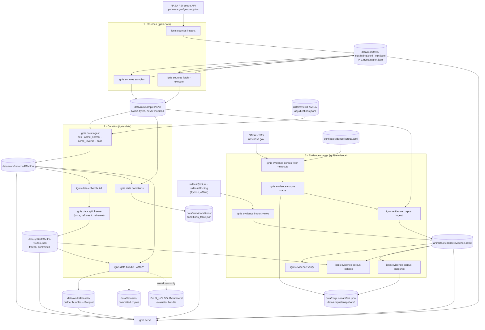

# Data pipeline

| | |
|---|---|
| **Scope** | From the NASA Physical Sciences Informatics (PSI) listings to every file `ignis serve` reads |
| **Audience** | Engineers who build, rebuild or change the data the server serves |
| **Source of truth** | The code paths cited in each step. Where this page and the code disagree, the code wins |
| **Related** | [REPRODUCIBILITY.md](REPRODUCIBILITY.md) · [CONFIGURATION.md](CONFIGURATION.md) · [REPOMAP.md](REPOMAP.md) · [GUIDE.md](GUIDE.md) · [infra/README.md](../infra/README.md) |

## 1. Overview

The pipeline is a sequence of `ignis` commands. Each one reads committed inputs or the output of an
earlier step and writes files under one of four roots. There is no database server and no hidden
state: if you delete the gitignored directories and run the steps again, you get the same files.
Section 6 lists the exceptions.

| Root | Variable | Default | Committed? |
|---|---|---|---|
| Data | `IGNIS_DATA` | `data` | partly: `manifests/`, `splits/`, `review/`, `corpus/`, `datasets/` are committed; `raw/`, `work/`, `cache/`, `media/` are gitignored |
| Artifacts | `IGNIS_ARTIFACTS` | `artifacts` | no (gitignored) |
| Runs | `IGNIS_RUNS` | `runs` | no (gitignored) |
| Lockbox | `IGNIS_HOLDOUT` | `holdout` | no (gitignored); read only by evaluation scopes |

The paths are defined in `crates/ignis-data/src/paths.rs` (data root), `crates/ignis-evidence/src/catalog.rs`
(`<IGNIS_ARTIFACTS>/evidence/`), `crates/ignis-core/src/resources.rs` (runs, configs) and
`crates/ignis-data/src/dataset.rs` (`DatasetStore::default_roots`). Every relative path is resolved
against the current directory, so run every command from the repository root.

**Dry run by default.** Commands that download in bulk or spend money print a plan and stop unless
you pass `--execute`. This applies to `sources fetch`, `evidence corpus fetch`, `evidence embed` and
the model passes (`data review auto`, `evidence llm-pass`). `sources fetch` and `evidence embed` go
through the resource guard (`ignis_core::resources::guard`, profiles in `configs/resources/`), and
`sources fetch` records each executed job in `runs/jobs/`. `sources inspect` and `sources samples`
use the network without `--execute`; they are read-only and bounded.

## 2. Flow



The order that `infra/scripts/build-data.sh` runs on the server is section 5. A local build uses the
same commands in the same order.

## 3. Steps

Every step has the same layout: **Command**, **Inputs**, **Outputs**, **Idempotency**, **Code**.

### 3.1 Sources: listings and manifests

The four modelled investigations are PSI-69 (FLEX), PSI-159 (ACME CFI-G), PSI-25 (BASS-II) and
PSI-26 (BASS). This list is `INVESTIGATIONS` in `crates/ignis-data/src/sources/mod.rs`. A command
that takes investigations and gets none uses these four.

#### `ignis sources inspect [INV...]`

| | |
|---|---|
| Command | `ignis sources inspect PSI-69 PSI-159 PSI-25 PSI-26` |
| Inputs | PSI metadata and file-listing endpoints (network, read-only) |
| Outputs | `data/manifests/<INV>.investigation.json` (title, DOI, licence, `investigation_version`, `metadata_url_sha256`, `retrieved_at`); `data/manifests/<INV>.listing.jsonl` (one row per remote file: `category`, `file_name`, `file_version`, `size_bytes`, `restricted`, `stable_url`, `updated`; no bytes); raw responses in `data/raw/samples/_meta/<INV>.json` and `files_<INV>.json` |
| Idempotency | Overwrites the listing and investigation files each run. If NASA has not changed anything, only `retrieved_at` changes. If NASA published a new version, the diff shows it (section 6) |
| Code | `inspect_one` in `crates/ignis-data/src/cli.rs`; client in `crates/ignis-data/src/sources/psi.rs`; manifest writers in `sources/manifest.rs` |

#### `ignis sources samples [INV...]`

| | |
|---|---|
| Command | `ignis sources samples` |
| Inputs | The listing: the raw response saved by `inspect` when present, otherwise the committed `data/manifests/<INV>.listing.jsonl`. A fresh checkout can therefore fetch without calling the metadata endpoint |
| Outputs | Bytes in `data/raw/samples/<INV>/<file_name>`; one `Source` record per file in `data/manifests/<INV>.jsonl` (`id = sha256:<hex of the bytes>`, `file_version`, `investigation_version`, `size_bytes`, `canonical_url`, `rights`, `retrieved_at`) |
| Selection | Deterministic per investigation (`crates/ignis-data/src/sources/samples.rs`). A file over `MAX_FILE_BYTES` (12,000,000) or marked restricted is skipped and reported. PSI-69 runs in two stages: stage 1 fetches the test sheets, then stage 2 picks the first two methanol runs of every sixth test date, up to 14 runs (`flex_stage2` in `cli.rs`) |
| Idempotency | A file is not downloaded again when it exists locally and its manifest record has the listing's `file_version`. The manifest is merged, not replaced |
| Code | `SourcesCmd::Samples` and `fetch_all` in `crates/ignis-data/src/cli.rs` |

#### `ignis sources fetch <INV> [--pattern RE] [--category C] [--stored] --execute`

| | |
|---|---|
| Command | e.g. `ignis sources fetch PSI-10 --pattern '_Experimental table_' --execute` |
| Inputs | The listing as above. `--stored` selects the files the server stores under the atlas rule (documents and sensor text; media and archives stay at NASA; `crates/ignis-data/src/sources/storage.rs`) |
| Outputs | As for `samples`. Without `--execute` it only prints the plan: file count, bytes and an estimated time from `--mb-per-s` and the `--profile` in `configs/resources/` |
| Idempotency | Same skip rule as `samples`. The manifest is checkpointed every 100 files, so an interrupted bulk fetch keeps what it already hashed |
| Errata | NASA's listing states the wrong size for a few files. `data/manifests/listing_errata.jsonl` records the size NASA actually serves and the sha256 the bytes must have. A fetch that does not match the erratum fails |
| Code | `SourcesCmd::Fetch` in `cli.rs`; `crates/ignis-data/src/sources/adopt.rs` (errata, stored set) |

Related source commands:

- `ignis sources manifest <INV> --verify` re-hashes local bytes against `data/manifests/<INV>.jsonl` and exits non-zero on a missing or mismatched file.
- `ignis sources adopt <INV|all> --execute` records files that are already on disk but missing from the manifest (for example a teammate's upload). The size must equal NASA's listing, the bytes are hashed and nothing is downloaded. The `retrieved_at` of an adopted file is its local mtime.
- `ignis sources coverage [--out F]` reports, for each of the 19 flight investigations, how many files are stored, recorded and missing, plus a `manifest_hash`. The committed `data/manifests/coverage.json` has this shape.
- `ignis sources intl ...` and `ignis sources ntrs ...` write international and NTRS manifests (`data/manifests/intl/`, `data/manifests/ntrs/`). International sources are never mixed into NASA cohorts.
- `ignis sources media keyframes|zipdir|entry` builds the byte-range media indexes (R11) under `<IGNIS_DATA>/media/`. These are dry runs without `--execute`.

### 3.2 Raw and samples layout

```text
data/raw/samples/<INV>/<file_name>     NASA bytes exactly as served; never modified
data/raw/samples/_meta/                metadata and listing responses from `sources inspect`
data/raw/intl/<id>/                    international probe files
data/raw/evidence/ntrs/NTRS-<id>.pdf   corpus PDFs from NTRS (+ NTRS-<id>.json citation record)
```

A raw file is identified by the sha256 in its manifest record. `data/raw/` is gitignored and can
always be fetched again from NASA. The bytes themselves can change, though (section 6).

### 3.3 Records: `ignis data ingest [FAMILY|all]`

| | |
|---|---|
| Command | `ignis data ingest` (all four families) or `ignis data ingest flex` |
| Families | `flex`, `acme_normal`, `acme_inverse`, `bass` (`NAMES` in `crates/ignis-data/src/families/mod.rs`) |
| Inputs | `data/raw/samples/<INV>/` and the committed adjudications `data/review/<family>/adjudications.jsonl` |
| Outputs | `data/work/records/<family>/`: `experiments.jsonl`, `sessions.jsonl`, `specimens.jsonl`, `observations.jsonl`, `endpoints.jsonl`, `exclusions.jsonl`, `review.jsonl`, `post.jsonl` (one contract record per line; the server's registry loader uses the same file names, `crates/ignis-data/src/store.rs`). Prints record counts, identity-resolution counts and `adjudications_applied` |
| Idempotency | Each family's files are rewritten from scratch on every run. The same raw bytes and adjudications produce the same records |
| Code | `ingest_family` in `cli.rs`; parsers in `crates/ignis-data/src/families/{flex,acme,bass}.rs`; `review::apply` |

What each family reads:

| Family | Investigation | Main inputs (see the module docs for the exact structure) |
|---|---|---|
| `flex` | PSI-69 | `PSI-69_Experimental table_FLEX.csv`, per-run `_TestSheet.txt`, `_DropletData.txt`, `_ColorCamData.txt`, `_LLUVData.txt`, MDCA test-point settings. A file group is bound to a table row by CIR id + test date (+ GMT) |
| `acme_normal` | PSI-159 | `PSI-159_Experimental table_CFI-G_Normal Flames.csv` (+ per-test logs for timing) |
| `acme_inverse` | PSI-159 | `..._Inverse Flames.csv`. Kept as a separate family from `acme_normal` |
| `bass` | PSI-25, PSI-26 | `Experimental table_BASS-II.csv`, `Experimental table_BASS.csv`, the `As Run_Test Matrix.xlsx` sheets, and the video-to-run-to-specimen mapping. Video decoding is in `ignis-vision`, not here |

Review loop: `ignis data review export <family>` writes `data/review/<family>/items.jsonl` from the
last ingest. Adjudications go into `adjudications.jsonl`, by hand (`review import`) or through
`review auto` (calls `claude -p`; dry run unless `--execute`). The next `ingest` applies them.
Adjudications are committed human or model input and are never regenerated.

### 3.4 Cohorts, frozen splits and the protected test partition

| | |
|---|---|
| Command | `ignis data cohort build <family>`, then once per cohort `ignis data split freeze <cohort-id> --seed <int>` |
| Inputs | `data/work/records/<family>/`, the family's declared criteria (`FamilySpec.criteria`) |
| Outputs | `data/work/cohorts/<hex>.json` (gitignored); `data/splits/<family>-<hex16>.json` (committed; holds `split`, `cohort` and `content_hash`) |
| Idempotency | The cohort id is a content hash of the criteria and the members, so the same records give the same id. `split freeze` refuses to refreeze an existing id. The group shuffle is a bit-exact port of NumPy's `default_rng(seed).permutation` (`crates/ignis-data/src/npyrng.rs`), so splits frozen before the Rust port keep their ids |
| Code | `crates/ignis-data/src/cohort.rs` |

Committed frozen splits (all with seed `20261107`):

| File | Groups train / validation / test |
|---|---|
| `flex-660b7d9ede629b30.json` | 27 / 9 / 9 |
| `flex-c43bbe3580ffce2a.json` | 22 / 7 / 7 |
| `acme_normal-c77bc5baee98d3e3.json` | 7 / 2 / 2 |
| `acme_inverse-747032c921c8c8f2.json` | 7 / 2 / 3 |
| `bass-4083156d5b18dab4.json` | 2 / 1 / 1 |

Splits are frozen. A split is never rebuilt; it is only replaced by a documented new split.

**The protected test partition.** The `test` groups of a frozen split are outcome data that no
builder may see:

- Builder bundles (section 3.6) hold only the partitions they name and never `test`.
- The evaluator bundle, the only one with test outcomes, is written under the lockbox root
  `IGNIS_HOLDOUT/datasets/` (default `holdout/datasets/`), and `DatasetStore` opens it only for an
  evaluation scope (`ExecutionScope::require_partition`).
- The evidence service withholds outcome-bearing passages that the scope's partitions do not grant
  (`service::Lockbox`; section 3.7).
- The rules for the sealed evaluation path (`holdout/`, `--final-test`, `reveal_log.jsonl`) are in
  [AGENTS.md](../AGENTS.md#non-negotiable-rules) and [GUIDE.md §6](GUIDE.md#6-sealed-evaluation).

`ignis data views <cohort-id>` writes the Parquet array views the fitting code reads
(`data/work/views/<cohort-hex>/`; SI scaling only, no statistical normalization). Views are rebuilt
automatically when they are stale. The server does not read them directly.

### 3.5 Conditions table: `ignis data conditions`

| | |
|---|---|
| Command | `ignis data conditions` |
| Inputs | The records of the four families (`data/work/records/*/experiments.jsonl`) and the NASA experimental tables of 15 more flight investigations, read through declarative specs (`SPECS`, 16 tables: PSI-10 has two) |
| Prerequisite | Every table in `SPECS` must be in `data/raw/samples/<INV>/`. A missing one stops the command and names the file. Fetch them with `ignis sources fetch <INV> --pattern '_Experimental table_' --execute` for PSI-10, -20, -21, -22, -23, -39, -47, -68, -98, -99, -100, -101, -102, -106, -107 (about 1 MB in all) |
| Outputs | `data/work/conditions/conditions_table.json`, a `ConditionsTable` (schema `dataset.v2`) with one row per run and the **investigation envelopes** (the tested range of each condition key per investigation). Prints rows, investigations and value counts per investigation and key |
| Rules | A value keeps its raw value, raw unit, SI value and cell locator. A list or range in one cell (for example "21; 26.5; 40") does not say which run used which value, so the run-level cell is `missing` with the quoted text, and the envelope takes the values. Approximate cells keep the flag `approximate`. A key the table does not state is `missing` with a reason, never zero. Outcome columns (extinction diameter, burn time, spread rate) are never read, so the table carries no held-out outcome |
| Idempotency | Rewritten whole on each run; deterministic for the same inputs |
| Code | `crates/ignis-data/src/conditions.rs` (`build`, `SPECS`, `table_path`) |

The server offers `conditions_query` only when this file exists **and** the dataset service is
configured (`research_services` in `crates/ignis-cli/src/main.rs`).

### 3.6 Dataset bundles: `ignis data bundle` and `ignis data bundles`

| | |
|---|---|
| Command | `ignis data bundle <family> [--partitions train,validation]`, `ignis data bundle <family> --partitions train`, `ignis data bundles` |
| Families | `flex`, `acme_normal`, `acme_inverse` (the help text). `data/datasets/` also holds committed `bass-…` bundle copies |
| Inputs | The family's records and the first frozen split of that family under `data/splits/` in sorted file-name order (for `flex`, `flex-660b7d9ede629b30.json`). The split file embeds its cohort, so `cohort build` is not needed here |
| Outputs | Builder bundles in `data/work/datasets/<dataset_id>.json` plus content-addressed `artifacts/<sha256>.{parquet,json}`. Dataset ids name the partitions: `flex-<split16>-train`, `flex-<split16>-train-validation`. A committed copy goes to `data/datasets/<dataset_id>.json`. `--evaluator` writes the evaluator bundle under `IGNIS_HOLDOUT/datasets/` instead. Its values are never printed and it is never copied into `data/datasets/` |
| Views | `runs`, `conditions`, `endpoints`, and for FLEX `obs_<quantity>`; times are seconds since the bundle's `time_origin`; missing values are nulls with a flag |
| Idempotency | Parquet artifacts are content-addressed (`art-<sha32>`), and an unchanged artifact keeps its first `created_at`, so `content_digest` is stable across rebuilds. The committed copy is rewritten only when the digest changes; the command prints `copy_changed` |
| `bundles` | Lists every builder bundle with id, family, partitions, view count and `content_digest`, under a local research scope (train + validation) |
| Code | `crates/ignis-data/src/dataset.rs` (`build_and_save`, `publish_builder_copy`, `DatasetStore`) |

`ignis data sensors <INV...>` builds `sensors-<INV>` bundles from the sensor and settings text of
investigations without a model. It reads local files only and does not use the network.

### 3.7 Evidence corpus

The corpus is a curated list of works (`configs/evidence/corpus.toml`), not a mirror of PSI. Each
seed says why it is included or why it was rejected. The catalog is one SQLite file with FTS5,
`<IGNIS_ARTIFACTS>/evidence/evidence.sqlite` (DDL: `schemas/evidence_catalog.sql`).

| Command | Inputs | Outputs | Idempotency | Code |
|---|---|---|---|---|
| `ignis evidence corpus fetch --execute` | Seeds with an `ntrs_id` that are not rejected and have no local PDF | `data/raw/evidence/ntrs/NTRS-<id>.pdf` and the citation record `NTRS-<id>.json`. Lists PSI-file seeds that are not local (`psi_not_local`); those come from `sources fetch` | Skips seeds whose PDF exists. Without `--execute`, prints the plan | `CorpusCmd::Fetch` in `crates/ignis-evidence/src/lib.rs`; `corpus.rs` |
| `ignis evidence corpus status` | Seeds, local bytes and their hash, PSI manifests, the catalog if present | `data/corpus/manifest.jsonl` (status per seed: `discovered`, `metadata_only`, `downloaded`, `parsed`, `indexed`, `rejected`, `restricted`); `--no-write` only prints | Derived from facts on every run; never hand-edited | `corpus::status` |
| `ignis evidence corpus ingest` | Every downloaded, non-rejected, non-restricted seed | Parse views (MuPDF, parser `0.3.0-mupdf`) and chunks upserted into the catalog | Upsert; an up-to-date view is kept | needs the `pdf` cargo feature (MuPDF) |
| `ignis evidence import-views <DIR>... --pdf-root <DIR> [--force]` | Sidecar views `<root>/**/<inv>/<stem>.{pdfium,docling}.json`; PDFs at `<pdf-root>/<inv>/<file_name>` | Views stored in the catalog. PDFium views go first, so a Docling view of the same PDF ends active; a PDFium view never replaces a Docling one. Older views stay stored, so old citations still resolve | Incremental: a stored view is skipped unless `--force`. A refused view (bytes differ from the view's source hash, failed pages) is reported and the rest import | `import_views` in `lib.rs`; `docling_view.rs` |
| `ignis evidence verify` | The catalog and the original bytes at each recorded location | A pass/fail report per publication. MuPDF views are re-derived (hash, page texts, chunk spans, locators); sidecar views are checked against their source hash | Read-only | `crates/ignis-evidence/src/verify.rs`; needs `pdf` |
| `ignis evidence corpus snapshot` | The catalog | `data/corpus/snapshots/<snapshot_id>.json`: members (source, parse view, filter metadata, chunk count, chunk digest) and the embedding set. `snapshot_id` is a hash of that list | Same catalog gives the same id; any change that can change a search answer changes it | `corpus::snapshot` |
| `ignis evidence corpus lockbox` | The catalog, the frozen splits | Per publication: passages, how many the local research scope (train + validation) cannot read, and how many it can | Read-only | `service::withheld_by_publication` |

**Parse-view sidecars.** The views come from two offline Python tools. They are not on the request
path:

```bash
uv run --project sidecar/pdfium python sidecar/pdfium/ignis_pdfium.py <out_dir> <pdf>...
uv sync --project sidecar/docling
HF_HUB_OFFLINE=1 uv run --project sidecar/docling python sidecar/docling/ignis_docling.py \
    <pdf> <out.json> --models data/models/docling
```

The parser versions are pinned (`pypdfium2==5.15.2`, `docling==2.150.1`, see the `pyproject.toml`
files). A pin change produces a new parser version and therefore a new parse view. The directory
names `data/views/pdfium-5.15.2` and `data/views/docling-2.150.1` follow `<parser>-<version>`. The
parser was chosen by measurement: [benchmarks/parsers/README.md](../benchmarks/parsers/README.md).

Optional evidence steps (none of them runs in `build-data.sh`):

- `ignis evidence graph build` builds `graph.sqlite` next to the catalog from the manifests, the conditions table, the active parse views and any R8 labels.
- `ignis evidence enrich <pack>` loads a SIRA document-expansion pack. `ignis evidence llm-pass` produces one; it needs approved model spend and is a dry run without `--execute`.
- `ignis evidence outline`, `outline-summaries`, `labels`, `gold-select`, `gold-eval`, `retrieval-eval`.

**Embeddings.** `ignis evidence embed` still exists. It embeds every chunk through DeepInfra
(`configs/evidence/retrieval.toml`, key in `DEEPINFRA_API_KEY`) into `vectors.f32` and
`vectors.ids.json` next to the catalog, is a dry run with a token and USD estimate unless
`--execute`, and replaces an existing set only with `--force`. Hybrid search uses dense retrieval and
the reranker only when a vector set is in the catalog **and** the key is set. Otherwise it reports
them as unavailable and answers with BM25 plus SIRA expansion. The 2026-11-14 decision
(`docs/implementation/LANES_V2.md`, R12a) removes DeepInfra, embeddings and the reranker. The server
build does not run `embed`, and the deployment's env example sets no `DEEPINFRA_API_KEY`.

## 4. What the server reads

`ignis serve` (`crates/ignis-server/src/lib.rs`, `research_services` in `crates/ignis-cli/src/main.rs`)
checks for each input at startup. A missing input turns the matching service off and logs a line;
`/api/v1/capabilities` reports it. The server never answers with empty results in that case.

| Input | Default path (relative to `IGNIS_ROOT`) | Variable / flag | Without it |
|---|---|---|---|
| Records (legacy `/api` registry) | `data/work/records` | `IGNIS_RECORDS` / `--data` | registry origin has no runs |
| Cohorts | `data/work/cohorts` | `--cohorts` | |
| Frozen splits | `data/splits` | `--splits` | the evidence lockbox refuses to start without them |
| Evidence catalog | `artifacts/evidence/evidence.sqlite` | `IGNIS_EVIDENCE_DB` (server); `IGNIS_ARTIFACTS` (service default) | log: `KnowledgeService not configured` |
| Builder bundles | `data/work/datasets/` | via `IGNIS_DATA` | log: `DatasetService not configured` |
| Conditions table | `data/work/conditions/conditions_table.json` | via `IGNIS_DATA` | `conditions_query` not offered |
| Source manifests | `data/manifests` | `IGNIS_SOURCE_MANIFESTS` | source access (M12) has no listing |
| Media indexes / cache | `data/media/keyframes`, `data/media` | `IGNIS_MEDIA_INDEX`, `IGNIS_MEDIA_CACHE` | `.ts` sources have no playlist |
| Served model releases | `configs/models/served` | `IGNIS_WSP_SERVED`, only with `--enable-models` | models reported disabled |
| Research wiki | `runs/wiki/wiki.sqlite` | via `IGNIS_RUNS` | log: `wiki not configured` |
| Model releases (legacy) | `artifacts/models/<hex>/` | `IGNIS_ARTIFACTS` | |

On the origin VM, `infra/deploy/compose.yaml` mounts `/srv/ignis/data` read-only at
`/opt/ignis/data/work` and `/srv/ignis/artifacts` at `/opt/ignis/artifacts`. The image provides the
committed `data/manifests`, `data/splits`, `data/corpus`, `data/datasets` and `data/review` under
`/opt/ignis/data` (`infra/server/Dockerfile`). Restart the server after a data build.

## 5. Server build: `infra/scripts/build-data.sh`

```bash
sudo infra/scripts/build-data.sh     # IGNIS_IMAGE from /etc/ignis/release.env (or IGNIS_RELEASE_ENV)
```

The script runs every step inside the release image as uid 10001, with a read-only root, no
capabilities and `IGNIS_DATA=/data`. It writes only under `/srv/ignis`:

| Host path | Container path | Contents |
|---|---|---|
| `/srv/ignis/build-data/` | `/data` | Fresh copy of the image's committed `manifests splits corpus datasets review` on every run (`inspect` rewrites the listing manifests) |
| `/srv/ignis/raw/` | `/data/raw` | Downloads (kept between runs) |
| `/srv/ignis/data/` | `/data/work` | Records, conditions table, builder bundles; mounted read-only into the server |
| `/srv/ignis/artifacts/` | `/opt/ignis/artifacts` | The evidence catalog |
| `/srv/ignis/state/runs/` | `/srv/ignis/state/runs` | `IGNIS_RUNS` (job ledger) |

Order:

1. `sources inspect PSI-69 PSI-159 PSI-25 PSI-26`, then `sources samples`
2. `data ingest`. The records and the conditions table come before the corpus steps, so a corpus failure cannot leave the Conditions page stale
3. `sources fetch <INV> --pattern '_Experimental table_' --execute` for the 15 investigations of 3.5, then `data conditions`
4. `evidence corpus fetch --execute`, `evidence corpus status`, `evidence corpus ingest`
5. `evidence import-views` over every `/srv/ignis/data/views/*/` directory, with `--pdf-root /data/work/raw/samples` (runs only when `/srv/ignis/data/views/` has directories and `/srv/ignis/data/raw/samples` exists)
6. `evidence verify`, `evidence corpus snapshot`
7. For `flex`, `acme_normal`, `acme_inverse`: `data bundle <family>` and `data bundle <family> --partitions train`; then `data bundles`
8. `evidence corpus lockbox`
9. A `diff -rq` of the image's `data/manifests` against the refreshed copy. A changed listing means NASA published a new version: review it before the next release; never accept it silently. A changed `retrieved_at` is expected

Every step must finish without an error (`set -euo pipefail`). You can re-run the script safely:
downloads are skipped when the hash matches, and bundles are rewritten only when their content
changes. Re-run it after every release that changes ingest or bundle code, then
`systemctl restart ignis` and check `/api/v1/capabilities`.

## 6. Known non-determinism

| Source | Effect | How it is caught |
|---|---|---|
| NASA republishes a file (new `file_version`) or an investigation (new `investigation_version`) | New listing rows; `samples`/`fetch` download the new version | Step 9 of `build-data.sh`; `git diff data/manifests/` locally |
| NASA serves bytes that differ from the listing size | Fetch fails | `listing_errata.jsonl` (size + sha256) |
| `retrieved_at`, `created_at` timestamps | Differ between runs | Excluded from ids: release and bundle ids hash the content, not the time |
| Model-made adjudications (`review auto`), labels, summaries, expansion packs | Not reproducible by re-running the model | The model's output is the committed input (`adjudications.jsonl`, `label_answers.jsonl`, packs) |

## 7. Changing the pipeline

| To change | Edit | Then |
|---|---|---|
| How a NASA file is parsed | `crates/ignis-data/src/families/{flex,acme,bass}.rs` | `ignis data ingest`, compare the printed counts and the cohort flow table |
| Which sample files are fetched | `crates/ignis-data/src/sources/samples.rs` | `ignis sources samples` |
| Cohort criteria | `crates/ignis-data/src/cohort.rs` / the family module | new cohort id; freeze a new split and document it |
| A conditions table spec | `SPECS` in `crates/ignis-data/src/conditions.rs` | `ignis data conditions`; add the table's investigation to the loop in `build-data.sh` |
| Bundle views | `crates/ignis-data/src/dataset.rs` | `ignis data bundle <family>`; commit the changed `data/datasets/` copy |
| Corpus seeds | `configs/evidence/corpus.toml` | `corpus fetch --execute`, `status`, `ingest`, `snapshot`; commit `data/corpus/` |
| A parser version | the sidecar `pyproject.toml` | new views directory `<parser>-<version>`, `import-views`, `snapshot` |
