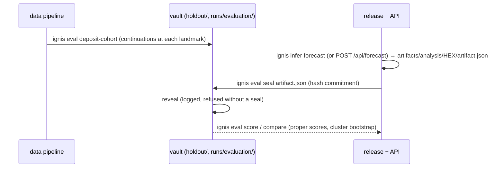

# IGNIS operator guide

**Ground rules that every section relies on**

- Commands print JSON or short text on stdout. Lab and eval refusals print `{"refused": true, ...}` and
  exit with code 2.
- Anything expensive (fits, bulk downloads, video decoding, paid API calls) is a **dry-run** that prints
  the plan and the estimated hours/USD for a resource profile. Only `--execute` runs it. Executed jobs
  are recorded in `runs/jobs/`.
- The **test partition** of a frozen split is opened once, by the team, after everything is frozen. No
  one adjudicates, tunes, or "just looks" with test outcomes (V3.1 §13.8).
- No model has been trained on NASA data yet. Synthetic releases are labelled `trained_on="synthetic"`
  and are never presented as NASA results.

Contents: [1 Setup](#1-setup) · [2 Sources](#2-sources-and-the-guarded-fetch) ·
[3 Curation](#3-curation-ingest-rules-cohort-split-views) · [4 Review](#4-review-and-adjudication) ·
[5 Fitting](#5-fitting-baselines-and-experts) · [6 Evaluation](#6-sealed-evaluation) ·
[7 Lab](#7-lab-tools-for-codex--astra) · [8 Decisions](#8-observation-choice-voi) ·
[9 Evidence](#9-evidence-search) · [10 Vision](#10-vision-metrology) ·
[11 Serving](#11-api-and-dashboard) · [12 Runpod](#12-running-on-runpod) · [13 Tests](#13-tests)

---

## 1. Setup

### Rust (required)

Install stable Rust with `rustup` (the port was developed with cargo 1.94). On Windows, use Git Bash.

```bash
cargo build --release -p ignis-cli          # ~3 min from clean on the development laptop
export PATH="$PWD/target/release:$PATH"     # binary: target/release/ignis (ignis.exe on Windows)
ignis --version
ignis --help
```

Run every command from the repository root: configs, data and artifacts resolve relative to it (or to
the `IGNIS_*` variables listed in [REPOMAP.md](REPOMAP.md#data-and-artifact-lifecycle)).

### Node.js (dashboard only)

```bash
npm ci --prefix web                         # uses web/package-lock.json
```

### MuPDF build environment (optional: PDF ingest for evidence)

PDF parsing is behind a cargo feature because it builds MuPDF from source:

```bash
cargo build --release -p ignis-cli --features pdf
```

On Windows, set `CLANG_PATH` to LLVM's `clang.exe` and build from a Visual Studio `vcvars64` shell.
Without the feature every other command works; only `ignis evidence ingest` of PDFs needs it.

### SAM2 sidecar (optional: learned segmentation)

The classical segmenter is pure Rust. SAM2.1 runs in a small Python sidecar; see
[sidecar/sam2/README.md](../sidecar/sam2/README.md):

```bash
uv sync --project sidecar/sam2
mkdir -p data/models/sam2 && curl -L -o data/models/sam2/sam2.1_hiera_small.pt \
  https://dl.fbaipublicfiles.com/segment_anything_2/092824/sam2.1_hiera_small.pt
```

`data/models/` is not gitignored: never commit the checkpoint.

---

## 2. Sources and the guarded fetch

IGNIS uses four NASA PSI investigations: **PSI-69** (FLEX), **PSI-159** (ACME CFI-G), **PSI-25**
(BASS-II) and **PSI-26** (BASS). Every fetched file gets a `Source` record (sha256, file version,
rights) in `data/manifests/<inv>.jsonl`; bytes go to `data/raw/samples/<inv>/` and are never modified.

```bash
ignis sources inspect PSI-69 PSI-159 PSI-25 PSI-26   # metadata + listing, read-only; no file bytes
ignis sources samples                                # bounded representative set (< ~150 MB total)
ignis sources manifest PSI-69 --verify               # re-hash local bytes against the manifest
```

`inspect` rewrites `data/manifests/<inv>.listing.jsonl` and `<inv>.investigation.json`. Run
`git diff data/manifests` afterwards: a diff means NASA published a new version, which must be
reviewed, not silently accepted (a frozen split never changes silently).

Bulk downloads go through the resource guard:

```bash
ignis sources fetch PSI-25 --category "Raw Data" --pattern 'T12\.mp4$'            # plan: files, bytes, hours
ignis sources fetch PSI-25 --category "Raw Data" --pattern 'T12\.mp4$' --execute  # download + manifest
```

### International sources

Registered as separate investigations and **never mixed into NASA cohorts**:

| Id | What | Access |
|---|---|---|
| `JAXA-GCEM` | JAXA DARTS, ISS Kibo Group Combustion | public; telemetry ZIP parser |
| `ZARM-FLARE` | ZARM/DLR FLARE IR drop-tower data (Zenodo) | CC BY-NC |
| `ESA-HREDA-*` (5) | ESA HREDA datasets | login-gated: metadata only |
| `MENDELEY-2GW4PJHKXZ` | solid-combustion microgravity evidence index | catalogue |

```bash
ignis sources intl list
ignis sources intl inspect JAXA-GCEM
ignis sources intl manifest all             # rebuild from live public metadata (no bulk bytes)
ignis sources intl fetch JAXA-GCEM          # probe set, byte-capped; dry-run unless --execute
```

---

## 3. Curation: ingest, rules, cohort, split, views

Families: `flex`, `acme_normal`, `acme_inverse`, `bass`.

```bash
ignis data ingest                 # all families → data/work/records/<family>/ (applies adjudications)
ignis data rules flex             # which method (deterministic / semantic / ...) produced each field
ignis data cohort build flex      # declared criteria → cohort id + inclusion/exclusion flow table
```

`ingest` prints counts and how many adjudications it applied; `cohort build` prints why every excluded
run was excluded (for FLEX on the sample set: not methanol, fiber supported, identity unresolved,
free-floating status unresolved, too few valid points, fuel conflict).

Cohorts and splits currently committed (unchanged until adjudications change membership):

| Family | Cohort id | Runs | Split file | Groups train/val/test |
|---|---|---|---|---|
| flex | `sha256:9e31b1aa…637e` | 114 | `data/splits/flex-660b7d9ede629b30.json` | 27 / 9 / 9 |
| acme_normal | `sha256:92fb4728…4701` | 129 | `data/splits/acme_normal-c77bc5baee98d3e3.json` | 7 / 2 / 2 |
| acme_inverse | `sha256:ed3e9beb…f45f` | 131 | `data/splits/acme_inverse-747032c921c8c8f2.json` | 7 / 2 / 3 |
| bass | `sha256:f66dc826…b278` | 25 | `data/splits/bass-4083156d5b18dab4.json` | 2 / 1 / 1 (**not qualified**) |

The full ids are in each split file (`split.id`, `split.cohort_id`). Splits are grouped by session
(60/20/20 of groups, seed recorded) and frozen:

```bash
ignis data split freeze <cohort-id> --seed 20261107   # refuses to re-freeze an existing split
ignis data views <cohort-id> --time-load              # Parquet views, physical SI scaling only
```

Views are derived: they are rebuilt automatically when missing or written by an older view version.
On the development laptop the FLEX views (114 runs) reload in ~10 ms.

---

## 4. Review and adjudication

Some fields cannot be decided by a deterministic rule (is this droplet free-floating? which run does
this video show? was this an extinction or an operator stop?). Ingest turns each of those into a
**review item** in `data/review/<family>/items.jsonl`:

| Family | Items | Field | Question |
|---|---|---|---|
| flex | 8 + 117 | `free_floating`, `flex_endpoint` | free-floating vs fiber-supported; how and when the hot phase ended (cause, censoring, bounds, event before support exit) |
| acme_normal | 3 + 30 | `endpoint_cause`, `comment_semantics` | extinction vs operator/automatic termination; does a comment change membership, controls or endpoint |
| acme_inverse | 20 | `comment_semantics` | as above |
| bass | 112 | `video_run` | which run/specimen a video records (28 PSI-25, 84 PSI-26) |

Each item carries the `question`, the `cited_text`, a `locator` (asset sha256 + path + row/column or
char span), allowed `candidates` and the `deterministic_screen` that routed it.

An adjudication is one JSON line with `item_id`, `value`, `resolution` (`resolved`,
`unresolved_conflict`, `unknown`, …), a `reviewer` (person) or `agent` (model session), a `rationale`
and optional extra `evidence` locators:

```json
{"item_id": "PSI-159:acme_normal:21088C1#endpoint", "value": "operator_termination", "resolution": "resolved", "reviewer": "Mircea", "rationale": "Comment documents the burner temperature limit; log shows flow cut at ...", "evidence": [{"asset_sha256": "...", "path": "...", "row": 4, "column": "Comments"}]}
```

```bash
ignis data review import acme_normal my-adjudications.jsonl   # validates every line, then appends
ignis data ingest acme_normal                                  # applies the latest answer per item
ignis data review export acme_normal                           # regenerate items.jsonl from the last ingest
```

`import` refuses the whole file if one line lacks `item_id`/`value`/`resolution`, names neither
reviewer nor agent, or refers to an unknown item. Ingest applies every field: `free_floating`,
`flex_endpoint` (endpoint record and view fields), `endpoint_cause`, `comment_semantics`, `video_run`
and `event_before_support_exit`. Without an adjudication a value stays unresolved. The team procedure
is in [TEAM.md](TEAM.md).

### Automatic adjudication

`ignis data review auto` classifies the queue with the headless Claude Code CLI on the logged-in
subscription (`claude auth login` once; no API key is used, the child process drops
`ANTHROPIC_*`/`CLAUDE*` variables). There is no human verification step.

```bash
ignis data review auto flex                                    # dry-run: items, shards, turns, files to fetch
ignis data review auto flex --dump-dossiers /tmp/d             # also writes what the model would read
ignis data review auto flex --shard 2/4 --concurrency 3 --execute   # one person's shard; resumable
ignis data review auto bass --only 'PSI-25.*' --limit 5 --execute
ignis data review auto-import flex                             # merges all shards, ingest, cohort
```

Each item gets a dossier in which every line has an id and a source locator (test sheet, table row,
series digest, script timeline, listing). Two independent `claude -p` processes (no tools, no shared
context, an empty working directory) answer with cited line ids. Code checks the value, the ids, the
verbatim quotes, and for FLEX the times and the censoring/cause logic; a failing pass is retried once
with the errors. All passes valid and in agreement (times within 0.25 s) gives `resolved`; anything
else is `unresolved_conflict` with every answer kept. A run left unresolved leaves the cohort and is
counted in the exclusion table. Records are labelled `agent = claude-code:<model>:<passes>`
(`Method::Semantic`). Shard files go to `data/review/<family>/drafts/auto-<i>of<n>.jsonl`; files fetched
only for dossiers go to the gitignored `data/cache/review/`, without touching the manifests. Rate
limits back off exponentially and then stop cleanly, reporting how many items remain. BASS dossiers
contain no video frames, so those items return `unclear` when name and tables do not decide.

---

## 5. Fitting baselines and experts

```bash
ignis fit list                         # experts in this build, their config files, saved releases
ignis fit plan                         # every model × every profile: estimated hours and USD
ignis fit plan --n-runs 68 --obs-per-run 490
```

Models: `flex.v3` (expert), `flex.v1`, `flex.d2_population`, `flex.d2_prefix`;
`acme_normal.hazard`, `acme_inverse.hazard` with `*.constant_baseline`, `*.piecewise_baseline`,
`*.linear_baseline`; `bass.operator` with `bass.persistence`, `bass.constant_velocity`.

### Dry-run, then execute

```bash
FLEX_COHORT=sha256:9e31b1aa6b56b2086aac85776d27778bb1680a83fcdfc543dad62e0385da637e
FLEX_SPLIT=sha256:660b7d9ede629b3009b4b761ea9e5875560719566e3dea21112f607cddd49894

ignis fit run flex.d2_population --cohort $FLEX_COHORT --split $FLEX_SPLIT             # plan
ignis fit run flex.d2_population --cohort $FLEX_COHORT --split $FLEX_SPLIT --execute   # baseline first
ignis fit run flex.v3 --cohort $FLEX_COHORT --split $FLEX_SPLIT                        # plan only
```

The flex.v3 plan on the real cohort reports 68 train runs, 33,137 observations, method NUTS and
**~9 h on 32 CPU threads** (FLEX fits are CPU-bound; a plan scales with the profile's `cpu_threads`). Fit the baselines first; they are cheap and every expert is compared
against them. `--split` also accepts a 16-hex prefix of the split id (e.g. `--split c77bc5baee98d3e3`).

| Flag | Meaning |
|---|---|
| `--profile <name>` | resource profile from `configs/resources/` (`cpu-local` default, `gpu-local`, `runpod-3090`, `runpod-4090`); the guard refuses plans above the profile's `max_hours` |
| `--set key=value` | config override, e.g. `--set fit.method=map` (repeatable) |
| `--resume <release>` | MAP warm start from a parent release; produces a `fine_tune` child (NUTS refuses) |
| `--fixture synthetic [--fixture-runs N]` | generated data, never promotable |
| `--seed <n>` | seed recorded in the release |

Synthetic smoke test (about 5 s on the development laptop):

```bash
ignis fit run flex.v3 --fixture synthetic --set fit.method=map --execute
```

### Releases and the ledger

A successful fit writes an immutable, content-addressed release to `artifacts/models/<hex>/`
(`release.json`, `params.npz`, and `posterior.npz` when there are posterior draws) and a ledger entry
`runs/jobs/job-<utc>-<suffix>.json` with profile, host, config, wall hours, estimated USD and exit state
(`completed` or `failed`). `billed_usd` stays `null` until someone records the provider's bill.
A release states `trained_on` (`nasa` / `synthetic`) and a qualification state such as `fit_only`;
NUTS fits must pass convergence checks (R-hat, divergences) or come back `insufficient_inference`.

Known open issue: `flex.v1` NUTS on synthetic data is `insufficient_inference` (R-hat 1.017, 1.5 %
divergences).

---

## 6. Sealed evaluation

The evaluation answers "did the forecast help?" without letting the outcome leak into the forecast.



### Step by step

1. **Split for the vault.** `ignis eval deposit|seal --split` accepts the full split id
   (`--split $FLEX_SPLIT`), resolved against the frozen files in `data/splits/`, a path to such a file, or
   a bare `Split` JSON under `IGNIS_SPLITS/<hex>.json` (default `data/work/splits/`).

2. **Deposit continuations** (data side). Everything is a command; `--cutoffs` defaults to the landmarks
   of `configs/evaluation/landmarks.toml`:

   ```bash
   ignis eval deposit-cohort --cohort $FLEX_COHORT --split $FLEX_SPLIT --partition validation
   ignis eval deposit <split> continuation.json --run <run-id>        # one payload by hand
   ```

   A case is (run, cutoff): `deposit-cohort` stores one payload per case
   (`holdout/<split>/<partition>/<run-key>.cutoff-<s>.json`) with the hidden part only: the observations
   after that cutoff (`time_s`, `value_si`, `quantity`, `valid`), the `endpoint` and the `front`. The vault
   refuses a payload holding anything at or before its cutoff, and refuses train runs. Runs not at risk at
   a cutoff are counted, not stored.

3. **Forecast** from the causal prefix with a release, one run or the whole partition, then **seal**:

   ```bash
   ignis infer forecast --release <id> --run <run-id> --cutoff 3 [--settings '{"seed":0}'] [--out a.json]
   ignis infer forecast-cohort --release <id> --split $FLEX_SPLIT --partition validation --cutoffs 1,3,5   # plan
   ignis infer forecast-cohort --release <id> --split $FLEX_SPLIT --partition validation --cutoffs 1,3,5 --execute --seal
   ```

   `infer forecast` runs the same path as `POST /api/forecast` (`ignis_core::analysis`): the same run,
   cutoff, settings and release give the same content-addressed artifact, stored at
   `artifacts/analysis/<hex>/`. Scientific refusals print `{"refused": true, "refusal": {"kind", "code",
   "reason"}}` and exit 2. `forecast-cohort` is a dry-run without `--execute`; `--partition test` needs
   `--final-test`. Runs whose phase is not established at a cutoff are listed `not_at_risk`; expert refusals
   are listed with their code and counted. An artifact sealed by hand with `ignis eval seal` is bound to its
   cutoff through the store.

4. **Score** after sealing:

   ```bash
   ignis eval seals --release <release-id>
   ignis eval score --release <release-id> --partition validation --out score.json
   ignis eval compare <baseline-release> <expert-release> --out cmp.json   # same cases, same metrics
   ignis eval report cmp.json --md cmp.md
   ```

   For event models the forecast grids differ by cutoff, so give shared horizons: `--horizons 30,60,120`
   (or pass shared `times_s` in `--settings`).

`score` and `compare` report proper scores (CRPS, coverage, log density, MAE; censoring-corrected
Brier/IBS for events; masked front metrics for BASS), refusal accounting (refused and unscorable cases
are counted, not dropped), and group-cluster bootstrap intervals (`--n-boot`, default 2000). `compare`
refuses mismatched feature order, units or cohort unless explicitly allowed, and `--intersect` restricts
it to cases sealed by every release.

This chain (fit → deposit-cohort → forecast-cohort → seal → score → compare → report) runs with commands
only and was exercised on the synthetic fixture and, as an ACME baseline smoke, on the real ACME validation
partition. No NASA-trained expert release exists yet. For the fixture, add `--fixture synthetic
--fixture-runs N --seed S` to `deposit-cohort` and take the ids from the release's `release.json`.

### Test-partition rules

- A test reveal requires `--final-test`; every reveal attempt, granted or refused, is appended to
  `runs/evaluation/reveal_log.jsonl` with user and host.
- Lab commands refuse `--partition test`, and the vault refuses reveals while a lab session is active.
- The final test runs **once**, after cohort, split, models, hyperparameters, metrics and the VOI
  policy are frozen. A change guided by test results turns the test into development, and renaming
  files or changing seeds does not restore independence.

---

## 7. Lab tools for Codex / Astra

`ignis lab` inspects, probes and edits **fitted** releases on train/validation data only; every edit
creates a new release with a `parent_id` and an edit manifest under `artifacts/edits/` (lineage kind
inferred from what changed: weight < architecture < objective < preprocessing; the ops are documented at
the top of `crates/ignis-lab/src/lab/edits.rs`). These edits are not literal WSP: a handwritten release
is revised only by a `HandwrittenWeightPatch` (see [AGENTS.md](../AGENTS.md)), and the registry refuses a
lab edit that would keep a literal release's manifest with changed tensors. The short version:

```bash
ignis lab show <rel>
ignis lab tensor <rel> <name> --slice "0:4,:" --hist 30
ignis lab grad <rel> --cohort <cohort> --split <split> --partition train
ignis lab residuals <rel> --cohort <cohort> --split <split> --by <condition-keys>
ignis lab apply <rel> edit.json --dry-run      # read the manifest
ignis lab apply <rel> edit.json                # → new release
ignis lab resume <rel> --profile cpu-local     # dry-run plan; --execute hands back to `ignis fit run --resume`
ignis lab lineage <rel>
ignis lab diff <a> <b>
```

---

## 8. Observation choice (VOI)

`ignis decide` ranks which not-yet-admitted pre-cutoff observation would most reduce the expected loss
of a forecast (V3.1 ch. 11). The continuation is never an input.

```bash
ignis decide rank --release <rel> --run <run-id> --cutoff 3 --policy voi --partition validation
ignis decide replay --release <rel> --runs 3 --budget 1 --policies voi,random,uniform,max_variance
```

`replay` compares policies at equal budget on archived runs; report failures as well as wins. The VOI
candidates come from any expert with a candidate-measurement model (`Expert::candidate_predictive`;
the FLEX experts today). `ignis decide` and the API both read stored run records
(`ViewSource::run_archives`), and the API endpoint `/api/acquisition` scores its candidates with the
release's expert; experts without a candidate model answer a typed `no_candidate_model` refusal. A
candidate is an observation recorded by the cutoff but not yet admitted; scoring sees the prefix and
the candidates' metadata only, never their values or the continuation.

---

## 9. Evidence search

> Updated with the DeepInfra lane. Dense retrieval and reranking are being moved from a local model to
> the **DeepInfra API** (`Qwen/Qwen3-Embedding-8B`, `Qwen/Qwen3-Reranker-8B`); the key is read only from
> the environment variable `DEEPINFRA_API_KEY`. Exact flag names may still change: check
> `ignis evidence --help`.

```bash
ignis evidence ingest <pdf-or-dir> --investigation PSI-69   # needs the `pdf` feature; page/char locators
ignis evidence embed                                        # plan: chunks, estimated cost (dry-run)
ignis evidence embed --execute                              # paid API calls; needs DEEPINFRA_API_KEY
ignis evidence search "methanol droplet extinction diameter" --family flex --limit 5
ignis evidence firewall                                     # protected crates must not depend on evidence
```

Search fuses SQLite FTS5 (lexical) with dense results by reciprocal-rank fusion (k = 60), then reranks
the top candidates. Without a key, network or embedded vectors, it falls back to the lexical/RRF order
and says so. Results print locators (publication, page, character span). `--sealed-run <id>` strips
outcome-bearing chunks for runs under sealed evaluation. The catalog lives at
`artifacts/evidence/evidence.sqlite`.

---

## 10. Vision metrology

BASS forecasts consume `ContourObservation`s: the leading luminous front on a fixed transverse grid,
mapped to the specimen plane, with status (topology changes are reported, never smoothed away).

```bash
ignis vision probe data/raw/samples/PSI-25/<clip>.mp4          # container metadata + every PTS (no decode)
ignis vision frames <clip>.mp4 --every 30                      # plan; --execute writes PNGs to data/cache/frames
ignis vision contours <clip>.mp4 --calibration configs/vision/calibration.psi25_T12.pixel.json \
  --run-id PSI-25:T12 --time-origin-s 0 --method classical     # plan
ignis vision contours ... --execute                            # → artifacts/vision/
ignis vision contours ... --method sam2 --execute              # SAM2.1 sidecar (see §1)
```

- Time comes from container PTS, never `frame / fps`.
- Both segmenters are strictly causal: the mask at frame *t* depends only on frames ≤ *t*.
- Calibration specs cite their reference points; `calibration.psi25_T12.pixel.json` is pixel-only
  (resolution `unknown`) because no cited reference points exist yet. `calibration.example.json` is
  illustrative only.
- Measured on the development laptop: 403 frames/s (previous Python pipeline: 42).
- SAM2 settings (checkpoint, device `cpu`/`cuda`, sidecar command) are in `configs/vision/sam2.toml`;
  the checkpoint path can also come from `IGNIS_SAM2_CHECKPOINT`.

---

## 11. API and dashboard

```bash
ignis serve --dev          # API on http://127.0.0.1:8787/api; synthetic fixture under /api/fixtures
npm --prefix web run dev   # Vite on http://localhost:5173, proxies /api to IGNIS_PORT (default 8787)
```

Both are also defined in [`.claude/launch.json`](../.claude/launch.json) (`ignis-server` runs a debug
build through `cargo run`). The server reads records from `data/work/records` (after `ignis data
ingest`), releases from `artifacts/models/`, and the evidence catalog from
`artifacts/evidence/evidence.sqlite`; `GET /api/health` reports what it found. The records
directory can be overridden with `--data` or `IGNIS_RECORDS` (not `IGNIS_DATA`, which the data commands
use for the data root).

The research runtime API is `/api/v1` (episodes, resumable SSE, artifacts, uploads, jobs; state in
`--state-dir`, default `runs/server`); with `--dev` the same routes are served from the C0 contract
fixtures at `/api/fixtures/v1`. On the registry origin, `/seal`, `/reveal` and `/admin/reload` answer a
typed `internal_route_disabled` refusal unless the server runs with `--internal-routes`, and
observations/series/overlay of validation and test runs are refused (`scope_denied`).

Endpoints are documented in [crates/ignis-server/README.md](../crates/ignis-server/README.md). For
real data the dashboard also has `GET /cohorts` (cohorts with their splits), `GET /experiments?family=&cohort=
&split=&partition=&q=`, `GET /experiments/{id}/series?cutoff_s=` (admitted measurements as columns),
`GET /experiments/{id}/overlay?cutoff_s=` (BASS recordings and admitted contours) and `/models` with one
state per expert.

The dashboard has three workspaces, **Explore**, **Compare** and **Experiment Lab**, and a switch
between the registry origin and the synthetic fixture origin (shown with a fixture banner). For a
production-style single process: `npm --prefix web run build`, then `ignis serve` serves `web/dist`
at `/`. Details: [web/README.md](../web/README.md).

---

## 12. Running on Runpod

**Nothing in this repository provisions, stops or deletes cloud resources.** Pods are started and
stopped by a person in the Runpod console, and billing state is confirmed there.

What goes where:

| Work | Where | Why |
|---|---|---|
| FLEX / ACME / BASS fits | local 32-core machine (`cpu-local`) | CPU-bound; the measured fits use 32 threads |
| SAM2 metrology on BASS clips | Runpod RTX 3090 (`runpod-3090`) | GPU helps SAM2 |
| optional accelerators (`ignis accel`) | Runpod RTX 3090, only if profiling justifies it | optional by design |

Budget: **100 USD total**. `configs/resources/runpod-3090.toml` declares a planning tariff of
0.50 USD/h and `max_hours = 12` per job (re-confirm the tariff at checkout); `runpod-4090.toml` is a burst
profile for a measured job that is clearly faster there. The guard refuses plans over `max_hours`.

### On the pod

Scripts: [`tools/runpod/`](../tools/runpod/README.md). `setup.sh` installs Rust, builds `ignis` in release
mode, installs `sidecar/sam2` and fetches the SAM2.1 checkpoint; `sync.sh` copies the views and clips a job
needs and brings results back with sha256 verification. Neither touches a pod's lifecycle, and neither has
been run on Linux yet.

1. Put the clone on the pod's **persistent volume** (not the container disk) and run
   `tools/runpod/setup.sh`.
2. From your machine, send only what the job needs:
   `tools/runpod/sync.sh push root@<host> data/splits data/work/views/<cohort> data/raw/samples/PSI-25/<clip>.mp4`.
3. For SAM2, set `device = "cuda"` in `configs/vision/sam2.toml`.
4. Always dry-run first with the pod profile, e.g.
   `ignis vision contours <clip> --calibration <spec> --method sam2 --profile runpod-3090`. `runpod-3090` is
   planned at 16 vCPUs (`cpu_threads`), so `ignis fit plan` reports different hours from the local machine.

### Before stopping or terminating the pod

1. Run `tools/runpod/sync.sh pull root@<host>`: it copies back `artifacts/` (releases, `vision/` contours,
   analyses), `runs/jobs/` (the cost ledger) and `runs/evaluation/`, and compares every file by sha256 on
   both sides, refusing with a non-zero exit on any mismatch.
2. A local copy with matching hashes must exist before terminate: terminate can delete the pod's local
   volume, and stop may keep (and bill) volumes.
3. Record the provider's bill in the job's `billed_usd` if you need actual cost next to the estimate.
4. Stop or terminate from the console and confirm the billing state there.

---

## 13. Tests

```bash
cargo test --release --workspace                 # everything
cargo test --release -p ignis-flex --test parity # one suite
```

Highlights: JAX parity fixtures for FLEX, ACME and BASS (`tests/parity.rs`); FLEX identities and
finite-difference gradients; BASS spatial convergence order; schema/contract agreement
(`ignis-core`); real-record ingest of committed CC0 NASA fixtures (`ignis-data`); grouped splits never
cross partitions; vault rules (reveal needs a seal, test needs `--final-test`, every attempt logged);
lab edits never modify the parent and invalidate posterior draws when needed; causal masks in vision;
the evidence firewall; a server forecast → seal → reveal round trip on the fixture. Each crate's
README lists its own tests.
