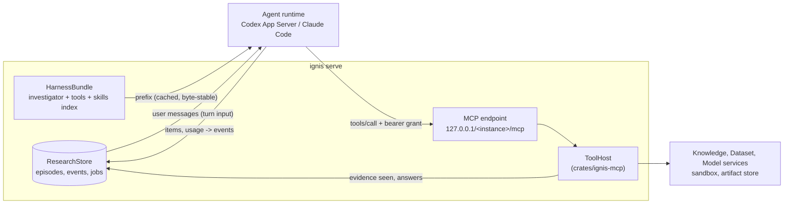
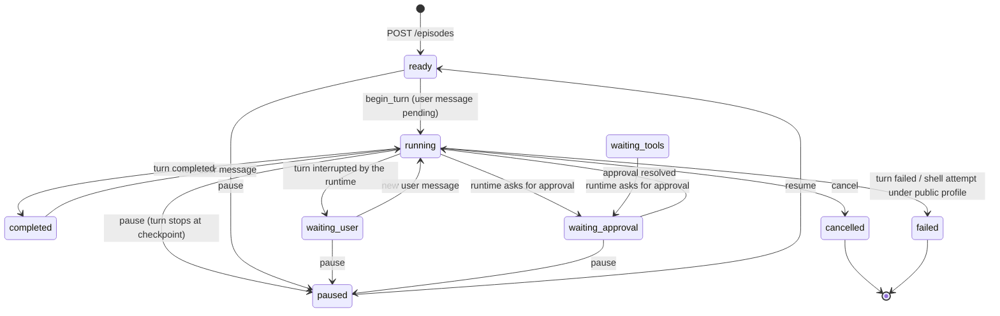
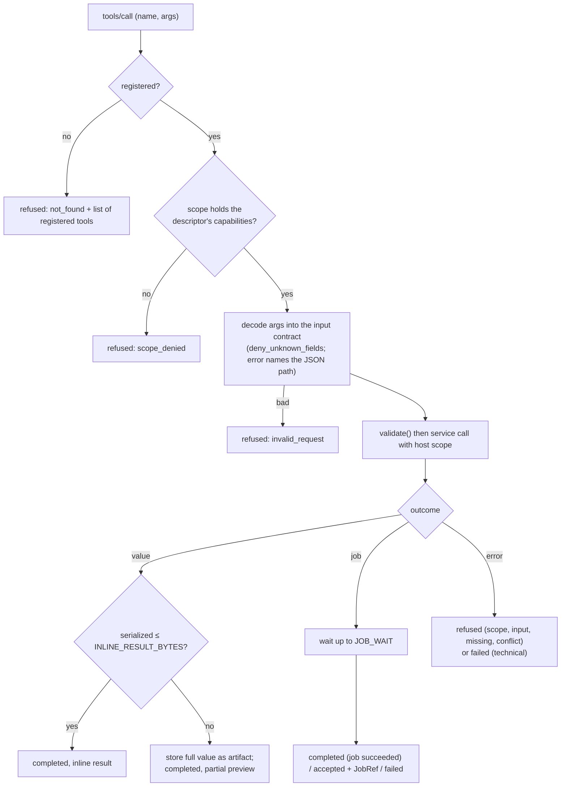
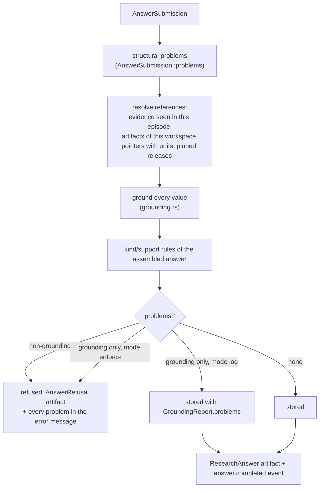

# IGNIS research agent harness

| | |
|---|---|
| **Scope** | How a research episode runs: runtime turns, the injected harness bundle, the IGNIS tool catalog, answer submission, the event trail, extending and evaluating the harness |
| **Audience** | Engineers changing the investigator prompt, a skill, a tool or the answer rules |
| **Companion docs** | [ARCHITECTURE.md](ARCHITECTURE.md) (system architecture), [AGENTS.md](../AGENTS.md) (repository rules), [implementation/CONTRACTS.md](implementation/CONTRACTS.md) (contract change rules) |
| **Authority** | Code. Each section links the files it was checked against. |

## 1. Overview

IGNIS does not run its own agent loop. An external runtime (Codex App Server or Claude Code) owns
the conversation and the model/tool loop. IGNIS owns everything around it:

- **the harness bundle**: the instruction prefix and skills the runtime is started with, identified by
  a digest and pinned on each episode;
- **the tools**: one dispatcher (`ToolHost`) exposed over a loopback MCP endpoint, with a scope the
  host derives, never the model;
- **the answer contract**: `answer_submit`, where the host validates every claim and citation before
  an answer is stored;
- **the record**: an append-only event log per episode, streamed to the web trail and exported as a
  replayable trace.



## 2. How an episode runs

### 2.1 Status machine

`EpisodeStatus` is defined in
[research.rs](../crates/ignis-core/src/contracts/research.rs). It constrains actions, not reasoning:
inside `running` the agent decides whether to read, compute, ask or answer.



| Transition | Where |
|---|---|
| `ready`/`completed`/`waiting_user` → `running` | `ResearchStore::begin_turn` ([store.rs](../crates/ignis-research/src/store.rs)): opens at most one turn per episode, in the same transaction as the status change |
| End of turn | `turn_outcome` ([mapping.rs](../crates/ignis-research/src/runtime/mapping.rs)): `completed` → `completed`; interrupted for pause → `paused`, for cancel → `cancelled`, for policy → `failed`, by the runtime → `waiting_user`; `failed` or unknown → `failed` |
| Approvals | [bridge.rs](../crates/ignis-research/src/runtime/bridge.rs) (Codex only; Claude Code runs with `--permission-mode dontAsk`, so it never asks) |
| Host actions | `ResearchStore::act`: pause from `ready`/`running`/`waiting_*`; resume from `paused` to `ready`; cancel from anything but `failed` (also cancels the episode's queued jobs) |

`post_message` refuses an episode that is `cancelled` or `failed`. `waiting_tools` exists in the
contract and is treated as a live state, but no code path in the runtime bridges currently writes it.

### 2.2 Runtime turns

```mermaid
sequenceDiagram
    autonumber
    participant UI as Web / API client
    participant S as /api/v1
    participant St as ResearchStore
    participant B as Runtime bridge
    participant RT as codex app-server / claude -p
    UI->>S: POST /episodes/{id}/messages
    S->>St: append message.user
    S->>B: kick(scope, episode)
    B->>St: pin_episode (harness pin, note)
    B->>St: begin_turn (status running, reason "runtime turn started; harness h1 sha256:… injected")
    B->>RT: turn input = the pending user messages
    loop model/tool loop (owned by the runtime)
        RT-->>B: items, deltas, tool calls, usage
        B->>St: mapped events (gap-free seq)
    end
    RT-->>B: turn finished
    B->>St: status change from turn_outcome
```

- **Codex** ([bridge.rs](../crates/ignis-research/src/runtime/bridge.rs)): one pinned
  `codex app-server` per workspace over private stdio JSON-RPC, one thread per episode. A turn this
  process does not run (crash, lost connection) is settled from the runtime thread before anything new
  starts; its messages are never re-sent. High-volume delta streams are suppressed at the source
  (`optOutNotificationMethods`).
- **Claude Code** ([claude.rs](../crates/ignis-research/src/runtime/claude.rs)): one `claude -p`
  process per turn with `--output-format stream-json`, built-in tools off (`--tools ""`), user and
  project settings ignored, the IGNIS MCP tools pre-allowed. Interrupt kills the process; a turn left
  open by a previous host process is settled as interrupted. With `--claude-delegation`, the
  investigator may hand one bounded subtask to Claude Code's native subagent (depth 1, same tools and
  scope, no `answer_submit`); off by default.
- Both bridges translate runtime output through [mapping.rs](../crates/ignis-research/src/runtime/mapping.rs)
  and record it through the shared [recorder.rs](../crates/ignis-research/src/runtime/recorder.rs), so
  both produce the same events. Unknown notifications are archived as `runtime.opaque`.

### 2.3 Harness prompt injection

The harness bundle is assembled in [harness.rs](../crates/ignis-research/src/runtime/harness.rs).

**Source files** (repository root):

| File | Role |
|---|---|
| [harness/investigator.md](../harness/investigator.md) | The investigator instructions: rules that always hold, work loop, claim kinds, refusal codes, which tool answers what, reference atmospheres, outcomes |
| [harness/skills/source-grounding/SKILL.md](../harness/skills/source-grounding/SKILL.md) | Method for documentary questions |
| [harness/skills/quantitative-analysis/SKILL.md](../harness/skills/quantitative-analysis/SKILL.md) | Method for computations with `analysis_execute` |
| [harness/skills/model-qualification/SKILL.md](../harness/skills/model-qualification/SKILL.md) | Method for forecasts with the served releases |

Skills use the agentskills.io format: frontmatter with `name` (must equal the directory name) and
`description`, then a non-empty body. A malformed skill fails the render, which leaves the runtime
unavailable.

**Rendered prefix**, in this order:

1. `investigator.md`, trimmed, line endings normalized to `\n`;
2. `## IGNIS tools`: generated from `tool_catalog()`, restricted to the tools this runtime is attached
   to, in name order, each as ``- `name` (effect `…`, idempotent, may return a job): summary
   Arguments: `Input`; result: `Output`.`` If no tools are attached, a paragraph says so;
3. `## Skills`: when `skills_read` is attached, a one-line index (`- `name`: description`) and the
   instruction to read a skill before the first tool call of that kind. Otherwise every skill is
   inlined as a `<skill name="…">` block.

The prefix is byte-stable for prompt caching: no timestamps, episode ids or user data. Anything
episode-specific (today: the user's messages) goes into the turn input, after the prefix.

**Versioning and hashing.**

| Item | Rule |
|---|---|
| Default bundle | Compiled into the binary with `include_str!`, label `h1` (`EMBEDDED_LABEL`) |
| Variant | `--harness-dir` / `IGNIS_HARNESS_DIR` loads `investigator.md` and `skills/*/SKILL.md` from a directory; its directory name is the label |
| Digest | sha256 of the prefix bytes; when skills are served on demand, sha256 of the prefix followed by `## Skills served on demand` and every skill as a `<skill>` block, so the pin covers what `skills_read` can return |
| Short form | `h1 sha256:<first 12 hex>` (`HarnessBundle::short`), used in log reasons such as `harness h1 sha256:0123456789ab injected` and `harness switched from … to …` |
| Pin | `HarnessRef { digest, label, runtime_build, model, effort }` on `EpisodePins.harness`, written by `pin_episode` |
| Re-pinning | Codex reapplies instructions on `thread/resume`, so a new bundle replaces the pin. Claude Code keeps the system prompt its session started with, so a resumed session stays on its pin and the log says so |

The digest changes whenever any instruction text, any skill, or the set of attached tools changes
(test `the_prefix_is_byte_stable_and_its_digest_is_its_content` in
[harness.rs](../crates/ignis-research/src/runtime/harness.rs)).

**Delivery.** Codex receives the prefix as `developerInstructions` on `thread/start` and
`thread/resume`; its coding-agent base instructions are replaced by `runtime/codex_base.md` through
`model_instructions_file` ([preflight.rs](../crates/ignis-research/src/runtime/preflight.rs)). Claude
Code receives it with `--append-system-prompt-file`, from a file named by the digest.

`skills_read` serves skill text only from the bundle the episode is pinned to (`HarnessShelf`); a
host that does not hold that digest refuses with `capability_unavailable`.

## 3. Tool catalog

### 3.1 Where tools are defined

| Piece | File |
|---|---|
| Descriptors (name, summary, effect, idempotency, capabilities, input/output contract, may-return-job, owner lane) | `tool_catalog()` in [research.rs](../crates/ignis-core/src/contracts/research.rs) |
| Availability per deployment | `catalog()` in [tools.rs](../crates/ignis-mcp/src/tools.rs) |
| Dispatch | `ToolHost::dispatch` in [tools.rs](../crates/ignis-mcp/src/tools.rs) |
| Model-facing input schemas (inlined, slimmed) | [schemas.rs](../crates/ignis-mcp/src/schemas.rs) |
| MCP transport (`tools/list`, `tools/call`) | [http.rs](../crates/ignis-mcp/src/http.rs) |
| Answer validation | [answer.rs](../crates/ignis-mcp/src/answer.rs), [grounding.rs](../crates/ignis-mcp/src/grounding.rs) |

A tool whose service is not configured is **not registered**: it is absent from `tools/list` and
from the prompt's tool section, and `GET /api/v1/capabilities` gives the reason. It never answers with
an empty result.

### 3.2 Call lifecycle



Rules that hold for every call ([tools.rs](../crates/ignis-mcp/src/tools.rs)):

- **Result envelope.** Every call returns a `ToolResult` (`tools.v1`): `execution_status`
  (`accepted`, `completed`, `refused`, `failed`, `cancelled`), `scientific_status` (always
  `not_assessed` from the wrapper; outcomes stay in the payload), `result` (`InlinePayload`), `job`,
  `artifact_refs`, `error`, `origin`. `ToolResult::validate` enforces the combinations (an
  `accepted` call carries a job and no result; a refused one carries an error and no result).
- **`INLINE_RESULT_BYTES` = 64 KiB.** A larger serialized result is stored as a JSON artifact and the
  call returns `partial = true` with a preview: `stored_as_artifact`, `total_bytes`,
  `top_level_fields` and a `how_to_read` hint pointing at `artifacts_read` with a `json_pointer` or a
  byte range. The `full` field of the payload is the artifact's `ArtifactRef`. (The preview format is
  under active change; the contract is `InlinePayload { value, partial, full }`.)
- **`JOB_WAIT` = 25 s.** `models_forecast`, `analysis_execute` and `jobs_get` wait server-side, with
  backoff from 50 ms to 500 ms, for the job to reach a terminal state before answering, so the agent
  does not spend a model request per poll. The bound stays below the runtime's MCP call timeout
  (Codex: 60 s). A job that ends in time answers `completed` with its output artifacts; otherwise
  `accepted` with the `JobRef`.
- **Evidence recording.** Results of `sources_search`, `sources_read`, `datasets_inspect` and
  `conditions_query` (`RETRIEVES_EVIDENCE`) made for an episode record every `EvidenceRef` they carry
  on that episode. `artifacts_read` and `jobs_get` never do: an artifact can be written by
  agent-authored code or belong to another episode.
- **Scope and episode** come from the MCP grant, never from arguments.

### 3.3 Catalog

Capabilities are the `Capability` values the descriptor requires; "—" means none beyond a valid
grant. Contracts are in [ignis-core/src/contracts](../crates/ignis-core/src/contracts/).

| Tool | Effect | Capabilities | Input → output | Purpose and key arguments | Limits and notes |
|---|---|---|---|---|---|
| `sources_search` | read | ReadSources | `SearchRequest` → `SearchPage` | Ranked, citable passages for `query`; `mode` (hybrid default: BM25 + SIRA expansion), `filters` (`investigation_ids`, `source_ids`, families), `expected_terms` (3 to 8 `{term, importance}`), `response_format`, `page_size`, `cursor` | `concise` (default) returns rank, `evidence_id`, `evidence_class`, `source_id`, page and snippet per hit plus titles once; `detailed` returns the full page. The only tool whose results carry citable evidence ids. Lockbox stated in the lexical backend detail when partitions are sealed |
| `sources_read` | read | ReadSources | `ReadRequest` → `ReadResult` | Text of one source version for `range` (`pages`, `passage` by `evidence_id`, `table` by `table_id`) | Segments with locators, no evidence ids; `complete = false` gives `next`; segments are never cut |
| `sources_outline` | read | ReadSources | `OutlineRequest` → `SourceOutline` | Section tree of a source (`source_id`, `node_id`, `depth`) | Summaries are generated text; nothing is citable |
| `graph_neighbors` | read | ReadSources | `GraphNeighborsRequest` → `GraphNeighborsPage` | Typed links around a `node` (run, source, evidence, release, or a concept such as `hw:mdca`, `cond:oxygen_mole_fraction`); `relations`, `direction`, `value_min_si`/`value_max_si` | Links are pointers, never citable; paged |
| `wiki_read` | read | ReadSources | `WikiReadRequest` → `WikiReadResult` | A wiki page by `page_id` (head or `revision`), or the page index | Notes, not corpus evidence; withheld items are counted. Registered only with a wiki store |
| `wiki_patch` | workspace_write | WikiWrite | `WikiPatch` → `WikiRevision` | Compare-and-swap revision of `page_id` against `base_revision` with `ops` | Not idempotent. Registered only when some session can hold `wiki_write`; research sessions cannot, so it is off by default |
| `datasets_inspect` | read | ReadData | `DatasetRef` → `DatasetBundle` | Metadata of one bundle by `dataset_id` (also a family name or an id prefix when exactly one bundle matches): views, typed columns, SI units, `time_origin` | No measurement rows, no evidence ids; an unknown id is refused with the readable bundles listed |
| `conditions_query` | read | ReadData | `ConditionsQuery` → `ConditionsTable` | Per-run experimental conditions (inputs only, never outcomes), filtered by `investigation_ids`, `run_ids` (NASA names resolve), `keys`, numeric `min_si`/`max_si` or categorical `any_of`; `include_envelopes` for each investigation's tested range; can rank matching runs by nearness to a target atmosphere | Gaps are explicit statuses; paged with `next_cursor`; runs of ungranted partitions withheld. Registered only when the conditions table is built (`ignis data conditions`). The query shape is under active change |
| `models_inspect` | read | RunModels | `ReleaseRef` → `ModelRelease` | One release by `release_id` (the `sha256:` id from the served list): construction, domain, qualification state | Registered only with `--enable-models` and a model service |
| `models_forecast` | compute | RunModels, ReadData | `ForecastRequest` → `AnalysisArtifact` | Queue a strict forward run: `release_id`, `input` (`stored_run` with `run_id` + `cutoff_s`, or `prefix` with an admitted `input_hash`), `settings` (`target`, `times_s`, `horizon_s`), `client_request_id` | May return a job (`models_forecast`); waits `JOB_WAIT`; idempotent on `client_request_id`. Refusals (out of domain, phase not established) are artifacts with reasons. Test-partition runs refused |
| `analysis_execute` | compute | ExecuteCode | `AnalysisExecuteRequest` → `ExecutionRecord` | Run Python `source` once in the isolated runner; `inputs` by reference (`artifact_id`, `dataset_view`, or a complete `conditions` query) mounted at `/in/<name>`; `client_request_id` | May return a job (`analysis_execute`); waits `JOB_WAIT`; no network; a non-zero exit is the program's outcome. Inputs are checked against the scope before queueing. Registered only when the runner passed preflight |
| `artifacts_read` | read | — | `ArtifactReadRequest` → `InlinePayload` | Part of an artifact of this workspace: `json_pointer` (`""` = whole) or `byte_offset`/`byte_length` | Continues a `partial` preview; reading never makes content citable |
| `jobs_get` | read | — | `JobLookup` → `JobRef` | State of a job by `job_id` | Waits up to `JOB_WAIT`; a job of another workspace is not found |
| `answer_submit` | compute | — | `AnswerSubmission` → `ResearchAnswer` | Store this turn's answer (section 4) | Needs an episode-bound grant; acknowledged with `answer_id`, `status`, artifact id and counts, not echoed |
| `skills_read` | read | — | `SkillRef` → `SkillText` | Full text of one skill of the pinned harness by `name` | Unknown names refused with the bundle's skill names |
| `web_search` | network_fetch | NetworkFetch | `WebSearchRequest` → `WebSearchPage` | Candidate web sources for `query` | Registered only with `IGNIS_ENABLE_WEB=1` and a provider (`PARALLEL_API_KEY`); results are never corpus evidence |
| `web_fetch` | network_fetch | NetworkFetch | `WebFetchRequest` → `ExternalSourceCandidate` | Snapshot one http(s) `url` under the SSRF policy | Registered only with `IGNIS_ENABLE_WEB=1`; never promoted into the corpus |

Note: the research scope built for web users (`research_scope` in
[v1/io.rs](../crates/ignis-server/src/v1/io.rs)) grants `ReadSources`, `ReadData`, `RunModels`,
`WorkspaceWrite` and, with a runner, `ExecuteCode`. It does not grant `NetworkFetch` or `WikiWrite`,
so in research sessions the web and wiki-write tools are refused at the capability check even when
registered.

## 4. `answer_submit`: claims and answer status

### 4.1 Submission shape

`AnswerSubmission` ([research.rs](../crates/ignis-core/src/contracts/research.rs)):

| Field | Meaning |
|---|---|
| `status` | `complete`, `partial`, `insufficient_evidence` or `failed` (chosen by the agent) |
| `blocks` | `text` (with `claim_ids`), `artifact`, or `view` (a component from the closed view catalog, bound to claims) |
| `claims` | `claim_id`, `kind`, `text`, `support[]`, `values[]` |
| `model_releases` | Releases used; each must be pinned on the episode or have run in one of its successful forecasts |
| `limitations` | What changes the interpretation; required (non-empty) for `partial` and `insufficient_evidence` |
| `client_request_id` | Idempotency: a retry with the same key returns the stored answer |

### 4.2 Claim kinds and support

| Kind | Allowed support |
|---|---|
| `source_reports` | `evidence` (an `evidence_id` a retrieval tool returned in this episode) |
| `observed` | Evidence of class `original_observation` or `source_derived`, with its number in `values` |
| `computed` | `artifact_value` (`artifact_id` + JSON Pointer) or a cell in `values` |
| `predicted` | A value in an `AnalysisArtifact` of a release listed in `model_releases` |
| `interpretation` | Anything or nothing |
| `background` | None: no `support`, no `values`; recorded as `checked_by = host_rule / unverifiable`; refused if it names a run of the validation or test partition |

Support kinds are `ClaimSupport::Evidence { evidence_id }` and
`ClaimSupport::ArtifactValue { artifact_id, pointer }`. Every number a claim states goes in `values`,
bound to a `ValueSource`:

| Value source | Grounding level | Check |
|---|---|---|
| `artifact_cell` (`artifact_id`, `sha256`, `rows` key selectors, `column`) | cell | Digest must match; keys must select exactly one row; a number written by `analysis_execute` must also cite that run's `ExecutionRecord` and its exact inputs in `derivation` |
| `conditions_cell` (`snapshot`, `investigation_id`, `run_id`, `key`, `locator`, `reading`) | cell | Read back from the conditions service under the episode's scope; a different snapshot is stale |
| `evidence_quote` (`evidence_id`) | text | The stated number followed by its unit occurs in the quote a retrieval tool returned |

The host writes `checked_by` and `values[].resolved`; a submission that sets either is refused.

### 4.3 Validation and status



- The answer status is the agent's choice; the host does not downgrade it. The host enforces that a
  `partial` or `insufficient_evidence` answer states what is missing in `limitations`, and that a
  non-`failed` answer has at least one block.
- The investigator prompt defines the outcomes ([investigator.md](../harness/investigator.md),
  "Outcomes"): `complete` when the evidence (with labelled background) answers the question, including
  a null result; `partial` when part is answered after the reasonable avenues were tried;
  `insufficient_evidence` only when neither the data nor reliable background answers it.
- **Grounding mode** is `--answer-grounding` / `IGNIS_ANSWER_GROUNDING` on `ignis serve` ([lib.rs](../crates/ignis-server/src/lib.rs)):
  `log` (default) stores the answer and records grounding problems in its `grounding` report;
  `enforce` refuses it. Grounding problems are `ungrounded_number`, `stale_snapshot`,
  `unresolved_row`, `unknown_column`, `unit_mismatch`, `value_mismatch`, `ungrounded_derivation`.
- Other refusal codes: `unknown_evidence`, `unknown_artifact`, `unresolved_pointer`,
  `kind_support_mismatch`, `unpinned_release`, `unknown_claim`, `view_contract_mismatch`,
  `invalid_structure` (`AnswerProblemKind`). A refusal lists every problem at once so one
  resubmission can fix them all.

## 5. Event kinds and the web trail

Events are `ResearchEvent { seq, occurred_at, causation, body, origin }`; `body` is tagged by `kind`
([research.rs](../crates/ignis-core/src/contracts/research.rs)). The web groups the log into turns in
[web/src/views/turns.ts](../web/src/views/turns.ts) (`toTurns`) and renders them in
[web/src/views/Research.tsx](../web/src/views/Research.tsx).

| Kind | Payload | Producer | In the trail |
|---|---|---|---|
| `episode.status_changed` | `from`, `to`, `reason` | store (turns, host actions) | Not a step; drives the episode state |
| `message.user` | `message_id`, `text` | `POST /messages` | Starts a new turn |
| `message.delta` | `message_id`, `text` | runtime | A `said` aside (once per message) |
| `message.completed` | `message_id`, `text` | runtime | A `said` aside; the closing reply is the turn body |
| `tool.started` | `call_id`, `tool`, `arguments` (redacted by scope; large ones previewed) | runtime | A `tool` step with a notebook sentence (`describeCall`) |
| `step.rationale` | `call_id?`, `text`, `source = model_explanation` | runtime | A `note` aside when it names no call |
| `tool.finished` | `result: ToolResult` | runtime | Ends the `tool` step; refused/failed/cancelled shown as such; `inconclusive`/`insufficient_evidence`/`out_of_domain` shown as a warning |
| `job.updated` | `job: JobRef` | state store, on state changes of a job bound to the episode (tool-submitted jobs are not bound today; `POST /analyses?episode_id=` binds one) | A `job` step ("The forecast finished", "… is running") |
| `artifact.created` | `artifact` | no live producer found; read by the fixture origin | Not a step |
| `approval.requested` | `approval_id`, `action`, `effect` | Codex bridge | An `approval` step ("Asked you to approve: …") |
| `approval.resolved` | `approval_id`, `decision` | Codex bridge, after the host resolves or the approval expires | Updates the approval step's decision |
| `answer.completed` | `answer_id`, `status`, `answer` (artifact) | `answer_submit` | An `answer` step: "Answered", "Gave a partial answer", "Answered: insufficient evidence", "The answer failed" |
| `runtime.opaque` | `method`, `payload?` | recorder | Not a step (diagnostics only) |
| `usage.reported` | `usage: UsageReport` | runtime (measured by the provider) | Not a step; feeds `/metrics` |

`answer_submit` and `jobs_get` are bookkeeping: the trail folds them away unless they did not succeed
(a refused answer is part of the story). Tool labels and step icons come from `TOOL_LABEL` and
`TOOL_KIND` in [turns.ts](../web/src/views/turns.ts); `skills_read` has no entry there today.

## 6. Adding a new tool

Follow [implementation/CONTRACTS.md](implementation/CONTRACTS.md) for any contract change (producer,
fixture, consumer and regenerated schemas in the same change).

1. **Contracts.** Define the input and output types in the owning family file under
   [crates/ignis-core/src/contracts/](../crates/ignis-core/src/contracts/) with
   `#[serde(deny_unknown_fields)]`, `JsonSchema` and a `validate()` for invariants. Add both to the
   exported list in `schema::all()` ([schema.rs](../crates/ignis-core/src/schema.rs)).
2. **Service.** Add the operation to the owning service trait in
   [services.rs](../crates/ignis-core/src/services.rs) and implement it in the domain crate. It takes
   `&ExecutionScope` as a separate argument; it never reads a scope from the request.
3. **Descriptor.** Add a `t(...)` entry to `tool_catalog()` in
   [research.rs](../crates/ignis-core/src/contracts/research.rs): wire name (`^[a-z][a-z0-9_]*$`),
   effect, idempotency, capabilities, input/output contract names, `may_return_job`, owner lane. The
   summary must pass `every_tool_description_states_usage_limits_and_arguments`
   ([tests/tools.rs](../crates/ignis-mcp/tests/tools.rs)): a "Use …" guideline, a stated limitation,
   at least one argument in backticks, not its own name, no few-shot example.
4. **Availability.** Add the tool to the match in `catalog()` in
   [tools.rs](../crates/ignis-mcp/src/tools.rs) with the condition under which it is unavailable (an
   unmatched name is reported "no adapter for this tool").
5. **Dispatch.** Add an arm to `ToolHost::dispatch`: `decode` into the contract, `validate()`, call
   the service with the scope. Return a job through `submit_*` and `settle` if it is long work. Add the
   name to `RETRIEVES_EVIDENCE` only if its results carry citable `EvidenceRef`s retrieved by a
   service.
6. **Input schema.** Add the contract to `full_input_schema` in
   [schemas.rs](../crates/ignis-mcp/src/schemas.rs) and to the `decode` match in
   [tests/schemas.rs](../crates/ignis-mcp/tests/schemas.rs).
7. **Schemas and TypeScript.**
   ```bash
   cargo run -p ignis-cli -- schemas export
   npm --prefix web run gen:types
   npm --prefix web run check:types
   ```
   The generator is [web/scripts/gen-types.mjs](../web/scripts/gen-types.mjs); never edit
   `web/src/contracts/generated.ts` by hand.
8. **Fixtures.** Add contract fixtures under [fixtures/contracts/](../fixtures/contracts/) when the
   new types need them (they are validated by the `ignis-core` tests and used by the slim-schema test).
9. **Web trail.** Add a label and kind to `TOOL_LABEL` / `TOOL_KIND` in
   [turns.ts](../web/src/views/turns.ts), and a sentence in `describeCall` if the default is not
   clear.
10. **Harness.** The tool section of the prompt is generated, so no prompt edit is needed to list the
    tool. Edit [investigator.md](../harness/investigator.md) ("Which tool answers what") or a skill only
    if the agent needs method guidance. Either change moves the harness digest.
11. **Tests.** Add an integration test in [crates/ignis-mcp/tests/](../crates/ignis-mcp/tests/) that
    drives `ToolHost` → service → `ToolResult` (see `tools.rs` for the patterns: registration,
    capability refusal, unknown-field refusal, large-result preview). Then run:
    ```bash
    cargo test -p ignis-core
    cargo test -p ignis-mcp
    cargo test -p ignis-research   # harness rendering tests
    npm --prefix web run typecheck
    ```

## 7. Evaluating the harness

### 7.1 What exists

| Instrument | What it measures | Where |
|---|---|---|
| `ignis harness run` | Runs a dev task set under a harness variant through the product path (in-process `/api/v1`, the same bridges, MCP tools and store); writes one `TraceBundle` per (task, repetition) and `summary.json` | [harness_run.rs](../crates/ignis-server/src/harness_run.rs) |
| Traces | Content-addressed, replayable bundle of an episode: event log, tool arguments and results, harness pin, measured usage | [trace.rs](../crates/ignis-research/src/trace.rs) |
| Metrics | Tool latency, tokens, cache hits and cost per episode and per workspace (`GET /api/v1/episodes/{id}/metrics`, `GET /api/v1/metrics`); cost from measured tokens and a versioned price list, absent when unknown | [metrics.rs](../crates/ignis-research/src/metrics.rs), [v1/metrics.rs](../crates/ignis-server/src/v1/metrics.rs) |
| Retrieval evaluation | nDCG@10 and recall@10 for BM25, query expansion, document expansion and both, plus a τ/w sweep, on dev tasks only | `ignis evidence retrieval-eval`, [retrieval_eval.rs](../crates/ignis-evidence/src/retrieval_eval.rs) |
| Parser benchmark | Parse quality of MuPDF vs Docling views | [benchmarks/parsers](../benchmarks/parsers/README.md) |
| Offline end-to-end test | `harness run` over the dev fixture with the fake Codex app-server; trace validity and replay; hold-out, test task sets and test scopes refused | [crates/ignis-server/tests/harness.rs](../crates/ignis-server/tests/harness.rs) |
| Fake runtimes | Offline stand-ins for Codex and Claude Code | [ignis-fake-codex](../crates/ignis-research/src/bin/ignis-fake-codex.rs), [ignis-fake-claude-code](../crates/ignis-research/src/bin/ignis-fake-claude-code.rs), [fake.rs](../crates/ignis-research/src/runtime/fake.rs) |
| Opt-in live checks | Real `codex` handshake, tool listing, a real turn; a real runner | [runtime_live.rs](../crates/ignis-research/tests/runtime_live.rs), [live_codex.rs](../crates/ignis-mcp/tests/live_codex.rs), [analysis_live.rs](../crates/ignis-mcp/tests/analysis_live.rs) |

### 7.2 Running a variant

```bash
# Plan only (prints what would run; nothing starts without --execute)
ignis harness run --variant harness --tasks fixtures/harness/dev_tasks.json --out runs/harness/h1

# Execute (a real runtime spends money); same runtime flags as `ignis serve`
ignis harness run --variant harness --tasks fixtures/harness/dev_tasks.json \
  --out runs/harness/h1 --repeat 3 --execute
```

- `--variant` is a harness directory, or the `sha256:` digest of the bundle built into the binary
  (checked against the pin of the first episode). `--harness-dir` is not used by harness runs.
- Other flags: `--tasks-format`, `--task-timeout-s` (default 900), `--price-list`
  (`IGNIS_PRICE_LIST`), plus the runtime flags.
- Output: `<out>/state/`, `<out>/traces/<task>.r<n>.json`, `<out>/summary.json`. Episode creation is
  idempotent on (variant, task, repetition), so an interrupted run resumes.
- Guards, before anything starts: no path under a `holdout/` directory; the task set must declare a
  development partition, never `test`; the scope must be the research scope (train only).

[fixtures/harness/dev_tasks.json](../fixtures/harness/dev_tasks.json) is a synthetic fixture written
for the fake runtimes; it has no expected answers and is not a gold set
([README](../fixtures/harness/README.md)).

### 7.3 What does not exist yet

- A gold dev task set and its loader (`--tasks-format gold`, Tudor's T10 `GoldTask`) are referenced in
  [harness_run.rs](../crates/ignis-server/src/harness_run.rs) and
  [retrieval_eval.rs](../crates/ignis-evidence/src/retrieval_eval.rs) but not on this branch;
  `benchmarks/` holds only the parser benchmark.
- Variant comparison (T11: paired statistics, ablations) and offline harness search (M10b) are not
  implemented; they are meant to read the traces and `summary.json`. The model evaluator in
  [ignis-lab](../crates/ignis-lab/src/eval/service.rs) refuses `HarnessBenchmark` requests for this
  reason.

### 7.4 Rules

- Report every harness number with its `HarnessRef` (digest, label, runtime build, model, effort).
- Never run a harness or retrieval evaluation on the test partition or a `holdout/` path; the tools
  refuse it, and a change guided by test results turns the test into development
  ([AGENTS.md](../AGENTS.md)).
- Live runs and paid model calls need `--execute` and explicit authorization.
