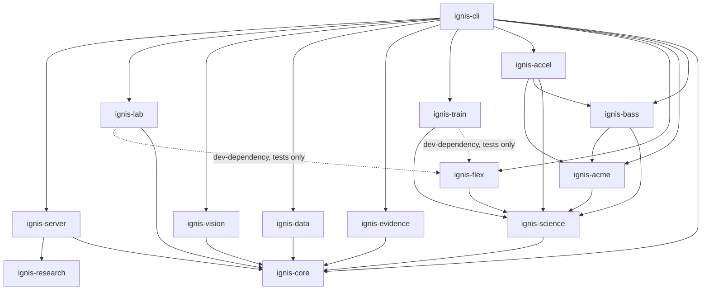
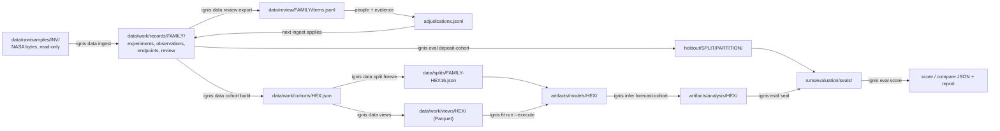

# Repository map

How the IGNIS repository is laid out, how the crates depend on each other, where to change what, and
how data moves from raw NASA bytes to scored results. For the commands themselves see
[GUIDE.md](GUIDE.md); for the current architecture, contracts and lane ownership see
[implementation/](implementation/) (ARCHITECTURE, CONTRACTS, INTEGRATION, WORKBOARD, handoffs) and
[design/IGNIS_MASTER_V2.md](design/IGNIS_MASTER_V2.md). [IGNIS_V3.1.md](IGNIS_V3.1.md) is historical
(equations, early infrastructure). Crates marked *(planned)* below do not exist yet.

## Annotated tree

Paths marked *(gitignored)* are created locally by commands and can be rebuilt from committed manifests
and configs. Everything else is committed.

```text
.
├── README.md                  landing page
├── AGENTS.md                  operating guide for every coding agent (architecture, ownership, rules, commands)
├── fixtures/contracts/        synthetic C0 contract fixtures (origin=synthetic_fixture) + manifest.json
├── Cargo.toml                 workspace (crates/*), shared dependency versions, release profile
├── rust-toolchain.toml        pinned Rust toolchain (CI and the server image use the same)
├── .claude/launch.json        dev-server definitions: ignis-web (5173), ignis-server (8787)
├── .github/workflows/         CI: fmt, check, tests, web type drift + build, Worker tests, shellcheck
│
├── crates/                    the Rust workspace (one binary: ignis)
│   ├── ignis-core/            contracts (+ C0 families in contracts/), service traits, prefixes, views, Expert trait, release registry, resource guard, shared forecast path
│   ├── ignis-science/         numerics: reverse-mode AD, Student-t/OU-Kalman, quadrature, hazards, flows, NUTS, optimisers
│   ├── ignis-flex/            FLEX droplet experts (flex.v3, flex.v1, D² baselines)
│   ├── ignis-acme/            ACME competing-risk hazard experts (normal / inverse) + baselines
│   ├── ignis-bass/            BASS visible-front operator ensemble + baselines
│   ├── ignis-accel/           optional inference accelerators (encoder + spline flows)
│   ├── ignis-train/           `ignis fit` and `ignis decide` drivers (model-agnostic)
│   ├── ignis-data/            sources (NASA PSI + international), ingest, cohorts, splits, views, review
│   ├── ignis-lab/             sealed evaluation vault + scorers; `ignis infer` forecasts; Codex/Astra checkpoint lab
│   ├── ignis-evidence/        PDF chunks, SQLite FTS5, dense retrieval + rerank, RRF, leak firewall
│   ├── ignis-vision/          video decode with real PTS, calibration, contours, SAM2 bridge
│   ├── ignis-research/        runtime state: episodes + event logs, jobs (leases), uploads (SQLite WAL); artifact store
│   ├── ignis-mcp/             IGNIS tools over MCP (rmcp, loopback only): one `ToolHost` dispatcher shared with `/api/v1`
│   ├── ignis-server/          Axum API (`ignis serve`): legacy `/api` + research `/api/v1`; fixtures/ = synthetic dev origin
│   └── ignis-cli/             main.rs: wires every command group and collects the experts
│
├── infra/                     deployment (runbook: infra/README.md); nothing here runs automatically
│   ├── deploy/                compose.yaml, systemd units, env examples for the origin (Google Compute Engine VM)
│   ├── server/                server image (Dockerfile, entrypoint)
│   ├── runner/                isolated analysis runner image (pinned Python packages)
│   ├── scripts/               build, backup/restore to R2, gVisor verification
│   └── worker/                Cloudflare Worker "ignis-edge": static UI + /api proxy behind Access
│
├── configs/
│   ├── resources/             execution profiles: cpu-local, gpu-local, runpod-3090, runpod-4090
│   ├── training/defaults.toml planning constants, eval/forecast/support defaults (merged under model configs)
│   ├── models/<family>/       per-model configs: flex/{v3,v1,d2_population,d2_prefix}, acme/{normal,inverse}, bass/operator
│   ├── accel/                 accelerator configs (acme_normal, bass)
│   ├── evidence/              retrieval.toml, firewall.toml (protected crates), run_patterns.toml
│   └── vision/                segmentation.toml, sam2.toml, calibration specs (example + PSI-25 T12 pixel)
│
├── data/                      IGNIS_DATA root (default: data)
│   ├── manifests/             Source records of fetched assets + remote listings (committed)
│   │   ├── PSI-<n>.jsonl              one Source per fetched file (sha256, version, rights)
│   │   ├── PSI-<n>.listing.jsonl      remote inventory, no bytes
│   │   ├── PSI-<n>.investigation.json investigation metadata
│   │   └── intl/                      JAXA-GCEM, ZARM-FLARE, ESA-HREDA-*, MENDELEY-* manifests
│   ├── review/<family>/       items.jsonl (questions) + adjudications.jsonl (answers) (committed)
│   ├── splits/<family>-<hex16>.json   frozen grouped splits with their cohort (committed)
│   ├── raw/                   (gitignored) samples/<inv>/ NASA bytes, never modified; samples/_meta/; intl/; evidence/
│   ├── work/                  (gitignored) records/<family>/, cohorts/<hex>.json, views/<hex>/ Parquet
│   └── cache/                 (gitignored) frames/ PNG cache of decoded video
│
├── artifacts/                 (gitignored) IGNIS_ARTIFACTS root
│   ├── models/<hex>/          immutable releases: release.json, params.npz, posterior.npz
│   ├── edits/<hex>.json       lab edit manifests
│   ├── evidence/              evidence.sqlite catalog (+ vector files)
│   ├── vision/                ContourObservation JSONL from `ignis vision contours`
│   └── analysis/ sealed/ reveals/   written by the API (write-once)
├── runs/                      (gitignored) IGNIS_RUNS root
│   ├── jobs/job-*.json        job/cost ledger of every executed job
│   ├── evaluation/            seals/, artifacts/, splits/, reveal_log.jsonl (vault bookkeeping)
│   └── accel/                 accelerator task files
├── holdout/                   (gitignored) IGNIS_HOLDOUT: sealed continuations; read only by the vault
│
├── schemas/                   JSON Schemas exported from ignis-core contracts (+ evidence_catalog.sql)
├── sidecar/sam2/              Python SAM2.1 causal tracker driven over stdin/stdout by ignis-vision
├── web/                       React + TypeScript + uPlot dashboard (Vite), types generated from schemas/
├── tools/parity/              historical scripts that froze the JAX parity fixtures (need the deleted Python code)
├── tools/runpod/              setup.sh + sync.sh for a GPU pod (never create, stop or delete pods)
└── docs/                      IGNIS_V3.1.md (reference), GUIDE.md, REPOMAP.md, TEAM.md
```

Two more paths appear at runtime: `data/models/sam2/` (the SAM2 checkpoint configured in
`configs/vision/sam2.toml`) and `web/node_modules/`, `web/dist/`. Note that `data/models/` is **not**
in `.gitignore`; do not commit the checkpoint.

## Crate dependency graph

Solid arrows point from a crate to what it depends on; the dotted arrow is a test-only dependency. `ignis-cli` depends on every
crate except `ignis-science` directly.



Design rules that the graph encodes:

- `ignis-core` depends on no workspace crate: it is the single authority for contracts and schemas.
- The protected crates (`ignis-science`, `-flex`, `-acme`, `-bass`, `-accel`, `-train`) must never
  depend on `ignis-evidence`, directly or transitively; `ignis evidence firewall` checks this.
- `ignis-server`, `ignis-lab` and `ignis-train` do not depend on model crates. The binary injects the
  experts as `Vec<Box<dyn Expert>>` and the data as a `ViewSource` (`crates/ignis-cli/src/main.rs`).
  (`ignis-train` and `ignis-lab` use `ignis-flex` only in their tests.)

## Where do I change X?

| I want to… | Change | Then |
|---|---|---|
| Add or change a field of a shared record | the owning family file in `crates/ignis-core/src/contracts/` (or `contracts.rs` for the scientific records); rules in [CONTRACTS](implementation/CONTRACTS.md) | `ignis schemas export`, `npm --prefix web run gen:types`, `cargo test -p ignis-core`, `npm --prefix web run check:types` |
| Write or revise literal WSP weights | `crates/ignis-wsp/` *(planned, Iancu)* against a `ModelSpec`; never `ignis lab edit` on a literal release | [HANDOFF_IANCU](implementation/HANDOFF_IANCU.md) |
| Change how a NASA file is parsed | `crates/ignis-data/src/families/{flex,acme,bass}.rs` | `ignis data ingest`, compare flow tables |
| Change cohort criteria | `crates/ignis-data/src/cohort.rs` / the family module | new cohort id; a new split must be frozen |
| Change which sample files are fetched | `crates/ignis-data/src/sources/samples.rs` | `ignis sources samples` |
| Register an international source | `crates/ignis-data/src/sources/intl/` | `ignis sources intl manifest <id>` |
| Tune a model's hyperparameters | `configs/models/<family>/<model>.toml` (or `--set key=value`) | `ignis fit run ...` dry-run first |
| Change planning constants / cost estimates | `configs/training/defaults.toml` | `ignis fit plan` |
| Add a resource profile (e.g. a new GPU) | `configs/resources/<name>.toml` | `--profile <name>` |
| Change an expert's model | `crates/ignis-{flex,acme,bass}/src/model.rs`, `dynamics.rs`, `expert.rs` | crate tests incl. parity/identities |
| Add a new expert | implement `ignis_core::expert::Expert`, add it to `experts()` in `crates/ignis-cli/src/main.rs` | `ignis fit list` |
| Change shared numerics (AD, NUTS, quadrature) | `crates/ignis-science/src/` | `cargo test -p ignis-science` and every expert's tests |
| Change a score or the bootstrap | `crates/ignis-lab/src/eval/{scores,scoring,bootstrap}.rs` | `cargo test -p ignis-lab` |
| Change what lab edits may do (fitted releases only) | `crates/ignis-lab/src/lab/edits.rs` (ops documented at the top) | update [GUIDE.md](GUIDE.md) §7 |
| Change an API endpoint | legacy: `crates/ignis-server/src/api.rs`; research: `crates/ignis-server/src/v1/` | `web/src/api.ts`, `crates/ignis-server/README.md`, `docs/implementation/INTEGRATION.md`, `cargo test -p ignis-server` |
| Change runtime state (episodes, events, jobs, uploads, artifacts) | `crates/ignis-research/src/{store,artifacts}.rs` | bump `SCHEMA_VERSION` + `migrate()` for durable changes; `cargo test -p ignis-research` |
| Change the forecast path (prefix, settings, artifact store) | `crates/ignis-core/src/analysis.rs` (shared by `ignis serve` and `ignis infer`) | `cargo test -p ignis-cli --test forecast_parity` |
| Change the landmarks | `configs/evaluation/landmarks.toml` | `ignis eval deposit-cohort`, `ignis infer forecast-cohort` |
| Change the dashboard | `web/src/` | `npm --prefix web run typecheck` |
| Change segmentation / contours | `crates/ignis-vision/src/{segment,contour,pipeline}.rs`, `configs/vision/` | `cargo test -p ignis-vision` |
| Change the SAM2 protocol | `sidecar/sam2/ignis_sam2.py` **and** `crates/ignis-vision/src/sam2.rs` together | a real clip, compare manifests |
| Change retrieval | `crates/ignis-evidence/src/`, `configs/evidence/retrieval.toml` | `cargo test -p ignis-evidence` |

## Data and artifact lifecycle



| Stage | Location | Identity | Rebuildable? |
|---|---|---|---|
| Raw bytes | `data/raw/samples/<inv>/` | sha256 in `data/manifests/<inv>.jsonl` | yes, from NASA (`ignis sources samples` / `fetch`) |
| Records | `data/work/records/<family>/*.jsonl` | run ids (e.g. `PSI-69:053F001:2010-05-05`) | yes, `ignis data ingest` |
| Review | `data/review/<family>/` | item id | items yes (export); adjudications are human input: **committed, never regenerated** |
| Cohort | `data/work/cohorts/<hex>.json` | `sha256:` of criteria + members | yes, `ignis data cohort build` |
| Split | `data/splits/<family>-<hex16>.json` | `sha256:` content hash, checked on load | frozen: never rebuilt, only replaced by a documented new split |
| Views | `data/work/views/<hex>/` | cohort hex + view version | yes, rebuilt automatically when stale |
| Releases | `artifacts/models/<hex>/` | content hash; tensors verified on load | no: immutable; every change is a new release with `parent_id` |
| Seals, reveals | `runs/evaluation/`, `holdout/` | artifact hash | no: write-once evidence of what was predicted before what was seen |
| Job ledger | `runs/jobs/` | `job-<utc>-<suffix>` | no: the cost record |

Environment variables move these roots: `IGNIS_DATA` (data root for `ignis-data`), `IGNIS_ARTIFACTS`,
`IGNIS_RUNS`, `IGNIS_HOLDOUT`, `IGNIS_SPLITS` (extra lab/eval split lookup, default `data/work/splits`),
`IGNIS_CONFIGS`, `IGNIS_CACHE`, and `IGNIS_RECORDS` (records directory read by `ignis serve`, default
`data/work/records`). Frozen splits in `data/splits/` are found by id from every command.
