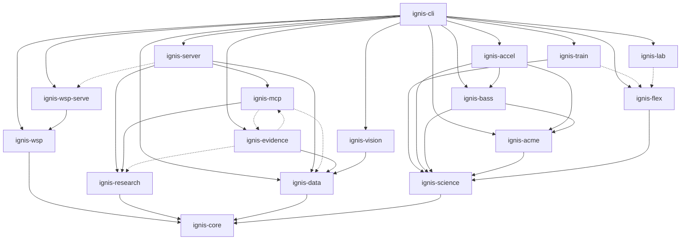
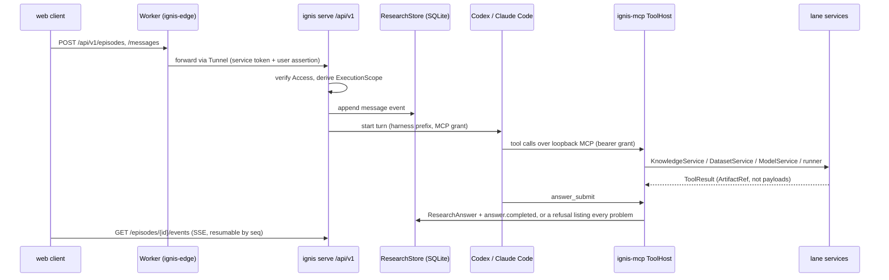
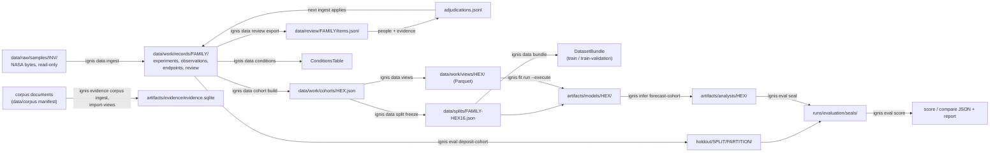

# Repository map

The code is the authority for what works now. If this page disagrees with the code, the code is
right; fix this page.

- [Annotated tree](#annotated-tree)
- [Crates](#crates)
- [Crate dependency graph](#crate-dependency-graph)
- [Runtime: what talks to what](#runtime-what-talks-to-what)
- [Web client](#web-client)
- [Infrastructure](#infrastructure)
- [Where do I change X?](#where-do-i-change-x)
- [Data and artifact lifecycle](#data-and-artifact-lifecycle)

## Annotated tree

Paths marked *(gitignored)* are created locally by commands. They can be rebuilt from committed
manifests and configs. Everything else is committed.

```text
.
├── README.md                  landing page
├── AGENTS.md                  operating rules for every coding agent
├── PRODUCT.md, DESIGN.md      product purpose and users; visual design system
├── Cargo.toml                 workspace (crates/*), shared dependency versions, release profile (thin LTO)
├── rust-toolchain.toml        pinned toolchain 1.99.1 (the server image reads the same version)
├── .claude/launch.json        dev servers: ignis-web (5173), ignis-server (8787), fake/real Codex variants
├── .github/workflows/ci.yml   disabled since 2026-11-14 (no CI; run checks locally)
│
├── crates/                    Rust workspace, one binary `ignis` (see Crates)
├── web/                       React 18 + TypeScript + uPlot client (Vite)
├── harness/                   agent harness sources: investigator.md + skills/<name>/SKILL.md
│   └── skills/                model-qualification, quantitative-analysis, source-grounding
├── sidecar/
│   ├── pdfium/                text-layer parse views of PDFs (ignis.pdfium_view.v1), offline batch
│   ├── docling/               structured parse views (tables, figures, OCR) (ignis.docling_view.v1), offline batch
│   └── sam2/                  SAM2.1 causal video segmenter, driven over stdin/stdout by ignis-vision
│
├── infra/                     deployment (runbook: infra/README.md); nothing here runs by itself
│   ├── deploy/                compose.yaml (ignis + cloudflared), systemd units, env examples
│   ├── server/                origin image (Dockerfile builds `ignis` with --features pdf, entrypoint)
│   ├── runner/                isolated analysis runner image (pinned Python packages)
│   ├── scripts/               build-server, build-data, fetch-codex/claude, autodeploy, backup/restore, gVisor check
│   └── worker/                Cloudflare Worker "ignis-edge": static UI, /api proxy, NTRS PDF proxy
│
├── configs/
│   ├── resources/             execution profiles: cpu-local, gpu-local, runpod-3090, runpod-4090
│   ├── training/defaults.toml planning constants, eval/forecast/support defaults
│   ├── models/                fitted-model configs (flex, acme, bass) and hand-written WSP specs
│   │   │                      (droplets, jets, solids, aerosol, bre, spherical, law, properties)
│   │   └── served/            served.json + models/<hex>/: the releases `ignis serve --enable-models` serves
│   ├── evaluation/            landmarks.toml
│   ├── evidence/              corpus.toml, retrieval.toml, firewall.toml (protected crates), run_patterns.toml
│   ├── vision/                segmentation.toml, sam2.toml, calibration specs, BASS qualification
│   ├── accel/                 accelerator configs (acme_normal, bass)
│   └── pricing/               llm_prices.toml (cost metrics, built into the binary)
│
├── data/                      IGNIS_DATA root (default: data)
│   ├── manifests/             one Source record per NASA file (sha256, version, rights) (committed)
│   │   ├── PSI-<n>.jsonl              fetched/stored files
│   │   ├── PSI-<n>.listing.jsonl      remote inventory, no bytes
│   │   ├── PSI-<n>.investigation.json investigation metadata
│   │   ├── ntrs/                      NTRS documents
│   │   └── intl/                      JAXA-GCEM, ZARM-FLARE, ESA-HREDA-*, MENDELEY-*; compatibility.json
│   ├── corpus/                manifest.jsonl + snapshots/ of the evidence corpus (committed)
│   ├── splits/                <family>-<hex16>.json frozen grouped splits with their cohort (committed)
│   ├── datasets/              DatasetBundle manifests per split and partitions (train, train-validation)
│   ├── review/<family>/       items.jsonl (questions) + adjudications.jsonl (answers) (committed)
│   ├── labels/gold/           gold labels for the document labeller
│   ├── raw/                   (gitignored) NASA bytes, never modified
│   ├── work/                  (gitignored) records/, cohorts/, views/ (Parquet), conditions, bundles
│   ├── media/                 (gitignored) keyframe indexes, ZIP directories, frame caches
│   ├── cache/                 (gitignored) decoded frame PNGs
│   └── models/                (gitignored) SAM2 checkpoint
│
├── artifacts/                 (gitignored) IGNIS_ARTIFACTS: models/<hex>/ releases, evidence/evidence.sqlite,
│                              analysis/, sealed/, reveals/ (write-once), vision/, edits/
├── runs/                      (gitignored) IGNIS_RUNS: jobs/ ledger, evaluation/ (seals, reveal_log.jsonl),
│                              server/ (state.sqlite + artifacts/ of `ignis serve`), codex/codex.env
├── holdout/                   (gitignored) IGNIS_HOLDOUT: sealed continuations; read only by the vault
│
├── schemas/                   JSON Schemas exported from ignis-core contracts (+ index.json, evidence_catalog.sql)
├── fixtures/
│   ├── contracts/             synthetic C0 contract fixtures (origin = synthetic_fixture) + manifest.json
│   └── harness/               dev_tasks.json for `ignis harness run` (synthetic, no expected answers)
├── benchmarks/parsers/        R7a parser benchmark: gold set, runner, results (why PDFium + Docling)
├── tools/
│   ├── codex/                 find/install the pinned Codex, sign in, serve, smoke test (.sh and .ps1)
│   ├── runner/                build the runner image locally
│   ├── runpod/                setup.sh + sync.sh for a GPU pod (never creates, stops or deletes pods)
│   ├── diag/                  VM state and user-simulation diagnostics
│   ├── wsp/                   reassemble and verify served releases, BASS optical inputs
│   ├── web/                   input preparation for web views
│   └── parity/                historical scripts that froze the JAX parity fixtures
                               wsp/ (protocol, results, cards, atlas of NASA files), demo/
```

## Crates

Each entry is taken from the crate's `lib.rs`/`main.rs` header and its `Cargo.toml`. Most crates
also have a `README.md` with their tests.

### ignis-core

The single authority for shared definitions. It depends on no workspace crate.

- `contracts.rs` holds the scientific records. `contracts/{common,research,evidence,dataset,wsp,evaluation}.rs`
  hold the C0 contract families. JSON Schemas come from `schema.rs`
  (`ignis schemas export` writes `schemas/`).
- `services.rs`: the synchronous service traits the composition root injects (`KnowledgeService`,
  `DatasetService`, `ModelService`, `ArtifactStore`, ...).
- `prefix.rs`: causal prefix construction and information-isolation checks. `views.rs`: array views
  and the `ViewSource` trait.
- `expert.rs`: the `Expert` trait. `analysis.rs`: the one forecast path shared by `ignis serve`
  and `ignis infer`. `records.rs`: the run-record registry.
- `registry.rs`: immutable content-addressed releases (npz tensors verified on load,
  `ModelRelease::check_construction`). `resources.rs`: resource profiles, the `--execute` guard and
  the job/cost ledger.
- Contract rules: [implementation/CONTRACTS.md](implementation/CONTRACTS.md) and
  `crates/ignis-core/AGENTS.md`.

### Scientific models

| Crate | Key modules | Notes |
|---|---|---|
| `ignis-science` | `ad`, `transforms`, `studentt`, `integrate`, `gauss_hermite`, `hazards`, `flows`, `optim`, `nuts`, `diagnostics`, `predictive`, `events` | Shared numerics. Protected: must not depend on `ignis-evidence`. |
| `ignis-flex` | `model`, `dynamics`, `expert`, `inference`, `structure`, `support`, `synthetic` | `flex.v3`, `flex.v1`, D² baselines. Exposes candidate-measurement models for VOI. |
| `ignis-acme` | `model`, `expert`, `features`, `optim`, `sampler`, `synthetic` | `acme_<normal\|inverse>.<hazard\|constant_baseline\|piecewise_baseline\|linear_baseline>`. |
| `ignis-bass` | `operator`, `dynamics`, `model`, `observation`, `expert`, `data`, `synthetic` | `bass.operator` ensemble, `bass.persistence`, `bass.constant_velocity`. Depends on `ignis-acme` for shared pieces. |
| `ignis-accel` | `nn`, `proposal`, `tasks`, `train`, `benchmark` | Optional encoder and spline-flow proposals (candle; `cuda` feature). `ignis accel`. |
| `ignis-train` | `fit`, `decide`, `config` | `ignis fit list\|plan\|run` and `ignis decide rank\|replay` over any `&[Box<dyn Expert>]`. Depends on no model crate (FLEX only in tests). |
| `ignis-wsp` | `text`, `spec`, `assemble`, `service`, per-family forwards (`flex`, `acme`, `bass`, `droplet*`, `flame*`, `front*`, `property_*`, `law*`, ...) and their `*_tools` | Literal weight-space programming: edit language, frozen specs, assembly into releases with a construction manifest, strict forwards. Each forward generation has its own identity, and earlier ones are left untouched. `ignis wsp spec\|compile\|check\|assemble\|rewrite\|inspect\|forward\|forward-hash\|...`. Results: [wsp/](wsp/). |
| `ignis-wsp-serve` | `lib.rs` (`ServedModels`) | Opens `configs/models/served/served.json` (or `IGNIS_WSP_SERVED`) and verifies each release (digests, content id, forward hash, family). Fails closed and serves the releases as one `ModelService`. Typed scenarios are admitted as `evidence_class = synthetic`. |

The fitted experts (`flex.*`, `acme_*`, `bass.*`) feed the legacy `/api` lab routes and `ignis
fit/eval/infer/lab`. The hand-written WSP releases feed `/api/v1` and the agent's `models_*` tools.
They are separate paths. Fitted-model lab edits are never WSP.

### Data, knowledge and measurement

| Crate | Key modules | Entry points |
|---|---|---|
| `ignis-data` | `sources/` (`psi`, `ntrs`, `samples`, `manifest`, `storage`, `adopt`, `intl/`), `families/{flex,acme,bass}`, `cohort`, `views` (`DataStore`, implements `ViewSource`), `conditions` (the `ConditionsTable` of the 19 flight investigations), `dataset` (`DatasetStore`, the one `DatasetService`), `sensors`, `media/` (keyframe indexes, ranges, ZIP directories), `review`, `auto` + `dossier` (automatic adjudication with headless `claude -p`) | `ignis sources inspect\|samples\|fetch\|manifest\|ntrs\|adopt\|coverage\|intl\|media ...`, `ignis data ingest\|cohort\|split freeze\|views\|conditions\|bundle\|bundles\|sensors\|review ...` |
| `ignis-evidence` | `corpus` (manifest, snapshots, lockbox), `pdf` (MuPDF, `pdf` feature), `docling_view` (import of PDFium/Docling views), `catalog` (SQLite FTS5), `search` (FTS5 + dense + RRF + bounded rerank), `deepinfra` + `dense` (Qwen3 embeddings and rerank, only with `DEEPINFRA_API_KEY`; otherwise lexical with an explicit status), `sira` (vocabulary expansion), `service` (`EvidenceService`, the one `KnowledgeService`; `Lockbox`), `outline`, `labels`, `llm_pass` + `combined` (guarded model passes), `graph` (`ProvenanceLink` graph), `wiki`, `web/` (web search and fetch with snapshots), `verify`, `firewall` | `ignis evidence corpus ...`, `ingest`, `import-view(s)`, `verify`, `embed`, `search`, `read`, `resolve`, `outline`, `labels`, `graph`, `web`, `firewall`, ... |
| `ignis-vision` | `video` (container PTS decode, frame cache), `calibration`, `segment` (classical, causal), `sam2` (sidecar client), `contour`, `pipeline`, `bundle`, `cli` | `ignis vision probe\|frames\|contours ...` |

### Evaluation

`ignis-lab` has three parts:

- `eval/`: the vault (`deposit`, `vault`: seal, reveal, reveal log), proper scores (`scores`,
  `scoring`), group-cluster `bootstrap`, `compare`, `report`, `scorecard`, `protocol` and the
  evaluation `service`.
- `infer.rs`: `ignis infer forecast|forecast-cohort` through the API's forecast path.
- `lab/`: `inspect`, `probe`, `edits` (operations documented at the top), `resume`, and `guard`
  (train and validation only).

It depends on no model crate; FLEX is used only in tests.

### Runtime and API

| Crate | Key modules | What it does |
|---|---|---|
| `ignis-research` | `store` (`ResearchStore`: SQLite WAL, one writer; episodes, gap-free event logs, idempotency keys, jobs with lease and fencing token, uploads), `artifacts` (`LocalArtifactStore`), `r2` + `s3` (R2 `ArtifactStore`), `backup`, `metrics`, `trace` (`TraceBundle`), `sandbox` (isolated runner), `runtime/` | Durable state and the agent-runtime bridges. `runtime/`: `AgentRuntime`, `bridge` (`CodexBridge`), `claude` (`ClaudeBridge`), `rpc` (private stdio JSON-RPC), `preflight` (pinned build manifest), `mapping` (thread/turn/item to events), `recorder`, `grants` (MCP bearer grants to scope), `harness` (bundle compiled from `harness/`, `IGNIS_HARNESS_DIR` override), `fake` + test binaries `ignis-fake-codex`, `ignis-fake-claude-code`. Synchronous; the host calls it on the blocking pool. |
| `ignis-mcp` | `tools` (`ToolHost`), `http` (rmcp streamable HTTP on loopback), `answer` (`answer_submit`), `grounding` (numbers read back from their bound cell), `schemas` | The one implementation of every agent tool: `sources_search`, `sources_read`, `sources_outline`, `graph_neighbors`, `wiki_read`, `wiki_patch`, `web_search`, `web_fetch`, `datasets_list`, `datasets_inspect`, `conditions_query`, `models_inspect`, `models_forecast`, `analysis_execute`, `skills_read`, `answer_submit`. Test binary `ignis-mcp-fake-engine`. |
| `ignis-server` | `lib.rs` (`ServeArgs`, router), `api.rs` (legacy `/api`), `refusal`, `state` (per-origin state), `fixture` (synthetic dev expert), `evidence` (legacy FTS5 search), `ops` (artifact backend, `ignis state backup\|verify\|restore`), `observe` (`ignis metrics`), `harness_run` (`ignis harness run`), `v1/` | `ignis serve`. `v1/`: `mod` (routes, OpenAPI via `aide`), `io` (`ErrorEnvelope`, strict JSON, `Caller` to `ExecutionScope`, SSE), `access` (Cloudflare Access verification), `agent` (runtime composition and flags), `runner` (in-process job runner), `sandbox` (runner flags and preflight), `data` (runs, datasets, conditions), `wsp` (model cards, scenarios), `metrics`, `sources/` (source access without copies: signed PSI URLs, HLS playlists), `fixture`. Test binary `ignis-server-fake-codex`. |
| `ignis-cli` | `main.rs` | The composition root. It builds `experts()` (ACME, BASS, FLEX), `fixtures()`, `research_services()` (knowledge, datasets, conditions, web, wiki, each present only when its data exists) and `served_models()` (only with `--enable-models`). Command groups: `schemas`, `serve`, `state`, `metrics`, `harness`, `eval`, `infer`, `lab`, `wsp`, `vision`, `sources`, `data`, `evidence`, `accel`, `fit`, `decide`. Feature `pdf` enables MuPDF. |

Routes served by `ignis serve`:

- Legacy `/api`: `/health`, `/livez`, `/experiments[/{id}[/observations|/series|/overlay|/video/{file}]]`,
  `/cohorts`, `/compare`, `/models[/{id}]`, `/forecast`, `/analysis/{id}`, `/acquisition`,
  `/evidence/search`, `/brief`, `/jobs/{id}`, `/score/student-t`. With `--internal-routes` it also
  serves `/seal`, `/reveal` and `/admin/reload`. With `--dev` the same router is mounted again under
  `/api/fixtures` on the synthetic origin.
- Research `/api/v1`: `/capabilities`, `/episodes[/{id}[/messages|/events|/approvals/{approval_id}|/metrics|/{action}]]`,
  `/artifacts/{id}[/meta]`, `/uploads/{initiate,complete,{id}/content}`, `/jobs/{id}[/cancel]`,
  `/search`, `/sources/{id}/...` (content, pages, playlists), `/models[/{id}[/scenarios]]`,
  `/model-cards`, `/analyses`, `/runs[/{id}]`, `/datasets[/{id}[/views/{view}]]`, `/conditions`,
  `/metrics`, `/openapi.json`. With `--dev`, C0 fixtures are served under `/api/fixtures/v1`.

## Crate dependency graph

Solid arrows point from a crate to what it depends on. Dotted arrows are dev-dependencies (tests
only). Every crate depends on `ignis-core`. Those edges are left out except for crates that depend
on nothing else.



The graph encodes these design rules:

- `ignis-core` depends on no workspace crate.
- The protected crates in `configs/evidence/firewall.toml` (`ignis-science`, `-flex`, `-acme`,
  `-bass`, `-accel`, `-train`) never depend on `ignis-evidence`, directly or transitively.
  `ignis evidence firewall` checks this.
- `ignis-server`, `ignis-lab` and `ignis-train` depend on no model crate. `ignis-server` does not
  depend on `ignis-evidence` or `ignis-wsp-serve` either. The binary injects experts
  (`Vec<Box<dyn Expert>>`), views (`ViewSource`) and lane services (`ResearchServices`) in
  `crates/ignis-cli/src/main.rs`.
- `ignis-research` depends only on `ignis-core`. Transports (`ignis-server`, `ignis-mcp`) sit on top
  of it.

## Runtime: what talks to what

### A research question



- The scope comes from the host: the `Caller` is derived from `--auth` (`local`, or
  `cloudflare-access`). The MCP grant maps to the same scope. A record from another workspace is
  reported as not found.
- A service that is not configured answers `503 capability_unavailable` and is listed in
  `GET /capabilities`. It never returns empty scientific results.
- `analysis_execute` runs a program once in a fresh OCI container: no network, read-only root,
  uid 65534, budgets, three bind mounts. gVisor (`--runner-runtime runsc`) is used on the VM.
- `answer_submit` checks numeric grounding (`--answer-grounding log|enforce`, default `log`).

### Sources without copies

`GET /api/v1/sources/{id}/content` resolves a source version from the R6 manifests. A PSI file gets
a fresh signed S3 URL (cached until shortly before it expires). A CFI-G `.ts` video with a keyframe
index gets byte-range HLS playlists over the same URL. An NTRS PDF goes through the Worker's
same-origin `/ntrs/...` proxy, because NTRS sends no CORS headers. Images and video stay at NASA.

### Legacy forecast path

`/api/forecast` and `ignis infer forecast` both go through `ignis_core::analysis`. The server builds
the causal `PrefixBundle` with the expert's own prospective policy and runs `Expert::forecast` on a
bounded Rayon pool via `spawn_blocking`. The result is a write-once `AnalysisArtifact` that
`ignis eval seal` can commit to before any reveal.

## Web client

`web/src/` is organised as follows:

| Path | Contents |
|---|---|
| `main.tsx`, `App.tsx` | Entry and view switch |
| `shell/` | `router.ts` (hash routes: `home`, `research`, `sources`, `runs`, `conditions`, `map`, `lab`, `compare`, `models`, `original`), `Sidebar`, `CommandMenu`, `ChatList`, `inspector`, `PdfPage` (pdf.js), `ContourVideo`, `OpenOriginal`/`SourceOriginal`, `queries`, `theme`, `persist` |
| `views/` | `Home`, `AskBox`, `Research`, `Answer`/`AnswerViews`, `Sources`, `Runs`, `RunPicker`, `Conditions`, `ByAtmosphere`, `MapView`/`ConditionsMap`, `Lab`/`LabModels`, `Compare`, `Models`, `Original` |
| `research/` | `/api/v1` client in three modes (`mock`: C0 fixtures in the browser; `fixtures`: `/api/fixtures/v1`; live), SSE and event-log replay, episodes, artifact views, habitats (reference atmospheres), conditions cells, map points, units, source access |
| `api.ts`, `hooks.ts` | Legacy `/api` client and react-query hooks |
| `contracts/generated.ts` | Generated from `schemas/` by `npm --prefix web run gen:types`; never edit by hand |
| `components/` | `ForecastChart`, `SeriesChart` (uPlot) |
| `data/` | Static investigation metadata |

Tests are in `web/tests/*.test.ts` (`npm --prefix web test`, node's test runner). The dev server
proxies `/api` to `IGNIS_PORT` (default 8787). `web/HARNESS_CONTRACT.md` describes what the client
expects from the agent's event stream.

## Infrastructure

| Piece | Where | Notes |
|---|---|---|
| Edge | `infra/worker` (`src/index.ts`, `wrangler.jsonc`, `wrangler.staging.jsonc`) | Serves the built UI from Workers Static Assets and forwards `/api/*` through Cloudflare Tunnel with a service token and the user's Access assertion. Strips client copies of those headers. Streams bodies without buffering. Owns no state. `npm --prefix infra/worker test` (vitest). |
| Origin | `infra/deploy/compose.yaml`, `infra/server/` | Google Compute Engine VM: an `ignis` container (`ignis serve`) and `cloudflared` (`tunnel run --url http://ignis:8787`), managed by `ignis.service`. |
| Releases | `infra/scripts/build-server.sh`, `fetch-codex.sh`, `fetch-claude.sh`, `autodeploy.sh` (+ `ignis-autodeploy.{service,timer}`) | Image built from a clean checkout with the pinned runtime binaries. Pull-model autodeploy of `main`. |
| Data on the VM | `infra/scripts/build-data.sh` | Runs the release image to fetch samples and corpus, ingest, build conditions, parse views and bundles. |
| State | `infra/scripts/backup.sh`, `restore.sh`, `restore-drill-local.sh` (+ `ignis-backup.{service,timer}`) | `ignis state backup` snapshots to R2. Restore only onto an empty state directory. |
| Runner | `infra/runner/`, `infra/scripts/verify-gvisor.sh` | Analysis container image; gVisor check on the VM. |

Runbook, identity, credentials and live status: [../infra/README.md](../infra/README.md).

## Where do I change X?

| I want to... | Change | Then |
|---|---|---|
| Add or change a field of a shared record | The owning family file in `crates/ignis-core/src/contracts/` (or `contracts.rs`); rules in [CONTRACTS](implementation/CONTRACTS.md) | `cargo run -p ignis-cli -- schemas export`, `npm --prefix web run gen:types`, `cargo test -p ignis-core`, `npm --prefix web run check:types` |
| Write or revise literal WSP weights | A patch against the spec in `crates/ignis-wsp/` (new forward = new module with its own identity); never `ignis lab edit` on a literal release | `ignis wsp check` / `assemble`, `cargo test -p ignis-wsp`; protocol in [wsp/PROTOCOL.md](wsp/PROTOCOL.md) |
| Serve another hand-written release | An entry in `configs/models/served/served.json` and its `models/<hex>/` directory | `ignis serve --enable-models` fails closed on a bad entry; `tools/wsp/verify_served.py` |
| Change an agent tool | `crates/ignis-mcp/src/tools.rs` (dispatcher) and the descriptor in `ignis-core` contracts | `cargo test -p ignis-mcp` |
| Change agent instructions or skills | `harness/investigator.md`, `harness/skills/<name>/SKILL.md` (compiled into the binary) | rebuild; compare variants with `ignis harness run` |
| Change the agent-runtime bridge | `crates/ignis-research/src/runtime/` (`bridge.rs` Codex, `claude.rs` Claude Code) | `cargo test -p ignis-research` (fake runtimes) |
| Change runtime state (episodes, events, jobs, uploads, artifacts) | `crates/ignis-research/src/{store,artifacts}.rs` | bump `SCHEMA_VERSION` + `migrate()` for durable changes; `cargo test -p ignis-research` |
| Change an API endpoint | Legacy: `crates/ignis-server/src/api.rs`; research: `crates/ignis-server/src/v1/` | `web/src/api.ts` or `web/src/research/`, `crates/ignis-server/README.md`, `cargo test -p ignis-server` |
| Change how a NASA file is parsed | `crates/ignis-data/src/families/{flex,acme,bass}.rs` | `ignis data ingest`, compare flow tables |
| Change the conditions table | `crates/ignis-data/src/conditions.rs` (`SPECS`) | `ignis data conditions`, `cargo test -p ignis-data` |
| Change cohort criteria | `crates/ignis-data/src/cohort.rs` / the family module | new cohort id; a new split must be frozen |
| Change which sample files are fetched | `crates/ignis-data/src/sources/samples.rs` | `ignis sources samples` |
| Register an international source | `crates/ignis-data/src/sources/intl/` | `ignis sources intl manifest <id>` |
| Change retrieval | `crates/ignis-evidence/src/{search,sira,service}.rs`, `configs/evidence/retrieval.toml` | `cargo test -p ignis-evidence` |
| Change PDF parse views | `sidecar/pdfium/`, `sidecar/docling/`, `crates/ignis-evidence/src/docling_view.rs` | `ignis evidence import-views`, `ignis evidence verify` |
| Tune a fitted model | `configs/models/<family>/<model>.toml` (or `--set key=value`) | `ignis fit run ...` dry-run first |
| Change planning constants / cost estimates | `configs/training/defaults.toml` | `ignis fit plan` |
| Add a resource profile | `configs/resources/<name>.toml` | `--profile <name>` |
| Change a fitted expert | `crates/ignis-{flex,acme,bass}/src/{model,dynamics,expert}.rs` | crate tests, including parity and identities |
| Add a fitted expert | implement `ignis_core::expert::Expert`, add it to `experts()` in `crates/ignis-cli/src/main.rs` | `ignis fit list` |
| Change shared numerics | `crates/ignis-science/src/` | `cargo test -p ignis-science` and every expert's tests |
| Change a score or the bootstrap | `crates/ignis-lab/src/eval/{scores,scoring,bootstrap}.rs` | `cargo test -p ignis-lab` |
| Change what lab edits may do (fitted releases only) | `crates/ignis-lab/src/lab/edits.rs` | update [GUIDE.md](GUIDE.md) §7 |
| Change the forecast path | `crates/ignis-core/src/analysis.rs` | `cargo test -p ignis-cli --test forecast_parity` |
| Change the landmarks | `configs/evaluation/landmarks.toml` | `ignis eval deposit-cohort`, `ignis infer forecast-cohort` |
| Change the client | `web/src/` | `npm --prefix web run typecheck`, `npm --prefix web test` |
| Change the edge | `infra/worker/src/index.ts` | `npm --prefix infra/worker test` |
| Change segmentation / contours | `crates/ignis-vision/src/{segment,contour,pipeline}.rs`, `configs/vision/` | `cargo test -p ignis-vision` |
| Change the SAM2 protocol | `sidecar/sam2/ignis_sam2.py` **and** `crates/ignis-vision/src/sam2.rs` together | a real clip, compare manifests |

## Data and artifact lifecycle



| Stage | Location | Identity | Rebuildable? |
|---|---|---|---|
| Raw bytes | `data/raw/samples/<inv>/` | sha256 in `data/manifests/<inv>.jsonl` | yes, from NASA (`ignis sources samples` / `fetch`) |
| Records | `data/work/records/<family>/*.jsonl` | run ids (e.g. `PSI-69:053F001:2010-05-05`) | yes, `ignis data ingest` |
| Review | `data/review/<family>/` | item id | items yes (export); adjudications are human input: **committed, never regenerated** |
| Cohort | `data/work/cohorts/<hex>.json` | `sha256:` of criteria + members | yes, `ignis data cohort build` |
| Split | `data/splits/<family>-<hex16>.json` | `sha256:` content hash, checked on load | frozen: never rebuilt, only replaced by a documented new split |
| Views | `data/work/views/<hex>/` | cohort hex + view version | yes, rebuilt automatically when stale |
| Bundles | manifests in `data/datasets/`, data under `data/work/` | split + partitions | yes, `ignis data bundle` (never includes test outcomes) |
| Evidence catalog | `artifacts/evidence/evidence.sqlite` | corpus snapshot in `data/corpus/snapshots/` | yes, `ignis evidence corpus fetch/ingest` + `import-views` |
| Releases | `artifacts/models/<hex>/`, `configs/models/served/models/<hex>/` | content hash; tensors verified on load | no: immutable; every change is a new release |
| Seals, reveals | `runs/evaluation/`, `holdout/` | artifact hash | no: write-once evidence of what was predicted before what was seen |
| Server state | `runs/server/` (`state.sqlite`, `artifacts/`); `/srv/ignis/state` on the VM | episode id, event `seq`, artifact hash | no: backed up with `ignis state backup` |
| Job ledger | `runs/jobs/` | `job-<utc>-<suffix>` | no: the cost record |

Environment variables move these roots: `IGNIS_DATA` (data root), `IGNIS_ARTIFACTS`, `IGNIS_RUNS`,
`IGNIS_HOLDOUT`, `IGNIS_SPLITS` (extra lab/eval split lookup, default `data/work/splits`),
`IGNIS_CONFIGS`, `IGNIS_CACHE`, `IGNIS_RECORDS` (records read by `ignis serve`, default
`data/work/records`), `IGNIS_STATE_DIR` (server state, default `runs/server`), `IGNIS_ROOT`
(repository root for `ignis serve`) and `IGNIS_WSP_SERVED` (served releases, default
`configs/models/served`). Frozen splits in `data/splits/` are found by id from every command. The
full list of flags and variables will be in [CONFIGURATION.md](CONFIGURATION.md).
