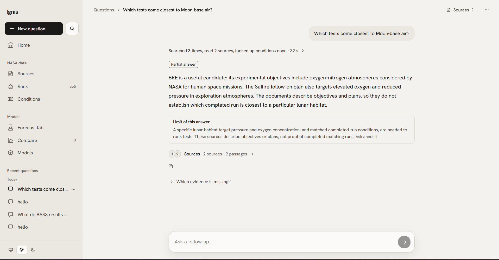

# One question and its answer

[Back to the screen guide](README.md)

## Route

`#/research/<episode id>`. The page reads no other parameter. An id the server does not know shows
"This question is not on this server" with a link **All questions**.

## Purpose

A question reads as a conversation with the IGNIS agent: your messages, a one-line summary of what
the agent did (which opens into the full trail of steps), its answer with a citation chip after each
claim, figures and embedded views, the limits of the answer, suggested follow-ups, and a composer to
continue. Every chip, step, figure and source opens its details in the side panel, down to the NASA
original at the cited place. The whole page is built from the question's ordered event log, streamed
live while the agent works.

## Layout

### Top bar

- **Breadcrumb**: *Questions > `<goal>`* (the goal is cut to fit; hover for the whole text).
  *Questions* links to the history.
- **Sources N** (once an answer cites sources): N is the number of distinct sources across the
  loaded answers. Toggles the *Sources* item in the side panel.
- **...** menu:
  - **Pause**, **Resume**, **Cancel**, offered by status: pause and cancel from `ready`, `running`,
    `waiting_tools`, `waiting_approval`, `waiting_user`; resume and cancel from `paused`; none once
    `completed`, `failed` or `cancelled`. Not offered in mock mode.
  - **Copy link**: the page URL.
  - **Details**: a card with *Status*, *Created*, *Corpus* (pinned corpus snapshot), *Runtime*,
    *Harness* (label and model), *Origin* (Synthetic, for fixtures) and *Events* (the stream cursor).
    In mock mode it also holds stream fault switches for testing: *Drop after* (a sequence number),
    *410 on resume*, and **Replay**. Stream problems (errors, gaps, giving up) are listed here.

### The conversation column

Each turn ([`views/turns.ts`](../../web/src/views/turns.ts) `toTurns`) shows, top to bottom:

1. **Your message** (the question, or a follow-up).
2. **Steps trail** (the route summary), see below.
3. **The agent's reply text**, when the turn has no stored answer: its last words, rendered as rich
   text. A reply still streaming ends with "...".
4. **Earlier answers in this turn** (folded): "An earlier answer in this turn" or "N earlier answers
   in this turn".
5. **The answer** (the last stored answer of the turn), see below.

Under the turns:

- **Approval needed: `<action>`** with **Approve** and **Deny**, for each pending approval request
  (enabled when the agent runtime is available).
- **Working** with a live dot, while the agent works and no turn exists yet.
- "No agent is configured on this server", when the runtime is unavailable and nothing has
  happened yet.
- "No answer was produced", when the question ended without an answer.
- "Events N-M were not received" for a gap the stream could not fill; the state continues from the
  snapshot.
- "The server refused the action" for a failed pause, resume, cancel or approval.

### Steps trail

`RouteSummary`, `Stops`, `LiveRow` in [`views/Research.tsx`](../../web/src/views/Research.tsx).

- **Closed**: one line, for example "Searched 3 times, read 2 sources, looked up conditions once ·
  32 s". The sentence counts the steps that ran successfully by kind (`routeSummary`): searches,
  sources read (distinct source ids), conditions lookups, forecasts, analyses, other steps. While the
  agent works it reads "N steps so far". A turn with only notes reads "N notes on the way"; with no
  tool work, "No tool steps". A red badge counts problems: "1 step did not run" / "N steps did not
  run".
- **Open** (click the line): one row per step, in order:
  - an icon by kind (search, read, data, model, compute, web, note, other) with a tone (done,
    running spinner, problem, warning);
  - the step as a notebook sentence built from the call's own arguments (`describeCall`), for
    example *Searched the NASA sources for "flame spread low airflow"*, *Read the BRE report,
    page 80*, *Looked up the test conditions of PSI-69*, *Asked for a model forecast*,
    *Ran an analysis in python*, *Opened a page on ntrs.nasa.gov*;
  - a detail: "12 passages", "no passages", "degraded search", "preview", "started as a job", "more
    remains", "model output", and a scientific verdict when the result is *inconclusive*,
    *insufficient evidence* or *out of domain*;
  - a state word when it is not a plain success: *working*, *failed*, *refused*, *cancelled*,
    *waiting for you*;
  - its duration when it took a second or more.
  A tool step is a button that opens the **Step** item in the side panel. The final row
  (*Answered*, *Gave a partial answer*, *Answered: insufficient evidence*, *The answer failed*) shows
  the turn's total time and scrolls to the answer.
- **Asides**: what the agent said between steps, and notes it left on its route, as muted rows folded
  to a few lines (**Show all** / **Show less**).
- **Live row**: while the agent works, the current step's sentence with a spinner and its running
  time in seconds stays under the summary line.
- Bookkeeping calls that succeeded (`answer_submit`, `jobs_get`) are left out of the trail; a refused
  `answer_submit` stays, and its step item lists every problem the host found (`AnswerRefusal`).

### The answer

[`views/Answer.tsx`](../../web/src/views/Answer.tsx) `AnswerView`, over the `ResearchAnswer` artifact.

- **Status tag**: *Partial answer*, *Insufficient evidence* or *Failed*, when the answer is not
  complete.
- **Synthetic** tag when the answer comes from fixtures on a live page.
- **Text blocks**: rich text (bold, safe http(s) links, and run names such as `FLEX-093` or a
  `PSI-...` id linked to the run's side panel when the data source knows the run). After each block
  come its **citation chips**, one per claim:
  - **`2 · p. 14`**: source number and place (page, `row N`, `12.3 s`, `table`). Sources are numbered
    in order of first citation in the answer.
  - **`+1`** suffix: the claim has more supports.
  - **computed**: the claim is bound to a value in an IGNIS artifact.
  - **model knowledge**: a *background* claim, stated from the model's own knowledge.
  - **interpretation**: the agent's reading with no source.
  Hovering or focusing a chip shows the **citation card**: *Source N* and the full locator, the
  quoted passage, a **1/N** pager across the claim's supports, the evidence class tag, **Original ↗**
  and **Open**. For a computed value it reads the value by JSON pointer from the artifact
  (`GET /api/v1/artifacts/{id}?pointer=`) together with its `/unit`. Clicking a chip opens the
  **Source** item in the side panel.
- **Figures**: "Figure N. `<caption>`", a *Model output* tag for an analysis artifact (or the
  contract), size, release, **run `<id>`** links, and **Open figure** (the *Figure* panel item).
- **Embedded views** ([`views/AnswerViews.tsx`](../../web/src/views/AnswerViews.tsx)): the agent
  places a component from a closed catalog and the UI draws it with its own components:
  - *Source excerpt*: evidence class, source id and place, the quote, **Open original**.
  - *Series comparison*: series read from artifacts by pointer and drawn on one chart.
  - *Conditions matrix*: a ConditionsTable as a run-by-condition grid; a cell opens its value, SI
    value, evidence class, locator with **Original ↗**, uncertainty and flags. Tables of 300 rows or
    more scroll in their own frame and render only the rows in view.
  - *Habitat atmospheres*: the [atmosphere map](atmosphere-map.md) over the table the answer cites.
  - *Video with contour*: the contour bundle over its NASA video.
  - *Model release*: state, name, weights, construction method, **Construction and checks**.
  - *Table*: an artifact field as a table, 50 rows at a time (**Show N more of M**).
  Each view's caption notes which claims it illustrates. A view that references something the answer
  does not cite is not drawn; the caption says why.
- **Limits of this answer**: each limitation as a line with **Ask about it**, which drafts "Can you
  resolve this limitation: ..." in the composer.
- **Sources** row: up to four source numbers stacked, "N sources · M passages". Open it to list each
  source (its id), the places cited in it (each opens the passage) and **Original ↗**.
- **Copy** (icon): copies the answer's text blocks.
- **Follow-ups** (up to six buttons), derived only from the answer:
  - *Forecast `<run>` from its first seconds* for up to two runs the figures were computed from (opens
    the Forecast lab on that run);
  - *Compare `<runs>`* when two or more runs are named (sets the Compare selection, up to 8, and opens
    Compare);
  - *Check the model-knowledge claims in the corpus*, when the answer has background claims;
  - *Find support for claim N*, for up to two claims with no support;
  - *Which evidence is missing?*, for a partial or insufficient-evidence answer.
  The last three draft a follow-up in the composer for you to edit and send.

When the stored answer cannot be loaded, an error note shows and the agent's last message stands in,
labelled "The agent's last message, unchecked:".

### Composer

Fixed at the bottom: "Ask a follow-up..." with a send arrow. Enter sends, Shift+Enter adds a line.
The field is disabled with the reason as placeholder: "Replay only" (mock mode), "This question is
cancelled" or "This question is failed". A failed send shows "The message was not sent". Follow-up
buttons and **Ask about it** fill the composer through the `ignis:followup` window event and focus it.

## Data

| What | Endpoint / contract |
|---|---|
| Episode | `GET /api/v1/episodes/{id}` → `ResearchEpisode` |
| Event stream | `GET /api/v1/episodes/{id}/events?after=<cursor>` (SSE, `last-event-id`), parsed into `EpisodeState` by [`research/eventLog.ts`](../../web/src/research/eventLog.ts) and [`research/stream.ts`](../../web/src/research/stream.ts) |
| Answers | `GET /api/v1/artifacts/{id}` → `ResearchAnswer` (blocks, claims, evidence, artifacts, limitations, status, origin) |
| Values | `GET /api/v1/artifacts/{id}?pointer=` → `InlinePayload` |
| Parsed page text | `GET /api/v1/sources/{id}/pages/{n}` → `ReadResult` |
| Original access | `GET /api/v1/sources/{id}/content` → `SourceAccess` |
| Follow-up | `POST /api/v1/episodes/{id}/messages` (`text`, `client_request_id`) |
| Pause / resume / cancel | `POST /api/v1/episodes/{id}/{action}` |
| Approval | `POST /api/v1/episodes/{id}/approvals/{approval id}` (`decision`) |

The stream resumes after a dropped connection without duplicates, reloads the snapshot on HTTP 410,
and never re-sends a command when it reconnects.

## Flows

**Read an answer and check a claim**

1. Read the answer text; each claim ends with a chip such as `2 · p. 14`.
2. Hover the chip to read the quoted passage; page through supports with the arrows.
3. Click **Open** (or the chip) to see the source in the side panel: passage, locator, the original
   page with the cited region, and the parsed text.
4. Click **Original ↗** to open the NASA original at that page in the IGNIS originals tab.

**See what the agent did**

1. Click the summary line above the answer.
2. Click a step to open it in the side panel: the query and passages for a search, the text read for
   a read, the rows returned for a conditions lookup, and *Technical details*.

**Continue the question**

1. Click a follow-up, or **Ask about it** under a limit, or type in the composer.
2. Edit the drafted text and press Enter. The new turn streams in under the previous one.

**Open all sources**: click **Sources N** in the top bar; each passage in the panel opens its source.

## Links

Side panel items (run, source, claim, figure, step, release, sources); the
[NASA Original viewer](original.md); [Forecast lab](forecast-lab.md) and [Compare](compare.md) from
follow-ups; [Questions](questions.md) from the breadcrumb.

## What the UI marks

Each claim's chip names its kind (source, computed, model knowledge, interpretation); model output
carries a *Model output* tag; fixtures carry *Synthetic*.

## Developer notes

- Components: `Episode`, `TurnView`, `RouteSummary`, `Stops`, `Composer`, `EpisodeMenu` in
  [`views/Research.tsx`](../../web/src/views/Research.tsx); `AnswerView`, `Cite`, `CiteCard`,
  `SourcesRow`, `Limits`, `NextSteps`, `FigureBlock`, `ArtifactValue` in
  [`views/Answer.tsx`](../../web/src/views/Answer.tsx); `ViewBlock` in
  [`views/AnswerViews.tsx`](../../web/src/views/AnswerViews.tsx); step and claim items in
  [`shell/Panel.tsx`](../../web/src/shell/Panel.tsx).
- Step sentences: add a tool to `TOOL_LABEL` and `TOOL_KIND`, and a case in `describeCall`
  ([`views/turns.ts`](../../web/src/views/turns.ts)).
- A new embedded view kind is a contract change (`ViewSpec` in `ignis-core`): add its title to
  `KIND_TITLE`, a case in `ViewBody`, and its reference checks in `viewProblems`
  ([`research/viewSpec.ts`](../../web/src/research/viewSpec.ts)).
- Follow-ups are `NextSteps`; add a rule there, derived only from the answer's own fields.
