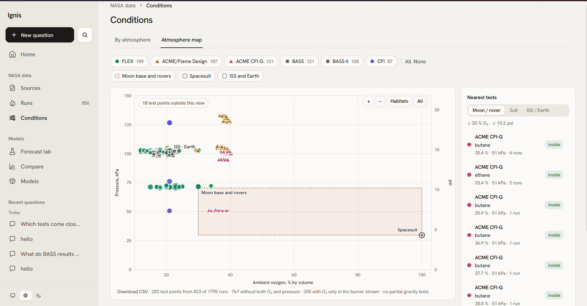

# Conditions: Atmosphere map

[Back to the screen guide](README.md)

## Route

`#/conditions?tab=map[&inv=<investigation id>]`. The old link `#/map` redirects here. `inv` focuses
one investigation: only its points are shown and the view is framed on them.

## Purpose

The atmosphere map places every NASA test point by ambient oxygen (horizontal) and pressure
(vertical), against the three crew atmospheres. Each point groups the runs of one investigation and
fuel at the same atmosphere; its size counts the runs, its colour names the investigation and its
shape the hardware. Beside the map, a list ranks the test points nearest a chosen atmosphere, and a
selected point lists its runs.

## Layout

1. **Page title** "Conditions" with tabs; **Atmosphere map** active.
2. **Layer chips**:
   - **Investigations shown**: one chip per investigation (swatch, acronym, number of placed runs),
     sorted by run count; click to hide or show. **All** and **None** switch every chip.
   - **Crew atmospheres shown**: **Moon base and rovers**, **Spacesuit**, **ISS and Earth**; click to
     hide or show each.
3. **Map** (left card):
   - Axes: *Ambient oxygen, % by volume* (bottom), *Pressure, kPa* (left), *psi* (right).
   - The Moon base and rovers region is a shaded rectangle (O2 30-100 %, 4.3-10.2 psi); ISS and Earth
     and Spacesuit are cross-in-circle marks with labels.
   - Points: colour per investigation (five fixed colour slots: PSI-69, PSI-10, PSI-159, PSI-39,
     PSI-68; the rest neutral); shape by hardware (circle: droplets; triangle: burner flames;
     square: solid samples; diamond: other); radius `min(13, 3.2 + 2.1 × sqrt(runs))`. Large points
     are drawn first so small ones stay clickable.
   - **Hover** a point: tooltip with acronym, fuel, "O2 % · kPa (psi)", "approximate" when a value is
     flagged approximate, and the run count.
   - **Click** a point to select it (again to deselect); click empty space to deselect.
   - **Wheel** over the plot zooms around the cursor; **drag** pans; **double-click** zooms in.
   - **Zoom tools**: **+**, **−**, **Habitats** (O2 10-103 %, 0-150 kPa), **All** (every point).
   - "N test points outside this view" button, when points fall outside; click to show all.
   - **Footer**: **Download CSV**, then "N test points from P of R runs · U without both O2 and
     pressure · B with O2 only in the burner stream · no partial-gravity tests".
4. **Side card** (right):
   - **Nearest tests** (no point selected): segments *Moon / rover*, *Suit*, *ISS / Earth*; the
     atmosphere's definition; the eight shown points nearest it, each with colour dot, acronym, fuel,
     "O2 % · kPa · N runs" and either an **inside** tag or the offset ("+9.0 pts O2, −4.5 psi").
     Clicking one selects it and centres the map on it.
   - **Selected point**: swatch, acronym, **Close**; the investigation's title; *Fuel*, *Oxygen*,
     *Pressure* (kPa and psi), and the offset to each of the three atmospheres; "N runs" with a link
     per run that opens the Run item in the side panel.

### States

"Loading..." (a copy from the last visit shows at once); "Conditions are not available on this
server".

## Data

The same reduced conditions view as [By atmosphere](conditions.md#data): `POST /api/v1/conditions`
(keys `oxygen_mole_fraction`, `pressure`, `fuel`, every page), runs placed by `pointsFromConditions`,
grouped into test points by `groupTestPoints`, offsets by `offset`. Client-side on this page:

- **Nearest list**: shown points sorted by `offset(...).distance`, ties by more runs, first eight.
- **Pressure in psi**: kPa / 6.894757.
- **CSV** (`ignis-test-points.csv`): one row per shown test point with `investigation`, `name`,
  `fuel`, `oxygen_percent`, `pressure_kpa`, `pressure_psi`, `runs`, `run_ids` (space-separated).
- **Zoom limits**: O2 span 1 % to 110 %, pressure span 2 kPa up to 1.1 × the highest point + 10 kPa.
- **Focus** (`inv`): hides every other investigation and frames O2 10-103 % and pressure 0 to the
  larger of 150 kPa and 1.1 × its highest point.

## Flows

**Locate an investigation's tests**

1. On By atmosphere, click **On the map** on a card (or open `#/conditions?tab=map&inv=PSI-69`).
2. The map shows only that investigation; switch other chips on to compare.
3. Click a point to see its runs and its offset to each atmosphere.

**Export the points**: set the chips to the investigations you want, then **Download CSV**.

**Find the tests nearest the spacesuit atmosphere**: pick *Suit* in *Nearest tests*, click the first
entry; the map centres on it and the side card lists its runs.

## Links

Run item in the side panel (per run); [By atmosphere](conditions.md); Home's *Atmosphere map* link.
Answers can embed the same map over the table they cite (*Habitat atmospheres* view).

## Developer notes

- Components: `MapView`, `useConditionsView`, `downloadCsv` in
  [`views/MapView.tsx`](../../web/src/views/MapView.tsx); `ConditionsMap`, `ShapeSwatch`, `HOME` in
  [`views/ConditionsMap.tsx`](../../web/src/views/ConditionsMap.tsx).
- Colour slots and shapes are `SLOT` and `SHAPE` in
  [`data/investigations.ts`](../../web/src/data/investigations.ts) (`invColor`, `invShape`).
- The map draws at the container's pixel width (ResizeObserver), height `0.58 × width` between 320
  and 560 px.
