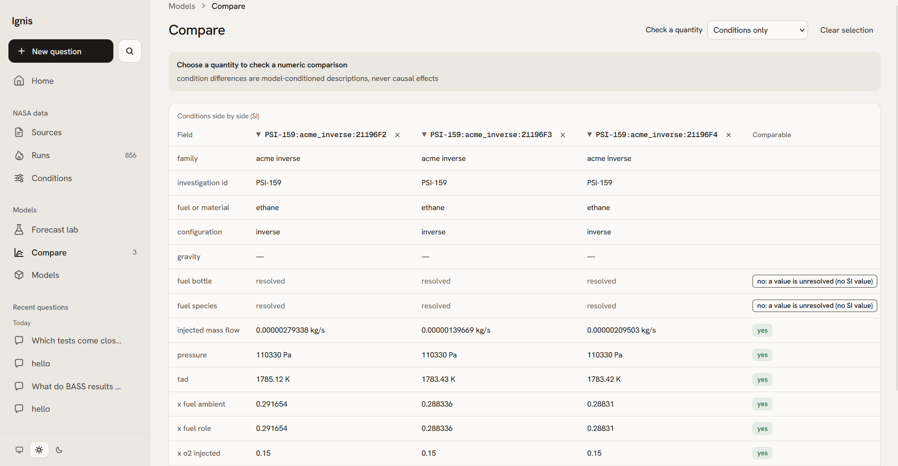

# Compare

[Back to the screen guide](README.md)

## Route

`#/compare`. No parameters: the runs come from the shared selection (up to 8), which the Runs
checkboxes, the run side panel (**Add to compare**) and the answer's *Compare <runs>* follow-up set.
Rail: *Models > Compare* (the badge counts the selection).

## Purpose

Compare puts the selected runs side by side, condition by condition in SI units, with a per-row
verdict on whether the values are comparable. Choose a measured quantity and the server says whether
a numeric comparison of that quantity across these runs is permitted, and of which kind.

## Layout

1. **Heading** "Compare". With two or more runs: **Check a quantity** select (*Conditions only*,
   *liquid diameter*, *visible flame diameter*, *uv flame diameter*, *front position*, *front
   contour*, *pressure*, *temperature*) and **Clear selection**.
2. **Empty state** (fewer than two runs): "Select at least two runs", how to select them, the one
   selected run when there is one, and **Open the run index**.
3. **Verdict note**:
   - *Conditions only*: "Choose a quantity to check a numeric comparison" with the server's note.
   - Permitted: "Numeric comparison of <quantity> is permitted" with the comparison kind tag and
     note.
   - Refused: one refusal note per reason ("Numeric comparison of <quantity> refused", code,
     reason, "Pick runs of one family with the same measured quantity.").
4. **Table** "Conditions side by side (SI)":
   - Header: one column per run with its family mark, its id (opens the Run side panel item), a
     *Synthetic* tag for fixture runs on a live page, and **×** to remove it; a last column
     **Comparable**.
   - Rows: *family*, *investigation id*, *fuel or material*, *configuration*, *gravity* (in g0), then
     one row per condition key: the SI value with its unit, the resolution in words when there is no
     SI value, or "not recorded". The *Comparable* cell is **yes** or **no: <reason>**.

## Data

`POST /api/compare` with `{ run_ids, quantity? }` → `CompareResult` (`columns`, `rows` with
`values`, `comparable`, `reason`; `comparison_kind`; `numeric_comparison` with `allowed`,
`refusals`, `note`). The request reruns whenever the selection or quantity changes. Values are
formatted with 6 significant digits ([`format.ts`](../../web/src/format.ts)); a unit `1` is not
printed.

## Flows

**Compare runs**

1. On Runs, tick two to eight runs and click **Compare** in the tray.
2. Read the conditions side by side; *Comparable* says which rows line up.
3. Pick a quantity in **Check a quantity** to see whether a numeric comparison is permitted.
4. Remove a run with **×**, or **Clear selection** to start over.

## Links

[Runs](runs.md) (selection and the empty-state button), Run side panel item.

## Developer notes

- Component: [`views/Compare.tsx`](../../web/src/views/Compare.tsx). The quantity list is
  `QUANTITIES`; add a `Quantity` from the contract there.
- The selection is [`shell/compare.tsx`](../../web/src/shell/compare.tsx) (`toggle`, `set`, `clear`,
  `MAX_COMPARE = 8`); it is cleared when the data source changes.
