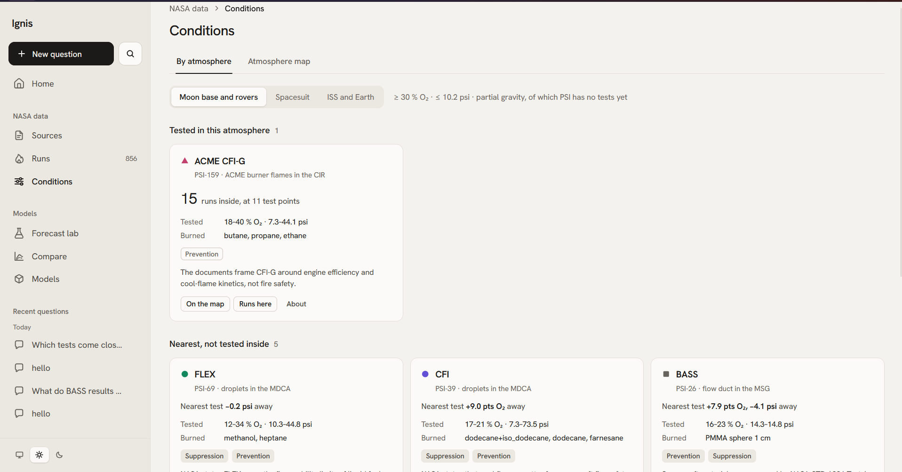

# Conditions: By atmosphere

[Back to the screen guide](README.md)

## Route

`#/conditions[?habitat=<moon|suit|iss>]`. Rail: *NASA data > Conditions*. The page has two tabs:
**By atmosphere** (this page, the default) and **Atmosphere map** (`?tab=map`, see
[atmosphere-map.md](atmosphere-map.md)). `habitat` picks the initial atmosphere (default `moon`).

## Purpose

By atmosphere answers which NASA investigations tested fire in a given crew atmosphere: Moon base and
rovers, Spacesuit, or ISS and Earth. For the chosen atmosphere it lists the investigations with test
points inside it (and how many runs), then the investigations whose nearest test lies outside, with
how far that test is in oxygen points and psi, then the investigations NASA's tables cannot place.
Each card joins the numbers with the investigation's atlas card: what was burned, its fire-safety
needs and why it matters.

## Layout

1. **Page title** "Conditions" with tabs **By atmosphere** and **Atmosphere map**.
2. **Atmosphere selector**: **Moon base and rovers**, **Spacesuit**, **ISS and Earth**; beside it the
   definition (">= 30 % O2 · <= 10.2 psi", "100 % O2 · 4.3 psi", "21 % O2 · 14.7 psi"). For the Moon
   it adds "· partial gravity, of which PSI has no tests yet".
3. **Tested in this atmosphere N**: cards for investigations with runs inside. When none:
   "No NASA test in these tables was run in this atmosphere."
4. **Nearest, not tested inside N**: cards for investigations whose tests are all outside.
5. **Not placeable from NASA's tables N** (folded; click to open): one row per investigation with its
   swatch, acronym, run count and reason: "NASA's table states no oxygen", "... no pressure",
   "... neither oxygen nor pressure", or "oxygen only in the burner stream; the atmosphere is the
   fuel", plus **About**.

### Investigation card

- **Header**: the investigation's map swatch (colour and shape), acronym, id and hardware.
- **Statistic**: "<N> runs inside, at <M> test points", or "Nearest test <offset> away", for example
  "+9.0 pts O2, −4.5 psi" (how far the test would move to reach the atmosphere; positive is higher).
- **Tested**: oxygen range in percent and pressure range in psi over the investigation's test points.
- **Burned**: up to three fuels from the atlas card (else the nearest point's fuel, else "not
  stated").
- **Needs** chips: *Prevention*, *Detection*, *Suppression*; a dashed chip is inferred (tooltip:
  NASA's words and the inference).
- **Relevance**: the first sentence of the atlas card's "why it matters".
- **Buttons**: **On the map** (`#/conditions?tab=map&inv=<id>`), **Runs here** (when runs are
  inside; `#/runs?habitat=<h>&inv=<id>`), **About** (the Investigation item in the side panel).

### States

"Loading..." (a copy from the last visit shows at once when available); "Conditions are not
available on this server" with the error.

## Data

`POST /api/v1/conditions` with
`{ schema_version: "dataset.v2", keys: ["oxygen_mole_fraction", "pressure", "fuel"], include_unknown: true, page_size: 1000, cursor }`,
followed page by page until `next_cursor` is null → `ConditionsTable.rows`. The reduced view is
computed in the browser and kept in IndexedDB (`conditions-view:<mode>`); it is shared with the map.

Computation ([`research/mapPoints.ts`](../../web/src/research/mapPoints.ts),
[`research/testPoints.ts`](../../web/src/research/testPoints.ts)):

1. **Placing runs** (`pointsFromConditions`): a run is placed only when it has a numeric
   `oxygen_mole_fraction` and `pressure`. An oxygen value flagged `oxidizer_stream:burner` is not the
   atmosphere and is never placed. Runs missing one or both are counted.
2. **Test points** (`groupTestPoints`): within one investigation and fuel, sorted by O2, pressure and
   id, a run joins the first group whose first run is within 0.5 percentage points of O2 and 1 kPa;
   otherwise it starts a new group. A point's O2 and pressure are the means of its runs.
3. **Offset to an atmosphere** (`offset`): per axis, the distance from the point to the atmosphere's
   interval, with a tolerance of 0.5 points of O2 and 1 % of the atmosphere's upper pressure. Inside
   when both are zero. Shown as O2 points and psi. Ranking distance is
   `hypot(dO2 as a fraction, dPressure / 101.325 kPa)`.
4. **Ranking** (`rankForAtmosphere`): investigations with runs inside first (most runs first), then
   by the distance of their nearest point, then those with no placeable point; ties by id.
5. **Not placeable** (`undecidable`): none of the investigation's runs has both values; the reason
   says which is missing, or that oxygen is only in the burner stream.

Narrative (fuels, needs, relevance, findings) comes from the atlas file
[`data/investigations.json`](../../web/src/data/investigations.json) via
[`data/investigations.ts`](../../web/src/data/investigations.ts). Numbers never come from it.

## Flows

**Which tests come closest to Moon-base air?**

1. Open Conditions (By atmosphere); *Moon base and rovers* is selected.
2. Read *Tested in this atmosphere*; each card says how many runs and test points are inside.
3. Read *Nearest, not tested inside* for how far the others are.
4. Click **Runs here** to list the runs, or **On the map** to see the points.

**Read about an investigation**: click **About** for its atlas card in the side panel.

## Links

[Atmosphere map](atmosphere-map.md), [Runs](runs.md), side panel Investigation item (which links to
the map and to [Sources](sources.md)).

## Developer notes

- Components: `ConditionsPage` and `ConditionsMatrix` (used by answers) in
  [`views/Conditions.tsx`](../../web/src/views/Conditions.tsx); `ByAtmosphere`, `InvCard`,
  `UndecidableRow` in [`views/ByAtmosphere.tsx`](../../web/src/views/ByAtmosphere.tsx); the shared
  query `useConditionsView` in [`views/MapView.tsx`](../../web/src/views/MapView.tsx).
- Add an atmosphere: extend `HabitatId` and `HABITAT_LIST` in
  [`research/habitats.ts`](../../web/src/research/habitats.ts); the selector, Runs filter, Home tiles
  and map read the list. The map draws regions for `moon` and reference marks for `iss` and `suit` by
  id in [`views/ConditionsMap.tsx`](../../web/src/views/ConditionsMap.tsx).
- `habitats.ts` also has envelope-based helpers (`habitatFit`, `rankFor`, `habitatFilters`) over
  `InvestigationEnvelope`; this page ranks from actual test points instead.
