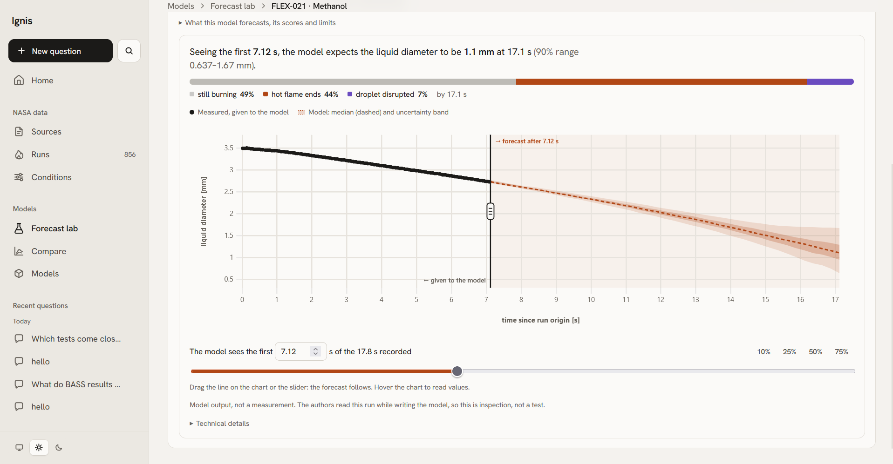

# Forecast lab

[Back to the screen guide](README.md)

## Routes

| Hash | View |
|---|---|
| `#/lab` | pick a run, or forecast from conditions you type |
| `#/lab/<run id>` | the lab on one run; the breadcrumb shows the run's label |

Rail: *Models > Forecast lab*. The run side panel's **Forecast** button and the answer's *Forecast
`<run>` from its first seconds* follow-up open `#/lab/<run id>`.

## Purpose

The forecast lab gives a model only the beginning of a NASA run, or conditions you type, and shows
its forecast with uncertainty next to what was recorded. Pick a run and the model written for it is
chosen for you; move the cutoff and the forecast follows. Two kinds of release are served:

- **Hand-written models** (the research service, `/api/v1`): literal-weight releases, each with a
  model card. They forecast a stored run of their training partition, or a scenario you type.
- **Fitted releases** of the run registry (`/api`), listed on the run's record: these add a five-step
  protocol to seal a prediction and then reveal the recorded continuation.

## Layout

### Header

"Forecast lab" and the subtitle "Give a model the beginning of a NASA run (or conditions you type),
read its forecast with uncertainty, and compare it with what was recorded." When the run has fitted
releases, a **Model release** select lists them ("`<model>` · `<state>`").

### What to forecast

- With a run: the family mark, the run label (NASA name · fuel), the run id (opens the Run side
  panel item), and a line with the family, "N recorded points (quantities)" or "conditions only: no
  measured time series in IGNIS yet", and the run's partition for the fitted release. **Change run**
  opens the picker; **Close** closes it.
- Without a run, or while changing: the **run picker** ([`views/RunPicker.tsx`](../../web/src/views/RunPicker.tsx)):
  - Search "Search by test name (FLEX-093), fuel or run id" (matches id, fuel, family and aliases;
    Enter picks the first row).
  - **Only runs a model can forecast (N of M)** toggle, on by default.
  - Family segments with counts (**All**, then each family).
  - The list: family mark, label, id and a reach tag:
    - **forecast · N points** / **forecast**: a served model reads this run directly;
    - **forecast from conditions**: a model forecasts from the run's conditions, filled in for you;
    - **you type its data**: a model is written for the family but needs values the record lacks;
    - **sealed for evaluation**: a validation or test run, kept from the models;
    - **no model**: no served model is written for the family;
    - **N points** / **conditions only**: shown while reach is unknown.
    Runs are sorted by reach (ready first), then by having a series, then by number of points.
  - "No run matches." with **Show the runs no model can forecast here** when the toggle hides them.

### Model and forecast (hand-written models)

[`views/LabModels.tsx`](../../web/src/views/LabModels.tsx).

- Without a run: "Pick a run above and the model written for it is chosen for you." and **Forecast
  from conditions you type instead** (then **<- Back to picking a run**).
- **Model chooser** (open while nothing is chosen, or on **Change**): radio list grouped as
  *Written for `<family>` runs* first, then *FLEX droplets*, *ACME burner flames*, *BASS solids*,
  *Other NASA investigations* (suffixed "(you type the conditions)" when a run is picked). Each
  option shows a short name, what it forecasts in one line, the model slug, and a **best fit** tag.
  A click picks and closes; **Done** closes.
- **Model line** once chosen: "Model `<name>` `<slug>`" and **Change**, then "Chosen automatically:
  `<reasons>`." (for example "same family (FLEX), written for n-heptane") and how many other models
  also fit.
- **Model panel**:
  - Name (the card's investigation), slug, tags **experimental** and **hand-written · zero-shot** or
    **· data-informed**.
  - **The NASA run** / **Conditions I type** segments, for models that read stored runs.
  - **What this model forecasts, its scores and limits** (folded): the card's forecast text,
    authorship note, *Reported development scores* (metric, value, comparison, source), *Limits*,
    inputs note, citation and model card document.
  - **Stored run mode**: if the run is not in the model's training partition, a note "This run is
    sealed for evaluation" and up to six training runs to pick instead.
  - **Typed mode**: a note on what is filled in; the inputs grouped as *Conditions*, *Controls over
    time*, *Measured before the cutoff*, *Timing*. Each field has a label from the card, its SI unit,
    an "optional" tag, an example placeholder, and a source note: "from the NASA record" or "not in
    the NASA record: enter it". Series and control stages use a small table editor (t, value; or
    start, end, value) with **+ Add row**, row removal, and multi-line paste.
    **Start from an example** / **Replace with example values** fills the card's examples.
  - **Cutoff** field ("The model sees the first N s", or "Start the forecast at N s") and
    **Forecast**, when the forecast is not automatic.
  - **The forecast**:
    - A sentence: "Seeing the first N s, the model expects the `<quantity>` to be `<median>` `<unit>` at
      `<t>` s (`
`% range `<lo>`-`<hi>` `<unit>`)." For an event model: "Probability of each outcome by
      `<t>` s (model output):" with an outcome bar and legend (*still burning*, *extinguished*, *hot
      flame ends*, *cool flame*, *droplet disrupted*, *stopped by the test script*, *flow stopped*,
      *unresolved*).
    - **Recorded**: how the run actually ended in NASA's record (event time, interval, scheduled
      stop, still burning at the end), shown for event models on stored training runs.
    - The chart: measured points given to the model (or "Your values (synthetic)"), the median
      (dashed) and the uncertainty band, the cutoff line. Hover reads values.
    - On a stored run with a series: the cutoff slider and field "The model sees the first N s of the
      T s recorded", presets **10%**, **25%**, **50%**, **75%**, and dragging the line on the chart.
    - The footer "Model output, not a measurement." (with "this is inspection, not a test" when the
      authors read the run while writing the model).
    - **Technical details**: the support note, event probabilities, release, prefix and artifact ids.
  - **Law releases** (every input a condition, several declared targets): one row per target that
    applies to the sample, with a question and its answer: a probability bar ("NN% likely") for a
    binary target, or a median with its range for a value (speeds in cm/s, fractions in %). When the
    record fills every input, the forecast runs once by itself and the inputs fold into "The N
    inputs, all from the NASA record ..."; **Forecast again with these inputs** reruns it.
  - "No forecast" with the reason when a call fails; "The model refuses this input and gives no
    number for it." with the support note when the support gate refuses.
- Service notes: "The prediction models are switched off on this server" (with the capability
  detail; the deployment needs `IGNIS_ENABLE_MODELS=true`), "Hand-written models are not served
  here", "No model is served", "No served model is written for `<family>` runs".

### Fitted releases: chart and steps

Shown when the run's record lists releases (`ExperimentDetail.releases`).

- **Chart** titled by the quantity and display unit (metres shown as mm), with a live status
  ("Updating the forecast...", "Cached artifact", "Computed now"). Legend: observed before the cutoff,
  model quantile bands with dashed median, revealed continuation (sealed until revealed), cutoff.
- **Cutoff, s**: slider and number field, from 0 to the longest recorded series, step 1/200 of it;
  default 40 %.
- A count line: "N admitted · P recorded but not yet available · H after the cutoff, sealed ·
  archive extent T s (display only, never a model input)".
- "No model output is drawn" with the refusal, when there are no bands.
- **Show the data as a table**: observed, model quantiles (about 12 rows) and revealed values.
- Partition notes: "This run is in the release's training partition" (with a link to a validation
  run) or "This run is in the test partition".
- **Steps**:
  1. **Run and cutoff**.
  2. **Forecast**: state tag, support note ("Inside the model's support" or "Refused by the support
     gate", the state, the gate and reasons), stacked event probabilities with a table at the last
     time, and the release line.
  3. **Next observation**: **List candidates** lists observations recorded before the cutoff but not
     yet admitted, with their time and utility score (no values are shown), and the cost note.
  4. **Seal the prediction**: **Seal prediction** hashes the forecast artifact; shows the seal time,
     partition and hash. Not offered again once the run's continuation was revealed at another cutoff.
  5. **Reveal the continuation**: **Reveal** (after sealing) adds the recorded continuation to the
     chart as rings and states how many observations and the endpoint.
- **Provenance** (folded): analysis id, cached or computed time, time origin, cohort and split,
  prefix and settings hashes, admitted observations and contours, conditions used, engine.

## Data

| What | Endpoint |
|---|---|
| Runs for the picker | `GET /api/experiments` |
| Run record, fitted releases, endpoint | `GET /api/experiments/{id}` → `ExperimentDetail` |
| Hand-written model cards | `GET /api/v1/model-cards` → `ModelCard[]` |
| A release's split | `GET /api/v1/models/{release id}` (`split_id`) |
| Training runs of a split | `GET /api/experiments?split=<split>&partition=train` |
| Observations at the cutoff | `GET /api/experiments/{id}/observations?cutoff_s=` → `ObservationsAtCutoff` |
| Typed scenario | `POST /api/v1/models/{release id}/scenarios` (`wsp.v1`: conditions, controls, observations, test date, phase start, cutoff) → `ScenarioAdmitted.input_hash` |
| Hand-written forecast | `POST /api/v1/analyses` (`release_id`, `input` = `stored_run` or `prefix`, optional `settings.target`), poll `GET /api/v1/jobs/{id}` every 400 ms, then `GET /api/v1/artifacts/{id}` → `AnalysisArtifact` |
| Fitted forecast | `POST /api/forecast` (`run_id`, `cutoff_s`, `model_release_id`, `wait_ms: 1500`), poll `GET /api/jobs/{id}` every 600 ms → `ForecastOutcome` |
| Candidates, seal, reveal | `POST /api/acquisition`, `/api/seal`, `/api/reveal` with `analysis_id` |
| Partition of a run (fitted) | `GET /api/experiments?split=<split>&partition=train\|validation\|test` |
| Lane input table | `web/public/data/bass5_inputs.json` for `bass5.wsp` |

Client-side:

- **Reach** (`useReach`): *ready* when a stored-run model of the run's family lists the run in its
  training partition (and the run has a series if the model reads observations); *conditions* when a
  typed model fits and the record fills every required input; *typed* when a typed model fits;
  *sealed* when a stored-run model exists for the family; else *none*.
- **Fit score** (`fit`): +4 same family (or +3 for an `other` model written for the run's
  investigation), +2 when the run's fuel appears in the card, −1 when the card names droplets,
  fabric or plastics and the fuel does not match, +1 for stored-run models; +3 more when the record
  fills every input. The highest score is chosen automatically.
- **Filling inputs** (`fromRun`): from the lane table row when one exists; else numeric conditions
  by name, text conditions from the fuel, BASS sample width parsed from the material name
  ("2 cm wide"), control stages from condition values, the test date from the session id.
- **Summary sentence** (`quantileSummary`): median and outer band at the last forecast time.
- Display: metres as mm (× 1000).
- With a stored training run, the forecast runs automatically 350 ms after the cutoff changes.

## Flows

**Forecast a run**

1. Open the Forecast lab and pick a run in the picker (tag *forecast*).
2. The best-fitting model is chosen; read "Chosen automatically: ..." or click **Change** to pick
   another.
3. Drag the cutoff on the chart, use the slider, a preset, or type seconds. The forecast follows.
4. Read the sentence (median and range at the last time) and the band against the measured points;
   for an event model, the outcome bar and how the run actually ended.

**Forecast from conditions you type**

1. On `#/lab` click **Forecast from conditions you type instead** (or on a run, **Conditions I
   type**).
2. Choose the model; fill its inputs, or **Start from an example**.
3. Set the cutoff and click **Forecast**.

**Seal and reveal (fitted releases)**

1. Open a run whose record has a fitted release; pick the release in the header.
2. Set the cutoff; the forecast appears as bands.
3. Optionally **List candidates** for the next observation.
4. Click **Seal prediction**, then **Reveal**; compare the rings with the bands.

## Links

Run side panel (run id), [Models](models.md) for release details, [Runs](runs.md).

## What the UI marks

Hand-written models carry an **experimental** tag; every forecast reads "Model output, not a
measurement"; a run outside a model's training partition is shown as *sealed for evaluation*.

## Developer notes

- Components: `Lab`, `Step`, `SupportNote`, `EventStack`, `DataTable` in
  [`views/Lab.tsx`](../../web/src/views/Lab.tsx); `LabModels`, `ModelPanel`, `ModelChooser`,
  `InputGroups`, `RowsEditor`, `LawAnswers`, `OutcomeBar`, `RecordedEnd`, `useReach`, `fit`,
  `fromRun`, `complete` in [`views/LabModels.tsx`](../../web/src/views/LabModels.tsx); `RunPicker`,
  `runLabel`, `nasaName` in [`views/RunPicker.tsx`](../../web/src/views/RunPicker.tsx); the chart in
  [`components/ForecastChart.tsx`](../../web/src/components/ForecastChart.tsx).
- Fitted-release requests use `useLatest` ([`hooks.ts`](../../web/src/hooks.ts)): debounced,
  cancellable, and only results for the current inputs are shown.
- A model whose inputs the registry does not hold as conditions can ship a per-run input table: add
  its JSON under `web/public/data/` and its model name to `TABLES` in `LabModels.tsx`.
- Outcome names and colours: `OUTCOME` and `outcomeColor`. Model groups: `MODEL_GROUPS`.
