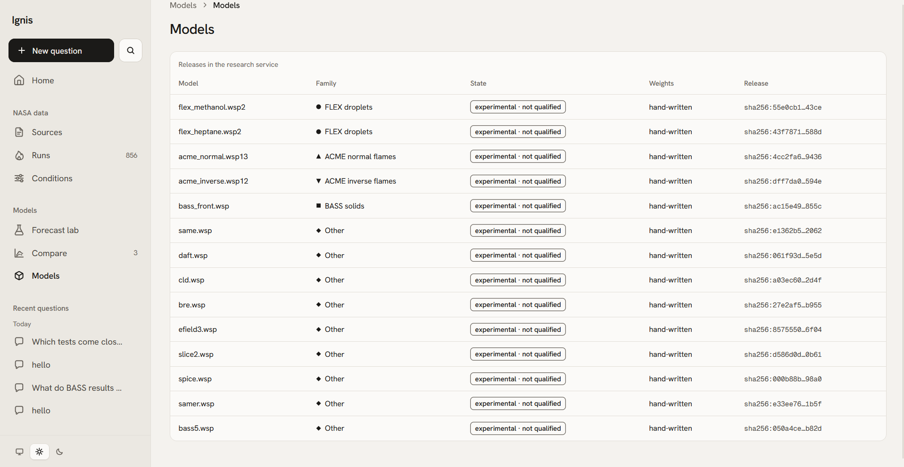

# Models

[Back to the screen guide](README.md)

## Route

`#/models`. No parameters. Rail: *Models > Models*.

## Purpose

Models lists the model releases the research service serves, with each release's family, state,
weights and id. Click a release to read how it was built in the side panel: construction method,
uncertainty kind, author, forward entry point, build checks, what the author saw, and its hashes.

## Layout

1. **Heading** "Models".
2. **Table** "Releases in the research service":

   | Column | Content |
   |---|---|
   | **Model** | `model_name` |
   | **Family** | family mark and name (FLEX droplets, ACME normal flames, ACME inverse flames, BASS solids, Other) |
   | **State** | state tag: a qualified state (`measurement_qualified`, `forecast_qualified`, `event_qualified`) in green; any other state in amber with "· not qualified" |
   | **Weights** | "hand-written" for `trained_on = not_trained`, else the training source in words |
   | **Release** | shortened release id |

   Clicking a row opens the **Model release** item in the side panel.
3. **Side panel** (Model release): the state tag; for a release that is not qualified, the line "No
   evaluation supports this release's predictions: show its outputs as experimental model output
   only."; *family*, *trained on* ("hand-written (literal weights)" for `not_trained`), *lineage*,
   *features*, *baseline*, *release*; then *Construction* (method, uncertainty, author provider and
   model, forward entry point and profile, tensors and trainable count, parent), *Build checks* (a
   summary and each check passed, failed or other), *What the author saw* (exposure counts) and
   *Hashes* (spec, patch, weights, forward). A release without a build manifest says so with its
   tensor counts.

### States

- "Models are not available on this server" with the capability detail, when the models service is
  off.
- "Releases could not be loaded" with the error.
- "No releases."

## Data

`GET /api/v1/models` → `ModelRelease[]` (`id`, `family`, `model_name`, `state`, `trained_on`,
`lineage`, `feature_order`, `is_baseline`, `construction`, `tensors`, `parent_id`). The availability
check is `GET /api/v1/capabilities` (`models.available`, `models.detail`).

## Flows

**Inspect a release**

1. Open Models.
2. Click a row.
3. Read the construction and build checks in the side panel; open *Hashes* for the content hashes.

## Links

Side panel Model release item. Answers embed the same release as a *Model release* card with
**Construction and checks**. The [Forecast lab](forecast-lab.md) runs the hand-written releases.

## What the UI marks

The state column marks every release that no evaluation has qualified as "not qualified".

## Developer notes

- Component: [`views/Models.tsx`](../../web/src/views/Models.tsx); the panel item is `ReleaseItem` in
  [`shell/Panel.tsx`](../../web/src/shell/Panel.tsx) with `ReleaseConstruction` in
  [`shell/ArtifactViews.tsx`](../../web/src/shell/ArtifactViews.tsx).
- `ReleaseState` and `isQualified` are in [`ui/common.tsx`](../../web/src/ui/common.tsx).
- The list query is `useReleases()` in [`shell/queries.ts`](../../web/src/shell/queries.ts), disabled
  when the models capability is off.
