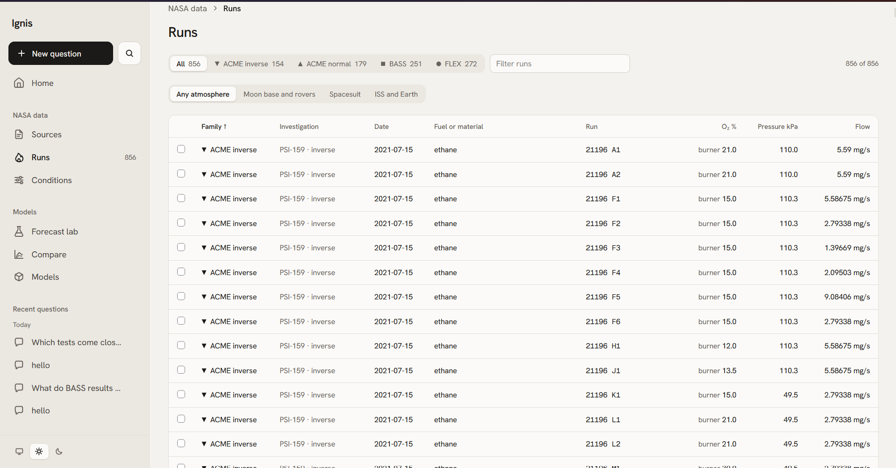

# Runs

[Back to the screen guide](README.md)

## Route

`#/runs[?family=<family>&habitat=<moon|suit|iss>&inv=<investigation id>]`. Rail: *NASA data > Runs*
(the badge is the number of runs).

| Parameter | Effect |
|---|---|
| `family` | starts with the family filter on (`flex`, `acme_normal`, `acme_inverse`, `bass`, `other`) |
| `habitat` | starts with the atmosphere filter on |
| `inv` | starts with an investigation filter chip (for example `PSI-69`) |

The parameters set the initial filters; changing a filter on the page does not rewrite the URL.

## Purpose

Runs is the index of every NASA run in the registry: one row per run with its family, investigation,
test date, fuel or material, NASA's own run name, ambient oxygen, pressure and flow. Sort by any
column, narrow by family, text, crew atmosphere or investigation, open a run's full record in the side
panel, and tick runs to compare them.

## Layout

1. **Heading** "Runs".
2. **First toolbar**:
   - **Family filter** ([`views/FamilyLegend.tsx`](../../web/src/views/FamilyLegend.tsx)): **All N**,
     then one segment per family with its mark and count. Clicking the active family again clears it.
   - **Filter runs** text field: matches the run id, its NASA name, fuel or material, configuration,
     investigation id and the investigation's acronym.
   - **N of M**: rows shown of all runs.
3. **Second toolbar**:
   - **Atmosphere** segments: **Any atmosphere**, **Moon base and rovers**, **Spacesuit**, **ISS and
     Earth** (tooltip: the atmosphere's definition). With one chosen, a note repeats the definition,
     "· recorded ambient O2 and pressure".
   - **Investigation chip** (when `inv` is set): "<acronym> ×"; click to remove the filter.
4. **Table** (click a column header to sort; click again to reverse; the arrow shows the direction):

   | Column | Content |
   |---|---|
   | (checkbox) | select for Compare; disabled once 8 runs are selected |
   | **Family** | family mark and name |
   | **Investigation** | investigation id and configuration (hidden on narrow screens) |
   | **Date** | test day from the session id (`YYYY-MM-DD`) |
   | **Fuel or material** | as recorded, or "unknown" (hidden on narrow screens) |
   | **Run** | NASA's run name, with the full id as tooltip; *Synthetic* tag for fixture runs on a live page |
   | **O2 %** | ambient oxygen in percent, 1 decimal; for an inverse flame, the burner-stream oxygen prefixed "burner" |
   | **Pressure kPa** | pressure in kPa, 1 decimal |
   | **Flow** | air flow in cm/s, or burner mass flow in mg/s (hidden on narrow screens) |

   Missing values show "—" and sort last in either direction. Ties sort by family, investigation,
   date and run. The default sort is Family ascending. Clicking a row opens the **Run** item in the
   side panel; the open row is highlighted.
5. **Compare tray** (bottom, when runs are ticked): "N selected" ("(maximum 8)" at the cap),
   **Compare** (enabled from 2 runs) and **Clear**.

### States

- "Loading runs..." on first load (a copy from the last visit shows at once when available).
- "Runs could not be loaded" with the error and **Try again**.
- "No run matches." with **Clear the filters** (clears the text and family filters).
- "No runs on this server yet."

## Data

`GET /api/experiments` → `ExperimentList.experiments[]` (`ExperimentSummary`). All filtering and
sorting is client-side:

- **Run name** (`runName`): the first alias present among `testsheet_header`, `file_flex_number`,
  `table_test`, then `run <as_run_number> · test <test_number>`, then `test_number`; else the id
  without investigation, family token and date.
- **Oxygen** (`oxygen`): `conditions.x_o2`, else `x_o2_ambient`, else `oxygen_mole_fraction`; if none,
  `x_o2_injected` marked as burner stream. Shown × 100.
- **Pressure**: `conditions.pressure.value_si` (Pa) / 1000.
- **Flow** (`flow`): `flow_velocity` (m/s) × 100 as cm/s, else `injected_mass_flow` (kg/s) × 10^6
  as mg/s.
- **Atmosphere filter** (`inAtmosphere`): a run is inside when it has ambient (not burner-stream)
  oxygen and a pressure, and `offset(o2, kPa, habitat).inside` holds: oxygen within 0.5 percentage
  points of the atmosphere's oxygen range and pressure within 1 % of its upper pressure bound
  ([`research/testPoints.ts`](../../web/src/research/testPoints.ts)). The atmospheres are
  `HABITAT_LIST` in [`research/habitats.ts`](../../web/src/research/habitats.ts): Moon base and rovers
  O2 30-100 %, 4.3-10.2 psi; Spacesuit 100 % O2 at 4.3 psi; ISS and Earth 21 % O2 at 14.7 psi
  (1 psi = 6894.757 Pa).

## Flows

**Find the runs of one investigation in one atmosphere**

1. On Conditions > By atmosphere, click **Runs here** on an investigation card (or open
   `#/runs?habitat=moon&inv=PSI-69`).
2. The table lists those runs; sort by O2 or pressure.
3. Click a row to read its conditions, NASA originals and measured series in the side panel.

**Compare runs**

1. Tick two to eight runs.
2. Click **Compare** in the tray. See [compare.md](compare.md).

**Forecast or ask about a run**: open the run in the side panel, then **Forecast** (Forecast lab) or
**Ask about this run** (starts a question).

## Links

Side panel Run item → Forecast lab, Questions, NASA originals; Compare tray → [Compare](compare.md).
Opened from Home tiles and Conditions cards.

## Developer notes

- Component: [`views/Runs.tsx`](../../web/src/views/Runs.tsx). The column getters are `val`; add a
  column by extending `Col`, `val`, the header and the row.
- The selection is the shared Compare context ([`shell/compare.tsx`](../../web/src/shell/compare.tsx),
  `MAX_COMPARE = 8`), cleared when the data source changes.
- The view is keyed by the URL parameters in [`App.tsx`](../../web/src/App.tsx), so a new link resets
  the filters.
- The atmosphere filter here reads the registry's per-run conditions; the Conditions pages read the
  conditions service. Both use the same tolerances.
