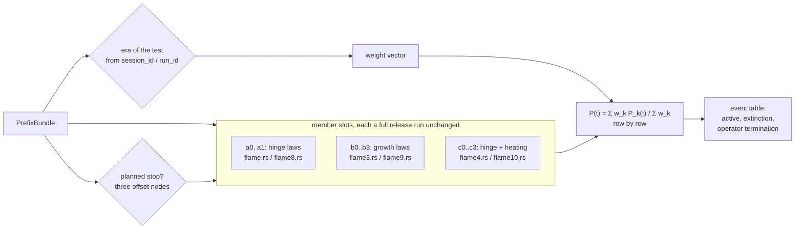
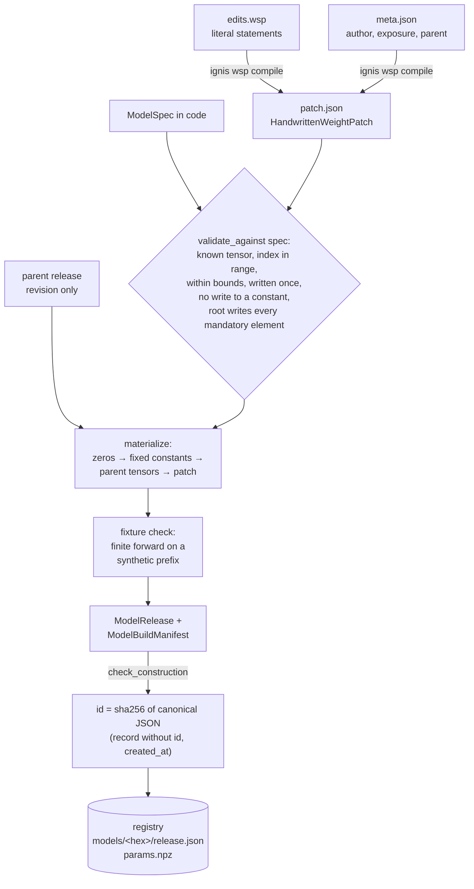
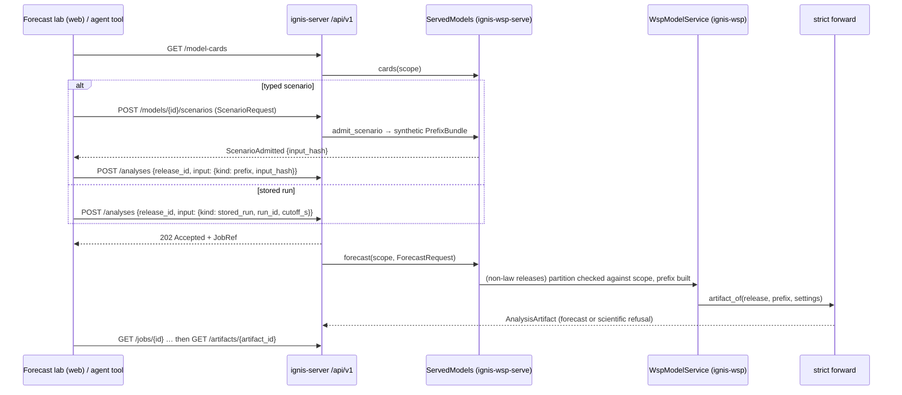
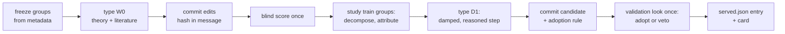

# Weight-space programming in IGNIS: the technical guide

IGNIS forecasts NASA's microgravity combustion experiments with scientific models whose every
parameter is a number an author model typed by hand. No optimiser, regression, sampler or search
produced any of them, and nothing is fitted when a forecast runs. We call this **weight-space
programming (WSP)**. This guide covers what WSP is, how a model is built, served and scored, and how to
write a new one. It is written for engineers and reviewers who will change the code or the models.

---

## Contents

1. [What WSP has achieved](#1-what-wsp-has-achieved)
2. [What WSP is, and why](#2-what-wsp-is-and-why)
3. [The forecasting tasks](#3-the-forecasting-tasks)
4. [Anatomy of a model](#4-anatomy-of-a-model)
5. [Forwards](#5-forwards)
6. [The generic law forward (`law.rs`)](#6-the-generic-law-forward-lawrs)
7. [Committees and mixtures](#7-committees-and-mixtures)
8. [Release assembly and content-addressed ids](#8-release-assembly-and-content-addressed-ids)
9. [Model cards and the served list](#9-model-cards-and-the-served-list)
10. [The serving path](#10-the-serving-path)
11. [The strictness rules](#11-the-strictness-rules)
12. [Evaluation](#12-evaluation)
13. [How to author a new model](#13-how-to-author-a-new-model)
14. [Rebuilding releases and scores](#14-rebuilding-releases-and-scores)
15. [Glossary](#15-glossary)
16. [Where to read more](#16-where-to-read-more)

---

## 1. What WSP has achieved

**Every one of NASA's 19 flight combustion investigations in PSI has a hand-written model with a
scored forecast**, and this deployment serves 14 hand-written releases
([`configs/models/served/served.json`](../../configs/models/served/served.json); the row-by-row table
is docs/wsp/COVERAGE_19.md):

| Group | Investigations (PSI number) | Served release(s) |
|---|---|---|
| Droplets | FLEX (69), FLEX-2 (68), CFI (39) | `flex_methanol.wsp2` D3, `flex_heptane.wsp2` D2 (FLEX-2 runs the heptane model unchanged; CFI and the new FLEX-2 fuels have zero-shot candidates `flex_<fuel>.wsp7` W0) |
| Spherical burner flames | CFI-G (159), Flame Design (10), s-Flame (23) | `acme_normal.wsp13` F4, `acme_inverse.wsp12` F2 |
| Fabric and solids | BASS-II (25), BASS (26), Saffire I, II, III (98, 99, 100) | `bass_front.wsp` D1 (BASS-II fabric, carried unchanged to Saffire), `bass5.wsp` (plastics and fabrics) |
| Burner rig, jets, aerosols | BRE (20), CLD Flame (21), E-FIELD (22), SLICE (106), SPICE (107), SAME-R (101), SAME (102), DAFT (47) | `bre.wsp` D3, `cld.wsp` D1, `efield3.wsp`, `slice2.wsp`, `spice.wsp` P3, `samer.wsp` S1, `same.wsp` W0, `daft.wsp` W0 |

Two served releases were revised after the final run, with every partition seen, and their scores are
in-sample descriptions of fit: `acme_normal.wsp13` F4 (the helium and hydrogen rows, on top of F3
stage 1) and `bass5.wsp` (the plastics quench speed). Both are labelled so on their cards (PROTOCOL
13.8).

### On the sealed test partitions

The project's sealed test partitions were scored once, in the final run of 15 November
(docs/wsp/RESULTS_FINAL.md). Lower is better. Bracketed ranges are 95 % bootstrap
intervals over sessions.

| Family | Adopted hand-written release | Best fitted or reference comparator | Paired difference |
|---|---|---|---|
| FLEX methanol: diameter CRPS, 65 cases, 9 sessions | `flex_methanol.wsp2` D3: **18.5 µm** | d-squared law 31.6; best fitted (MAP) model `flex.v3` 42.7 | −13.1 [−19.0, −7.7] against the d-squared law; −24.2 [−32.7, −15.9] against `flex.v3` |
| FLEX n-heptane: diameter CRPS, 43 cases, 7 sessions | `flex_heptane.wsp2` D2: **32.2 µm** | d-squared law 54.0 | −21.8 [−47.1, −4.9] |
| CFI-G normal flames: integrated Brier, extinction / termination, 60 cases | `acme_normal.wsp12` F2: **0.0414 / 0.0494** | fitted linear baseline 0.0933 / 0.1199; fitted hazard model 0.1068 / 0.1180 | −0.0498 / −0.0699 against the linear baseline |
| CFI-G inverse flames: same score, 69 cases the fitted models answer | `acme_inverse.wsp12` F2: **0.1045 / 0.0752** | fitted hazard model 0.1645 / 0.0817 | −0.0553 [−0.1181, −0.0086] at extinction |
| Flame Design normal flames, 3 test days (ethylene): sum of the two scores | F2: **0.2133** (0.0612 with the planned stop) | incidence baseline 0.4244 | |

The final run of the seventh generation scored the newer investigations on their unread test days
(docs/wsp/RESULTS_FINAL_GEN7.md):

| Investigation | Target | Model | Best baseline |
|---|---|---|---|
| BRE | extinction, integrated Brier, 95 cases | **0.139** (`bre` d3) | 0.222 |
| E-FIELD | ion current CRPS, 788 voltage levels | **0.319 µA** (`efield3`) | 0.575 µA (space-charge law) |
| E-FIELD | flame out in the window, 39 tests | **0.055** | 0.133 |
| SPICE | smoke-point length, 6 points | **4.18 mm** (P3) | 10.33 mm |
| SPICE | flame length given the flow | **1.18 mm** | 2.56 mm |
| SAME-R | particle diameter (ln), 33 rows | **0.167** (S1) | 0.256 |
| SAME-R | detector at full scale, Brier | **0.014** | 0.019 |
| CLD Flame | radiometer level, 63 test points | **0.115** | 0.144 |
| CLD Flame | flame lost before fuel-off, Brier | **0.0175** (`cld3`) | 0.0568 |
| Plastics and fabrics | kept burning after the igniter, 42 burns | **0.048** (`bass4`) | 0.071 |

### Against published models

The published predictors were rebuilt from their equations, their own published numbers were
reproduced, and they were then scored on the same cases as the adopted releases (post-hoc, after the
final run; docs/wsp/RESULTS_POINT_METRICS.md and RESULTS_PUBLISHED_ACME_BASS.md).

| Published model | Task | Published model | IGNIS release |
|---|---|---|---|
| Xi, Torero & Jahn, *Proc. Combust. Inst.* 38 (2021), data-assimilated droplet forecast | their own droplet (FLEX-094), cutoff 5 s, nRMSE over 5–10 s | 2.58 % (rebuild; they report 2.46 %) | `flex_heptane.wsp2` D2 **0.19 %**; the zero-shot W0 0.65 % |
| same | sealed FLEX test, evaluator window, nRMSE | heptane 17.16 %, methanol 6.95 % | heptane **5.41 %**, methanol **1.52 %**; paired −11.75 [−29.76, −1.62] and −5.43 [−7.62, −3.77] |
| Irace et al., *PCI* 39 (2023), radiative-extinction law with a growth clock | Flame Design normal flames, test days, integrated Brier sum | 0.337 | F2 **0.213**; paired −0.124 [−0.147, −0.080] over 3 days |
| Snegirev, *Combust. Flame* 248 (2023), critical radius with a clock | same | | F2 lower: −0.088 [−0.149, −0.041] without and −0.095 [−0.130, −0.058] with the planned stop |
| Ferkul et al. (2012), BASS spread-rate fit | BASS-II validation burns, tip CRPS in sample widths | 0.449 | `bass_front.wsp` D1 **0.121**, lower on all 3 burns |

The detailed transient simulation of Farouk and Dryer (2014) stays ahead of the heptane release on
the one FLEX run it was published for (whole-burn nRMSE 5.18 % against 13.05 %); that run is a known
target for the next droplet forward.

### Zero-shot laws that won before any outcome was seen

Two qualifiers apply to every number in this guide. A release is **zero-shot** only if it was typed
before any outcome of the data it is scored on was opened. Every other release is
**data-informed** and named so. The test partitions were sealed until the one final run.

---

## 2. What WSP is, and why

### 2.1 Hand-written, not trained

A WSP model has two parts:

- **The forward** is Rust code that turns a release's numbers and a prefix of a run into a forecast. It
  is deterministic and integrates its laws explicitly (Euler steps, fixed Gauss–Hermite nodes, fixed
  bisection of a known CDF). It cannot fit, search or sample anything.
- **The tensors** are the numbers. The author model types every one of them, in an edit language that
  has literals and nothing else, with a written physical reason beside each block.

Authors: **Fable** (`claude-fable-5-2`, the primary author) and **Astra** (a second author model, later
a reviewer, whose work is in docs/wsp/dossier/). Analysis and measurement may be
delegated to other model instances, but no script and no delegate writes a weight
(docs/wsp/PROTOCOL.md, section 7).

IGNIS only does rows 1 and 4. Row 2 is forbidden: a generated table is a program writing weights.
A function that is needed belongs in the forward, as code, with its constants typed
(docs/wsp/dossier/10_extension_map.md, section 10.2).

### 2.2 Why it works for these experiments

- **Physics identifies the parameters.** A droplet's burning rate, a critical extinction diameter, the
  critical reactant flux of a spherical flame and an oxygen limit are quantities with literature
  values and known dependences. The author types them where a trained model would have to learn them
  from a few dozen runs.
- **Data are few.** CFI-G holds two validation sessions per flame type; FLEX has a few hundred runs.
- **The model is readable.** Every number has a unit, bounds and a reason in its edits file. A
  reviewer can argue with a single statement.

### 2.3 Zero-shot (W0) and data-informed (D1, D2, ...): the naming

The name of a candidate says what its author had seen. The card field `authorship`
([`Authorship`](../../crates/ignis-core/src/contracts/wsp.rs)) is `zero_shot` or `data_informed`.

| Name | Meaning | Authorship |
|---|---|---|
| **W0** | Written before any outcome of its fuel, family or investigation was opened: theory, literature, the spec and input metadata only | zero-shot |
| **Q0** | A zero-shot law placed on a data-informed forward (`bass_front.wsp5` Q0: a zero-shot quench boundary on D1's tip law) | zero-shot for that law |
| **baseline-\***, **root** | Reference laws with no number from the campaign (the d-squared law, published theory, persistence) and the neutral root of a law slug | zero-shot references |
| **W1, W2** | Phase-1 revisions of W0 after development feedback | data-informed |
| **D1, D2, ...** | Typed after the author read development (train) data | data-informed |
| **P0, P1, P2, P3** | Physics-first rebuilds (fifth and sixth generations) | data-informed |
| **F1, F2, F3, F4** | Burner-flame committees reading a typed fuel table (F1's new-fuel rows were zero-shot; F2 onward revised from train days) | data-informed |
| **d1, d2, d3, C1, E1, S1, S2, K1, P2, P3** | Seventh-generation steps and studies of a law slug | data-informed |
| **lit** | A candidate centred on a published fit of the same data (SPICE) | not blind; reported beside, never selected |
| **carry-\*** | The carried numbers on a newer forward, giving identical forecasts, used as the partner in paired comparisons | as its source |
| **-nostops** | A member copy with its guessed stop atoms switched off, for prefixes that carry the planned stop | as its source |

The registry enforces part of this. A release whose manifest says `literal_one_shot` must have no
parent, no development feedback and no prior candidates in its exposure
([`ModelBuildManifest::validate`](../../crates/ignis-core/src/contracts/wsp.rs)). The first
data-informed candidate of a new spec is therefore a `literal_revision` of that spec's reference
baseline. A law slug's W0 is a revision of the slug's neutral root, which carries no information
([section 6.5](#65-the-neutral-root)); its zero-shot status is recorded in its `meta.json` exposure
and on its card.

---

## 3. The forecasting tasks

[generations 1 to 5](EXPERIMENTS_GEN1-5.md) and [generation 6 onward](EXPERIMENTS_GEN6-ON.md) describes each investigation in full. This section gives only what a
model is asked to forecast and how that is scored.

| Family | Investigation | Question | Output | Inputs | Score |
|---|---|---|---|---|---|
| FLEX droplets | PSI-69 (methanol, n-heptane), carried to FLEX-2 and CFI | Diameter of a free-floating burning droplet after the cutoff, through hot-flame, cool-flame (n-heptane) and no-flame states | quantiles 0.05, 0.25, 0.5, 0.75, 0.95 of `liquid_diameter` over time | `fuel`, `pressure`, `x_o2`, `x_co2`, `x_he`, the time the burning droplet was established, diameters measured up to the cutoff | CRPS in µm; MAE of the median; 50 % and 90 % coverage; cutoffs 1, 3, 5 s; horizon 10 s |
| ACME normal flames | CFI-G (PSI-159), Flame Design (PSI-10), s-Flame (PSI-23) | When and why a burner-supported spherical flame (fuel into oxidiser) ends | event probabilities over time: `active_supported`, `extinction`, `operator_termination`, `unresolved_support` | `fuel_species`, `injected_mass_flow`, `pressure`, `tad`, `x_fuel_role`, `x_o2_role`, `zst`; optional `programmed_stop`, test date, `burner_limit_c`, `diluent_species` | integrated Brier score over 6–120 s, for extinction and for operator termination, and their sum |
| ACME inverse flames | CFI-G, Flame Design | The same for an oxidiser-into-fuel flame | as above | as above, without the burner limit and diluent | as above |
| BASS fabric | BASS-II (PSI-25), carried to Saffire I–III | Where the flame tip on a thin fabric strip will be in concurrent flow, with the fan history as a known control; whether the track has ended | quantiles of `front_position` in sample widths; a track-ended probability | `x_o2`, `width`, `length`, `flow_velocity` and `igniter` control histories, front positions up to the cutoff | tip CRPS in sample widths; track-ended Brier; ignition-outcome Brier; cutoffs 5, 10, 20, 40 s after the igniter is off |
| Generic laws | BRE, CLD Flame, E-FIELD, SLICE, SPICE, SAME-R, SAME, DAFT, BASS plastics (PSI-20, 21, 22, 106, 107, 101, 102, 47, 26/25) | One or more declared targets per investigation: a positive quantity, a yes/no, or an end time with competing causes | `positive`: log-normal quantiles; `binary`: P(yes); `event`: cause-specific incidence over time | declared conditions only (typed scenarios) | CRPS or interval CRPS, Brier, integrated Brier, per target |

What counts as a case, and which cutoff and horizon apply, is set by the evaluator
(`ignis_lab::eval`) and by the lane scorers named in [section 12](#12-evaluation).

---

## 4. Anatomy of a model

### 4.1 The files of one candidate

```text
configs/models/<family>/<wspN>/<fuel or flame type>/
  spec.json            the frozen ModelSpec, exported from code (drift-tested)
  binding.json         cohort_id, split_id, source_manifest_hash: the population the release is declared for
  baseline-d2/         a reference candidate (lineage root)
  d3-fable/            a candidate written by Fable
    edits.wsp            the author's literal assignments, with the reasoning as comments
    meta.json            provenance: patch_id, parent_release_id, author, exposure, rationale, origin
    patch.json           edits + meta compiled into a HandwrittenWeightPatch
    release.json         the assembled release record (its id is its content hash)
```

Law slugs live under `configs/models/law/<slug>/`, with a `decl.json` beside the spec
([section 6](#6-the-generic-law-forward-lawrs)). The repository holds 246 committed release records
and 242 edits files under [`configs/models/`](../../configs/models/). The served bytes are in
`configs/models/served/models/<hex>/` (`release.json` and `params.npz`).

### 4.2 The spec

A [`ModelSpec`](../../crates/ignis-core/src/contracts/wsp.rs) is defined once, in code, next to the
forward that implements it. The JSON under `configs/models/` is its export, and that export is what an
author is handed. A spec fixes the following:

| Part | Content |
|---|---|
| `spec_id`, `family`, `model_name` | e.g. `flex_methanol-wsp-v3`, `flex`, `flex_methanol.wsp2` |
| `target` | quantity, SI unit, description, `excludes` (what the model does not predict) |
| `features` | name, unit, `source` (`condition:pressure`, `observation:liquid_diameter@prefix`), `transform` (`log@1`, `identity@1`); their order and transforms are part of the hash |
| `domain` | per-feature min and max |
| `tensors` | every tensor with shape, **role**, **fill rule**, unit, bounds and description |
| `forward` | `entry_point` (e.g. `ignis_wsp::law::forecast`), version, `profile = strict_no_fitting` |

**Tensor roles** ([`TensorRole`](../../crates/ignis-core/src/contracts/wsp.rs)): `weight`, `bias`,
`physical_parameter`, `noise_parameter`, `hazard_parameter`, `constant`. Every scalar that influences a
prediction is inventoried, whether or not it is called a weight.

**Fill rules** ([`TensorFill`](../../crates/ignis-core/src/contracts/wsp.rs), built by
[`spec.rs`](../../crates/ignis-wsp/src/spec.rs)):

| Rule | Constructor | Meaning |
|---|---|---|
| `author_writes_all` | `spec::authored` | a root patch must write every element; nothing is filled tacitly |
| `structural_zero` | `spec::sparse` | elements the patch does not write are zero by declaration (sparse hinge layers) |
| `fixed` | `spec::constant` | values fixed by the spec (normalisation references, numerical settings); the author cannot write them |

A spec has no default for a physical, noise or hazard parameter. A forward binds a release only if the
release names exactly the spec the forward was compiled with (`Params::bind`, refusal
`spec_mismatch`).

### 4.3 The edit language

([`text.rs`](../../crates/ignis-wsp/src/text.rs); PROTOCOL section 2)

```text
# comment
rate.b0 = -0.58                              # scalar tensor            -> set
rate.W1[2, 5] = 1.0                          # one element              -> set
rate.W1[3, :] = 0.0                          # constant over a box      -> fill_box
rate.skip[0:7] = [0.16, -0.075, 0.11, 0.08, -0.08, 0.052, 0.0]   # literal list -> set_box
haz.W1[0:2, 1:3] = [[1, 2], [3, 4]]          # nested list, may span lines
```

Selectors are non-negative integers and half-open slices `a:b` or `:`. Values are decimal literals.
The language has no expressions, no names on the right-hand side, no strides, no negative indices, no
repetition, no in-place arithmetic and no includes. One bad statement rejects the whole file. The MIT
language has strides, `*=`/`+=`/`-=` and `ZERO`; IGNIS leaves them out, so a patch is a set of
independent literal facts with each element written once. The statements compile to the contract's
three `LiteralOp`s: `set`, `set_box` and `fill_box`.

### 4.4 Parameters with physical meaning: an example

From [`configs/models/flex/wsp2/methanol/d3-fable/edits.wsp`](../../configs/models/flex/wsp2/methanol/d3-fable/edits.wsp),
the served methanol model. The header says what the author read. Then every block states the law it
types, the reason for it, and the evidence:

```text
# flex_methanol.wsp2 — D3 literal revision of the baseline sha256:abf919b6…247b, spec flex_methanol-wsp-v3
# Author: claude-fable-5-2 (Anthropic). DATA-INFORMED: typed after the author read the methanol TRAIN
# runs ...
# c = (c_o2, c_co2, c_he, c_logp, c_logd0):
#   c_o2 = (x_O2 - 0.21)/0.05   c_co2 = x_CO2/0.20   c_he = x_He/0.20
#   c_logp = ln(p / 1e5 Pa)     c_logd0 = ln(D0 / 2 mm)
# 1. Hot-flame burning rate, ln(K / 1 mm2/s) = N_rate(c, w, s)
# Air, 1 atm, 2 mm: 0.59 mm2/s on the plateau. Faster with oxygen, helium and pressure, slower with
# CO2, and slower as the droplet takes up water (-0.35 over the whole burn).
rate.b0 = -0.53
rate.skip[0:7] = [0.14, -0.04, 0.18, 0.10, 0.0, -0.35, 0.0]
# Unit 3: heat-up. The rate starts at 0.55 of its plateau and reaches it at s = 0.18.
rate.W1[3, 6] = -5.56
rate.b1[3] = 1.0
rate.w2[3] = -0.6
```

`rate.b0 = -0.53` is `ln(0.59)`: the burning-rate constant in air at 1 atm for a 2 mm droplet, in
mm²/s. The skip weights are the slopes of `ln K` in oxygen, CO₂, helium, pressure and burn progress. The
hinge unit 3 is the liquid heat-up as a ramp on the diffusion clock. The critical diameter block that
follows (`crit.b0 = 1.51`, which is about 9 mm in air) is the radiative-extinction diameter of the
atmosphere. Every number reads as a physical statement.

docs/wsp/dossier/10_extension_map.md sorts typed numbers into five kinds, and cards
count them separately:

| Kind | What it is | Where its value comes from |
|---|---|---|
| **N** nature | constants and property data (stoichiometry, heats, diffusivities) | handbooks, transcribed |
| **A** apparatus | sphere heat capacity, igniter timing, script delays, calibration rows | engineering documents or instrument readings |
| **L** law | the few constants a mechanism leaves open (critical flux, extinction temperature, oxygen limit) | literature; otherwise train |
| **S** structure | class gates, mixture weights | judgment, or train |
| **U** uncertainty | band widths, spreads of scenario nodes | train residuals plus a stated margin |

### 4.5 Provenance: `meta.json`

[`PatchMeta`](../../crates/ignis-wsp/src/assemble.rs) holds `patch_id`, `parent_release_id` (for
revisions), `author` (`provider`, `model_id`, optional `effort`), `exposure` (`sources`, `datasets` with
their partitions, `development_feedback`, `prior_candidates`), `rationale` and `origin`. The contract
refuses an exposure that lists the test partition ("an author never sees the test partition",
`DataExposure::validate`). The exposure of the served methanol D3 names the train test sheets, the
train feedback of D1 and D2, a train-only audit by a delegated agent, the published FLEX literature and
"author: pretraining-knowledge (unverifiable)".

### 4.6 The binding

`binding.json` (`cohort_id`, `split_id`, `source_manifest_hash`) names the evaluation population a
release is **declared for**, so that the existing forecast and evaluation commands can find its runs.
The release was not fitted on it ([`ignis_wsp::Binding`](../../crates/ignis-wsp/src/lib.rs)).

---

## 5. Forwards

### 5.1 Shared kernels

Every forward is built from four shared source files, which are part of every forward identity:

| File | Holds |
|---|---|
| [`nn.rs`](../../crates/ignis-wsp/src/nn.rs) | `affine`, `dot`, `relu`, `sigmoid` (stable), `softplus` (no overflow), and `hinge_net`: `y = b_out + skip·x + Σ_j w_out[j]·relu(b_hidden[j] + W_hidden[j,:]·x)`. With every hidden weight zero this is the linear law. Plain loops over borrowed slices, no allocation |
| [`quad.rs`](../../crates/ignis-wsp/src/quad.rs) | the seven-point probabilists' Gauss–Hermite rule (exact for polynomials of degree ≤ 13; weights sum to one), Acklam's normal quantile (relative error below 1.2e-9), the normal CDF via `erfc` |
| [`common.rs`](../../crates/ignis-wsp/src/common.rs) | default quantile levels `[0.05, 0.25, 0.5, 0.75, 0.95]`; `condition()` (a missing, unresolved or non-finite condition is a refusal, never a default); forecast times from `times_s` or `horizon_s` with `n_points` (default 41); weighted quantiles of point masses; the content-addressed `AnalysisArtifact` envelope (`evidence_class = model_output`; a refused forecast keeps its target and carries no numbers) |
| [`spec.rs`](../../crates/ignis-wsp/src/spec.rs) | spec constructors and `Params`, a shape-checked view that refuses a release built from another spec or holding a non-finite value |

The comparisons `!(x > 0.0)` are written that way on purpose: they are also true for NaN, so a
non-finite input is refused instead of slipping through
([`lib.rs`](../../crates/ignis-wsp/src/lib.rs)).

### 5.2 Every forward, by generation

**A forward is frozen with its releases.** A better forward is a new file with new model names, so
every earlier release keeps its id and its score. Model name `<model>.wspN` is the N-th spec of that
model; its CLI key is `<model>N` (e.g. `flex_methanol.wsp2` has the key `flex_methanol2`). The full key
list is [`models::MODELS`](../../crates/ignis-wsp/src/models.rs), and `ignis wsp spec --family <bad>`
prints it.

| Generation | Forward | Models | What it computes |
|---|---|---|---|
| 3 | [`droplet3.rs`](../../crates/ignis-wsp/src/droplet3.rs) | `flex_methanol.wsp2`, `flex_heptane.wsp2` (**served**) | the same physics, third generation: diffusive extinction by burn progress, radiative extinction on a clock, cool flame to an end diameter, evaporation after the flame |
| 4 | [`droplet4.rs`](../../crates/ignis-wsp/src/droplet4.rs), [`flame3.rs`](../../crates/ignis-wsp/src/flame3.rs), [`front.rs`](../../crates/ignis-wsp/src/front.rs), [`blend.rs`](../../crates/ignis-wsp/src/blend.rs) | `flex_*.wsp3`; `acme_*.wsp3`; `bass_front.wsp` (**served**); `acme_*.wsp4` | tracker flags; the published growth law of a spherical flame `r_f = r_ss·erfc(r_f / 2√(Dt))` against the extinction radius `r_ext = √(m_R / 4π m_cr)` with a burner-heating law; the band-shaped fabric flame (pyrolysis front, overhang, burned-out base); two laws averaged |
| 5 | [`droplet5.rs`](../../crates/ignis-wsp/src/droplet5.rs), [`droplet6.rs`](../../crates/ignis-wsp/src/droplet6.rs), [`committee.rs`](../../crates/ignis-wsp/src/committee.rs), [`front2.rs`](../../crates/ignis-wsp/src/front2.rs) | `flex_*.wsp4`, `flex_*.wsp5`; `acme_*.wsp5`; `bass_front.wsp2` | flame cameras as evidence of the state, a self-cooling unlit droplet, the cool-flame end in oxygen partial pressure; up to six member releases with weights and a planned-stop reading |
| 6 | [`flame4.rs`](../../crates/ignis-wsp/src/flame4.rs), [`committee2.rs`](../../crates/ignis-wsp/src/committee2.rs), [`fuel.rs`](../../crates/ignis-wsp/src/fuel.rs), [`flame5.rs`](../../crates/ignis-wsp/src/flame5.rs)–[`flame7.rs`](../../crates/ignis-wsp/src/flame7.rs), [`committee3.rs`](../../crates/ignis-wsp/src/committee3.rs), [`droplet8.rs`](../../crates/ignis-wsp/src/droplet8.rs), [`droplet9.rs`](../../crates/ignis-wsp/src/droplet9.rs), [`front5.rs`](../../crates/ignis-wsp/src/front5.rs) | `acme_*.wsp8`, `wsp7`, `wsp9`–`wsp12` (`acme_inverse.wsp12` **served**); `flex_<fuel>.wsp7`, `wsp8`; `bass_front.wsp5` | hinge laws with the heating law; ten member slots weighted by the era of the test; a typed fuel table (ethane, propane, butane, ethylene, methane, hydrogen); eight droplet fuels and mixtures; an oxygen-limit boundary with a 41-node mixture over its error |
| 7 | [`law.rs`](../../crates/ignis-wsp/src/law.rs), [`fuel2.rs`](../../crates/ignis-wsp/src/fuel2.rs), [`flame8.rs`](../../crates/ignis-wsp/src/flame8.rs)–[`flame10.rs`](../../crates/ignis-wsp/src/flame10.rs), [`committee4.rs`](../../crates/ignis-wsp/src/committee4.rs) | `<slug>.wsp` (eight **served**); `acme_normal.wsp13` (**served**), members `wsp14`–`wsp16` | the generic law forward; a second fuel table with a diluent table (helium, hydrogen, blends, the burner limit as an input) and two oxygen candidates |
| Astra | [`droplet7.rs`](../../crates/ignis-wsp/src/droplet7.rs), [`front3.rs`](../../crates/ignis-wsp/src/front3.rs), [`front4.rs`](../../crates/ignis-wsp/src/front4.rs), [`condition_committee.rs`](../../crates/ignis-wsp/src/condition_committee.rs), [`thermal.rs`](../../crates/ignis-wsp/src/thermal.rs), [`physical_core.rs`](../../crates/ignis-wsp/src/physical_core.rs), `property_*.rs` | `flex_*.wsp6`, `bass_front.wsp3`, `wsp4`, ... | coupled liquid mass and energy balance; an oxygen-supply speed; observation means matched at the still times; persistent condition nodes around the committee; source-bound property catalogues (pending evidence is inspectable, never evaluable) |

### 5.3 What a forward may read

Only the `PrefixBundle`: conditions known before the run, observations admitted at the cutoff, and
control stages known at the cutoff. Root-finding or optimisation over parameters or latents does not
exist on the route (PROTOCOL section 5). A forward answers in one of two ways:

- **a forecast** (`support.admitted = true`): quantiles over time, event probabilities over time, or
  both, with `diagnostics` that expose the intermediate physical quantities;
- **a scientific refusal** (`support.admitted = false`, status `unsupported`), at one of the gates
  `semantic`, `measurement`, `condition`, `numerical` or `horizon`. The refusal states its reason, for
  example a fuel outside the table, an oxygen fraction outside the declared domain, or an ethylene
  flame below the 1900 K bound of the weak-flame law.

### 5.4 Example of a forward's law: the third-generation droplet

From the header of [`droplet3.rs`](../../crates/ignis-wsp/src/droplet3.rs):

```text
q = D^2,  w = 1 - q/q0 (burn progress),  s = t K_ref / q0 (diffusion clock)
hot        dq/dt = -K_h,        ln(K_h/K_ref) = N_rate(c, w, s) + b + s_z z
class      P(radiative) = sigmoid(kappa x_exc + bias)          x_exc = ln(D0 / D_crit)
diffusive  flame out at progress W:  Lambda_D(w) = ln2 (exp(a_D (w - w_D)) - exp(-a_D w_D))
radiative  flame out at clock S:     Lambda_R(s) = ln2 (exp(a_R (s/s_R - 1)) - exp(-a_R))
cool       after a radiative extinction, with probability sigmoid(N_cool_p(c, x_exc)):
           dq/dt = -K_c until D = D_ce
no flame   D^2 falls by  k_inf r^m dt + k_hot r^h tau_e (1 - exp(-dt/tau_e))
N(x) = b0 + skip . x + sum_j w2[j] relu(b1[j] + W1[j, :] . x)
```

Each `N_*` is a `hinge_net` whose numbers the author typed. Everything else is fixed code.

---

## 6. The generic law forward (`law.rs`)

One strict forward hosts every hand-written law that is a small typed network over named input
features. It is how the seventh generation gave each of the remaining investigations a model
([`law.rs`](../../crates/ignis-wsp/src/law.rs), design in
[research/law_forward.md](research/law_forward.md)).

### 6.1 Two files per slug

| File | Holds | Written by |
|---|---|---|
| `configs/models/law/<slug>/decl.json` | feature names (= prefix condition keys), units, transforms; targets with their kind, unit, causes and optional shared quantity; **no number** | the engineer restating the physicist's law, once, before any release of the slug |
| `configs/models/law/<slug>/<candidate>/edits.wsp` | every number: centres, scales, domain bounds, biases, skips, hinge units, spreads, shapes, stop offsets | the author, literally |

The declaration is compiled in by [`law_slugs.rs`](../../crates/ignis-wsp/src/law_slugs.rs)
(`include_str!`) and is part of the slug's spec hash and forward identity. **Once a release of a slug
exists, its declaration is frozen**; a new declaration is a new slug (`cld2`, `efield3`, `bass5`, ...).
Adding a slug changes no other slug's identity. The registered slugs are `synthetic_demo` (tests only,
never NASA data), `sflame_event`, `bre`, `cld`, `efield`, `slice`, `spice`, `samer`, `same`, `daft`,
`bass1`, then `cld2`, `efield2`, `slice2`, `bass2`, `bass3`, `efield3`, `cld3`, `bass4` and `bass5`.

A declaration's `status` is `declared` (releases may be assembled), `placeholder` (registered before
the law was restated; no release can be assembled) or `synthetic`.

### 6.2 Features and network

```text
features   z_i = (x - c)/s | ln(x/c)/s | (1/x - 1/c)/s      x = value_si of condition <name>
           refused unless lo <= x <= hi and the transform can take x
network    N(z) = b0 + skip . z + sum_j w2[j] relu(b1[j] + W1[j, :] . z)      (j < 8 hinge units)
```

Limits: 16 features, 8 targets, 3 causes per event target, 8 hinge units per network.

### 6.3 Target kinds

| Kind | Law | Artifact |
|---|---|---|
| **positive** (a length, a diameter, a time, a signal) | `ln(median) = N_median(z)`, ln-sd `σ = N_spread(z) > 0`; a two-component log-normal mixture of one median, weights `(1 − w, w)`, ln-sds `(σ, kσ)`; quantiles by bisection of that fixed CDF (exact for `w = 0`) | `prefix_forecast`: quantiles at `times_s = [cutoff_s]`, the mean when finite |
| **binary** (yes or no) | `P(yes) = logistic(N_logit(z))` | `event_probabilities` with categories `yes`, `no` |
| **event** (an end in time, 1 to 3 competing causes) | per cause `τ_c = exp(N_c(z))`, `S_c(t) = 1 / (1 + (t/τ_c)^k_c)` (log-logistic); the causes compete, conditioned on no event before the cutoff; a scheduled stop takes the mass still active; integrated in `num.substeps = 512` steps per interval | `event_probabilities` with categories `active`, the causes, `scheduled_stop` |

A declared scheduled stop reads a condition (for example the planned stop) and a mixture over three
typed offset nodes (`<t>.stop.offset_s`, `<t>.stop.offset_w`), as `committee2.rs` does. Every artifact
carries `diagnostics.law` = `{slug, target, kind, label, unit, shared_quantity}` with the raw and
normalised features and the network outputs.

### 6.4 Tensors of a slug

| Tensor | Shape | Role | Meaning |
|---|---|---|---|
| `x.<f>.centre`, `x.<f>.scale` | [] | physical | centre and scale of the transform |
| `x.<f>.lo`, `x.<f>.hi` | [] | physical | the declared domain, in raw units |
| `<P>.b0` | [] | physical / noise / hazard | value at z = 0 |
| `<P>.skip` | [n] | weight | linear weights |
| `<P>.W1`, `<P>.b1`, `<P>.w2` | [8, n], [8], [8] | weight, bias (sparse) | hinge units |
| `<t>.tail_weight`, `<t>.tail_width` | [] | noise | second log-normal component (positive) |
| `<t>.<cause>.shape` | [] | hazard | log-logistic shape (event) |
| `<t>.stop.offset_s`, `<t>.stop.offset_w` | [3] | physical, weight | planned-stop nodes (event, with a declared stop) |

The networks `<P>` are `<t>.median` and `<t>.spread` (positive), `<t>.logit` (binary) and
`<t>.<cause>.median` (event).

### 6.5 The neutral root

`ignis wsp law-root --family <slug> --out <dir>` writes the root's `edits.wsp` and `meta.json`,
generated mechanically from the spec. In the root every `b0` is 0 (the spread `b0` is 10, the widest
allowed), every skip is 0, there are no hinges, every shape is at its lower bound, and every domain
bound is ±1e30. The root forecasts a median of 1 unit, a probability of 0.5 and clocks of median 1 s.
It is a lineage root and never a candidate. A candidate is a revision of the root that writes only what
its law uses. An example is
[`configs/models/law/samer/w0-fable/edits.wsp`](../../configs/models/law/samer/w0-fable/edits.wsp),
transcribed verbatim from the physicist's dossier `phys_samer_w0.md` section 7.4 ("no number
changed").

### 6.6 Served targets

A law release may declare more targets than are served. The served list names the served ones
(`targets`; the first is the default) and why the others are not (`targets_note`). For example, `bre`
D3 serves only `lasts`, because its clock reading is not the model. A forecast request selects a
target with `settings.target`.

---

## 7. Committees and mixtures

A committee release holds several **complete member releases** as tensor blocks, plus typed weights.
Each member runs unchanged, through the code its own releases use. A weighted mean of partitions of one
is a partition of one, so the output is a forecast of the same kind. Read as a model, a weight is the
author's probability that the member's description is the one that holds for a given flame. If a run
member refuses, the forecast is refused with that member's reasons; members are never silently
swapped.



| Forward | Slots | Weighting |
|---|---|---|
| [`blend.rs`](../../crates/ignis-wsp/src/blend.rs) (`acme_*.wsp4`) | `a.*` (a `flame.rs` release), `b.*` (a `flame3.rs` release) | `mix.w`, two typed numbers. The mean of two forecasts is never scored worse than the mean of their scores, and is better by a quarter of their mean squared disagreement: that is arithmetic, not a fit |
| [`committee.rs`](../../crates/ignis-wsp/src/committee.rs) (`acme_*.wsp5`) | up to six: a0, a1 (`flame.rs`), b0–b3 (`flame3.rs`) | `mix.w`; a second weight vector and an offset for prefixes that carry the script's planned stop |
| [`committee2.rs`](../../crates/ignis-wsp/src/committee2.rs) (`acme_*.wsp7`) | ten: adds c0–c3 (`flame4.rs`) | one weight vector per **era** of the test, read from the date in `session_id` or `run_id` (never from an outcome); three typed readings of the planned stop (P2: the stage sum plus 0, 1, 2 s at weights 0.25, 0.5, 0.25; F2: the computed stop at −1, 0, +1 s) |
| [`committee3.rs`](../../crates/ignis-wsp/src/committee3.rs) (`acme_*.wsp12`) | members reading the fuel table | as committee2 |
| [`committee4.rs`](../../crates/ignis-wsp/src/committee4.rs) (`acme_normal.wsp13`) | members reading the second fuel and diluent tables | plus two oxygen candidates (`x_o2_role_b`, `tad_b`, `zst_b`) mixed by `mix.o2_b_w` |
| [`condition_committee.rs`](../../crates/ignis-wsp/src/condition_committee.rs) | persistent input-condition nodes around the committee | an authored probability mass per node |
| [`front5.rs`](../../crates/ignis-wsp/src/front5.rs) (`bass_front.wsp5`) | one tip law | 41 equal-probability nodes over the boundary error, the same node at every time of a burn |

**Copying member values is not authoring.** The member numbers of a blend or committee are the stored
values of existing releases, copied statement by statement by `tools/wsp/blend_edits.py`,
`committee_edits.py`, `committee2_edits.py` to `committee4_edits.py`. These
scripts choose and compute nothing, and a test compares the committed committee with its member
releases tensor by tensor. The only numbers typed for a committee are its weights and its
committee-level tensors.

Droplet and fabric forwards integrate uncertainty the same way: fixed Gauss–Hermite nodes
(`quad::GH7_Z`) or equally likely normal-quantile nodes over a typed spread, never by sampling.

---

## 8. Release assembly and content-addressed ids



### 8.1 Order of construction

[`assemble::materialize`](../../crates/ignis-wsp/src/assemble.rs):

```text
zero tensors -> the spec's fixed constants -> parent's tensors (revision only) -> the patch
```

A revision must keep its parent's spec ("a new architecture is a new spec"). The rewrite path
(`ignis wsp rewrite`, [`rewrite.rs`](../../crates/ignis-wsp/src/rewrite.rs)) builds a complete
literal patch for a new spec and keeps the real parent as ancestry.

### 8.2 Build checks recorded in every manifest

`spec_valid`, `patch_valid`, `tensors_complete` (authored elements, nonzero count, constants),
`strict_forward_audit` (the crate links no optimizer; see [section 11](#11-the-strictness-rules)) and
`finite_forward_on_fixture` (the forward runs on a synthetic fixture prefix and returns a valid, finite,
admitted artifact). A release cannot carry a failed check.

### 8.3 The release record

| Field | Value for every literal release |
|---|---|
| `trained_on` | `not_trained` (and a literal construction manifest is required for it) |
| `state` | `experimental` |
| `lineage` | `literal_authoring` (one-shot) or `weight_edit` (revision), with `parent_id` |
| `construction.construction_method` | `literal_one_shot` or `literal_revision` |
| `construction.spec_hash`, `patch_hash`, `weights_hash` | the spec, the literal patch, the resulting tensors |
| `construction.forward_hash` | digest of the forward sources |
| `construction.author`, `exposure` | the exact provider model id; everything the author saw |
| `construction.uncertainty_kind` | `assumed_noise` (a literal release may not claim `calibrated_prediction`) |
| `posterior` | empty: a literal release has no posterior draws |
| `code_version` | `ignis-wsp@<crate version>+fwd.<first 16 hex of forward_hash>`, not the git tree |
| `cohort_id`, `split_id`, `source_manifest_hash` | from the binding |

The registry check is
[`ModelRelease::check_construction`](../../crates/ignis-core/src/contracts/wsp.rs).

### 8.4 The release id

`registry::save_release` ([`ignis-core/src/registry.rs`](../../crates/ignis-core/src/registry.rs))
sets `id = content_hash(release, exclude = ["id", "created_at"])`. That is `sha256:` of the
**canonical JSON** of the record, with keys recursively sorted
([`hashing.rs`](../../crates/ignis-core/src/hashing.rs)). The id therefore covers the weights, the
spec, the patch, the provenance and the forward identity. `code_version` does not depend on the
working tree, so re-assembling the same spec and patch under the same forward gives the same id. This
was checked for this guide: rebuilding `flex_methanol.wsp2` D3 from its committed patches into an
empty registry reproduced `sha256:c8a90dabbed6af4185de94c3cd5ac27486c19eb52c697d86b028849a37fcb654`,
and the rebuilt record differs from the committed one only in `created_at`.

**Forward identity.** [`audit::forward_hash`](../../crates/ignis-wsp/src/audit.rs) digests the forward
sources (the shared kernels plus the model's own files, by name, in a fixed order) with every
whitespace character removed. Formatting is therefore not identity, but any other edit of a forward
source is. A release refuses to run under any forward other than the one it was assembled with
(`forward_mismatch`): **a release is its weights and its forward.** A model's identity covers only the
shared files and its own forward file, so adding a model never changes another model's ids.

The registry root is `IGNIS_ARTIFACTS` (default `artifacts/`), laid out as
`models/<hex>/release.json` + `params.npz`. Saving is idempotent and re-reads the stored tensors to
compare them. Releases are immutable: a change is a new release.

---

## 9. Model cards and the served list

### 9.1 `ModelCard`

What the server states about a served release, besides its immutable record
([`ModelCard`](../../crates/ignis-core/src/contracts/wsp.rs)). It is read from the deployment's served
list, never from a request.

| Field | Meaning |
|---|---|
| `release_id`, `model_name`, `family` | identity (checked against the record at startup) |
| `title`, `summary` | the model's name in plain words ("FLEX methanol droplet model") and what it forecasts in one plain line; the UI leads with these |
| `qualification` | `{state: "qualified", basis}`: the served state the UI and the agent state, and what it was scored on in one line. The record keeps `state = experimental` (part of its id); serving the release is the deployment's qualification |
| `investigation` | e.g. "FLEX (PSI-69), methanol droplets" |
| `candidate` | the lane's name (D3, F2, ...) |
| `forecasts` | what it forecasts, in one sentence |
| `authorship`, `authorship_note` | `zero_shot` or `data_informed`, and one line on how it was written |
| `trained_on`, `state` | copied from the record: `not_trained`, `experimental` |
| `inputs` | list of `ModelInput` |
| `stored_runs` | whether this deployment builds the prefix from a stored NASA run |
| `inputs_note` | what a stored run or a typed scenario must give |
| `scores` | list of `ReportedScore` |
| `limits` | stated limits (a line starting "Do not use" is surfaced in the agent's tool description) |
| `cite`, `card_doc` | how to cite it; the model card document |
| `open_partitions`, `open_reason` | the partitions of the release's split whose stored runs research scopes (the forecast lab, its agents) may forecast; `["train"]` unless the served list opened more, with its reason |

**`ModelInput`**: `name`, `kind`, `unit_si`, `required`, `text` (a text value such as a fuel name),
`note`, `example` (never a measurement). The **input kinds**:

| Kind | Source |
|---|---|
| `condition` | `PrefixBundle.known_conditions` (pressure, oxygen fraction, fuel species, the planned stop) |
| `control` | `PrefixBundle.known_controls` (fan flow history, igniter) |
| `observation` | observations of the run before the cutoff (droplet diameters, front positions) |
| `test_date` | the test date, for laws that depend on the era of the test |
| `phase_start` | when the modelled phase was established (burning droplet, ignited fabric) |

**`ReportedScore`**: `metric` (and the data it is measured on), `value` with its unit, `comparison`
(baselines and intervals) and `source` (document and section). These are numbers as the authoring lane
reported them.

**Target kinds on cards.** Droplet and fabric models give quantiles of a positive quantity. Burner-flame
models give event tables. Law releases list their declared targets in `forecasts` as `positive`,
`binary` or `event`.

The written model cards (computation, what each number says, provenance, limits) are in
[cards/](cards/): `flex_droplet3.md` (the served droplet models), `acme_committee.md`,
`acme_clock.md`, `acme_growth.md`, `acme_blend.md`, `bass_front.md` and the earlier generations.

### 9.2 `served.json`

[`configs/models/served/served.json`](../../configs/models/served/served.json), schema
`ignis.served-models/1`, has one entry per served release ([`ServedEntry`](../../crates/ignis-wsp-serve/src/lib.rs)).
An entry carries the card fields above plus three serving rules for law releases and blends:
`targets`, `targets_note` and `refuse_blends` (refuse a scenario whose fuel is a blend when the release
has no blend law). The release bytes sit beside it in `models/<hex>/`. **Adding a release is a list
entry and its directory**; a rebuild is needed only when it runs on a forward the build lacks.

**Opened partitions.** An entry may set `"open_partitions": ["train", "validation", "test"]` with an
`open_reason`. Absent, a release forecasts train runs only: that is the default of every new
deployment. `ServedList::read` refuses an opening without `train` or without a reason, and a reason
without an opening. The committed list opens all three partitions for `flex_methanol.wsp2`,
`flex_heptane.wsp2`, `acme_normal.wsp13`, `acme_inverse.wsp12` and `bass_front.wsp`. The reason: the
sealed test partitions of their splits were spent in the one final run of 15 November (PROTOCOL
12.11, [RESULTS_FINAL.md](RESULTS_FINAL.md)), and validation was already used for selection. A
forecast on those runs therefore contaminates no evaluation. What the opening changes:

- a **research scope** (the lab, the agents' `models_forecast`) may forecast a validation or test run
  of that release. The scope itself still grants `train` only. Authoring and evaluation scopes keep
  their own grants;
- `GET /api/v1/models/{id}/runs` ([`StoredRunList`](../../crates/ignis-core/src/contracts/wsp.rs))
  lists every run of the opened partitions, each with its `partition` and `held_out`
  (validation or test: no author of the release read it);
- the legacy registry routes serve the outcomes of those runs (series, endpoint, recording) as they do
  for train runs, so the lab can draw what was recorded beside the forecast. A run stays sealed while
  any split it belongs to keeps its partition closed.

Evaluator bundles, `ignis eval`, `/seal` and `/reveal` never read the opening. A new generation that
needs a sealed test again freezes a new split. It does not close this one.

---

## 10. The serving path



### 10.1 Startup

`ignis serve --enable-models` (or `IGNIS_ENABLE_MODELS`) turns on the model families. Without it, the
model tools (`models_inspect`, `models_forecast`) are not registered and `/api/v1/capabilities` says
why. The served directory is `IGNIS_WSP_SERVED` (default `configs/models/served` under `--root`;
[`ignis-cli/src/main.rs`](../../crates/ignis-cli/src/main.rs)).

[`ServedModels::open`](../../crates/ignis-wsp-serve/src/lib.rs) **fails closed**. Every listed release
must load through the registry checks (tensor digests, construction). Its record must hash to its id.
It must name a literal forward compiled into `ignis-wsp` whose current `forward_hash` equals the one in
its manifest, and it must agree with its list entry on model name and family. A broken list serves no
models (the host prints why) instead of serving some of them.

### 10.2 Forecasts

- **Stored runs** (the droplet and burner-flame releases, `stored_runs = true`) go through
  [`WspModelService`](../../crates/ignis-wsp/src/service.rs). It routes a release to its forward by
  `model_name` (never by family alone), loads each release once per id, asks the prefix source where
  the data come from, checks that against the host's `ExecutionScope`, and only then asks for the
  prefix. **A test-partition run is refused before its prefix is built**, unless the served list
  opened that partition of the release to research scopes (9.2, opened partitions). A prefix hash the host has
  not admitted as a scenario is refused: the core crate keeps no other store of prefixes by hash.
- **Typed scenarios** (`POST /api/v1/models/{id}/scenarios`, [`v1/wsp.rs`](../../crates/ignis-server/src/v1/wsp.rs)):
  a person types the conditions (and, where the release reads them, controls, an early prefix, a
  test date and the phase start). [`scenario_prefix`](../../crates/ignis-wsp-serve/src/lib.rs) builds
  a prefix in which every value is marked `synthetic`, and nothing is filled in that the person did not
  type. The model's fixture is used only for its layout. The host keeps the prefix by `input_hash`.
  **Law releases read typed conditions only**: no stored run carries their features, so they forecast
  only an admitted scenario. There is no agent tool that admits a scenario: a forecast never runs on a
  prefix a language model assembled from text.
- **Jobs**: `POST /api/v1/analyses` takes a `ForecastRequest` (`schema_version: "wsp.v1"`,
  `release_id`, `input`, optional `settings`: `quantile_levels`, `horizon_s`, `n_points`, `times_s`,
  `target`) and returns `202 Accepted` with a `JobRef`. `GET /api/v1/jobs/{id}` gives the status, and
  the stored `AnalysisArtifact` is at `GET /api/v1/artifacts/{id}`. The legacy `/api/forecast` and
  `/api/analysis/{id}` routes serve the fitted lab and are not WSP.
- **Release routes**: `GET /api/v1/models` and `GET /api/v1/models/{id}` return the records;
  `GET /api/v1/model-cards` returns the cards; `GET /api/v1/models/{id}/runs` lists the stored runs the
  caller may forecast with the release, each with its partition. A model name given in place of a
  release id gets an error that names the correct id.

### 10.3 How the web shows releases

- [`web/src/views/Models.tsx`](../../web/src/views/Models.tsx) lists the releases with family, state
  ("experimental") and weights ("hand-written" when `trained_on = not_trained`).
- [`web/src/views/LabModels.tsx`](../../web/src/views/LabModels.tsx) is the forecast lab. It shows
  each card with the tags "experimental" and "hand-written · zero-shot / data-informed", the
  `forecasts` sentence, the authorship note, the reported scores with their sources, and the limits.
  The input can be "The NASA run" (the runs `/models/{id}/runs` lists, for releases with
  `stored_runs`: train, plus validation and test runs where the served list opened them) or
  "Conditions I type", which admits a scenario and then submits `/analyses`. The lab polls the job and
  draws the quantile bands or event stack. On a validation or test run it shows a "Held-out run" badge:
  the model never read that run. On a train run of a data-informed release it says that this is
  inspection, not a test.

---

## 11. The strictness rules

| Rule | How it is enforced |
|---|---|
| **No fitting anywhere on the route.** No gradient, MAP, NUTS, least squares, sampling or fallback to a fitted expert | `ignis-wsp` depends only on `ignis-core`; [`tests/strict.rs`](../../crates/ignis-wsp/tests/strict.rs) checks the resolved dependency graph against 15 forbidden crates (`ignis-science`, `ignis-flex`, `ignis-acme`, `ignis-bass`, `ignis-train`, `ignis-lab`, `nuts-rs`, `rand`, `argmin`, `nalgebra`, ...) and scans the sources for calls into fitting code |
| **Literals only.** Every number is typed by the author, with a reason | the edit language has no expressions; generated tables are not allowed; copier scripts may choose and compute nothing |
| **Frozen forwards are never edited.** A better forward is a new file | `forward_hash` in every manifest; `forward_mismatch` refusal; `ServedModels::open` refuses a served release whose forward identity changed; `tools/wsp/reassemble.py` prints whether each weight hash is unchanged |
| **Declarations are frozen** once a slug has a release | the declaration text is a forward source of the slug |
| **The candidate is committed before validation.** The edits file and the rule that will judge it are committed (hash in the commit message) before any score on unseen data exists | PROTOCOL sections 4, 8, 12.1; every registration names its commit |
| **Validation adopts or vetoes; it never tunes.** A validation score decides only whether a candidate replaces the carried model, by a rule written beforehand; a near miss is a refusal | PROTOCOL sections 8, 12.4; failed candidates stay in the tables as negative results |
| **Band widths are not chosen on train** | set from the residuals of earlier batches with a stated margin (PROTOCOL 8, 12.3) |
| **The test partition is sealed** | `DataExposure::validate` refuses an exposure that lists it; `ExecutionScope::require_partition` refuses test-partition runs outside an evaluation scope (forecasts on a split whose final test was spent are opened per release in `served.json`, 9.2); `holdout/` vaults are write-once and never opened by an author; every reveal is logged in `runs/evaluation/reveal_log.jsonl`; `--final-test`, `--partition test` and `--partition all` are never passed in development |
| **New data is scored blind once, then studied** | PROTOCOL 12.2: freeze, measure blind, score once, then study the train groups for one revision; the validation groups judge that revision once |
| **Typed back-propagation**: a revision is one damped step per batch | PROTOCOL 12.3: forward, decompose the loss, attribute (a script perturbs each physical block and reports, writing no weight), reason and type (pattern across sessions, inside the source range, about half the suggested step, 2–3 significant figures, a physical reason) |
| **Predict, then check** (seventh generation) | PROTOCOL 13.6: the author writes the expected effect per stratum before a logged what-if run (`tools/wsp/ext/law_whatif.py`, log `runs/dev/gen7/whatif_log.jsonl`); a candidate whose effect was not predicted in sign is dropped, not tuned; at most five logged candidates per law |
| **Refusal, never default** | a missing, unresolved or out-of-domain input is a scientific refusal that names it |
| **Model output is not a measurement** | artifacts are `evidence_class = model_output`; typed scenarios are `synthetic` |

---

## 12. Evaluation

### 12.1 Metrics

Implemented in [`ignis-lab/src/eval/scores.rs`](../../crates/ignis-lab/src/eval/scores.rs). Lower is
better everywhere except log predictive density.

| Metric | Definition | Used for |
|---|---|---|
| **CRPS from quantiles** | `2 ∫ ρ_τ(y − q_τ) dτ` with midpoint weights over the level set (0.05, 0.25, 0.5, 0.75, 0.95); comparable only on identical level sets | droplet diameter (µm), fabric tip (sample widths), law positive targets |
| **MAE of the median** | absolute error of the 0.5 quantile | droplets, fabric |
| **Coverage** | share of targets inside the central 50 % and 90 % bands, with their widths | calibration of bands |
| **nRMSE** | RMSE of the median divided by the mean measured diameter (the metric of Xi et al. 2021); also MAPE | post-hoc comparisons with published droplet studies |
| **Log predictive density** | from quantiles (`lpd_quantiles`: a piecewise-linear CDF with exponential tails) | reported by the evaluator where available |
| **IPCW Brier score** | cause-specific Brier at horizon `h` with inverse-probability-of-censoring weights (Graf/Gerds; Kaplan–Meier of the censoring times) | burner-flame and law event targets |
| **Integrated Brier** | trapezoidal integral of the Brier score over the horizon grid, divided by its span; for burner flames over 6 to 120 s, for extinction and for operator termination, and their sum as the decision score | ACME, BRE, CLD |
| **Brier (binary)** | `(P − I)²` | ignition outcome, track ended, law binary targets |
| **Paired differences** | candidate minus comparator on common cases, with a cluster bootstrap over sessions, days or burns | every adoption and comparison |
| **Refusal accounting** | the denominator is the prospectively admitted set; refusals are counted with their reasons | every table |

### 12.2 Baselines

- **Hand-written references** with no number from the campaign: the d-squared law of each droplet
  spec, the published theory of spherical flames (`baseline-theory`), the reference baseline sets of
  the committees, persistence for the fabric front.
- **Fitted baselines** of the data lane (`ignis fit run ... --execute`): `flex.v1`, `flex.v3` (MAP),
  `flex.d2_population`, `flex.d2_prefix`; for ACME, constant, piecewise, linear and hazard models.
- **Incidence baselines**: for each cutoff, the share of train cases that had ended by each horizon, by
  cause, computed once from train.
- **Constants**: the train-day constant or incidence (the "simple baseline") for law targets.

### 12.4 Selection rules

- **Droplets** (PROTOCOL 8): a candidate replaces the carried model when its median train CRPS over
  common cases is not worse and it is better or level (within 1 µm) in at least 60 % of train
  sessions; then validation, read once as an aggregate, may only veto.
- **Burner flames** (PROTOCOL 12.6, 12.10): a candidate replaces the carried model if the mean over
  investigations (CFI-G validation and Flame Design validation days) of the sum of the two integrated
  Brier scores is not higher, and the mean of the extinction score alone is not higher. The rule is
  applied on both paths: with and without the planned stop.
- **Families with several investigations** (PROTOCOL 12.4): the primary score is the equal-weight mean
  over investigations of the session-mean score, so that one large investigation cannot carry a model
  that fails on another.
- **Law slugs** (PROTOCOL 13.2–13.6): a model "beats the simple baseline" or "beats the best baseline"
  on the cases it answers. A revision or second law is kept only if it is lower pooled and on at least
  two thirds of the days whose forecasts change, and not worse by more than 5 % on the other targets.

---

## 13. How to author a new model

There are three paths, from cheapest to most expensive:

- **A.** A new candidate on an existing forward.
- **B.** A new law on the generic forward (`law.rs`).
- **C.** A new forward.

Each path follows the same discipline: freeze the groups, write a zero-shot W0 before any outcome is
opened, commit it, score it blind once, then revise from train only.



Build the binary first (from the repository root; the debug build `cargo build -p ignis-cli` with
`target/debug/ignis` works the same way):

```bash
cargo build --release -p ignis-cli
```

### 13.1 Path A: a new candidate on an existing forward

1. **Get the spec** the author writes against:

   ```bash
   target/release/ignis wsp spec --family flex_heptane2 --out configs/models/flex/wsp2/heptane/spec.json
   ```

   Without `--out` it prints a summary (feature count, authored elements, forward). The JSON lists
   every tensor with its role, fill rule, unit, bounds and description.

2. **Write the candidate directory** `configs/models/<...>/<name>-fable/`:
   - `edits.wsp`: the header says what was read ("DATA-INFORMED: typed after ..." or "zero-shot"),
     then one block per law, with the reason and the evidence as comments. A revision writes only the
     statements it changes; a root patch writes every `author_writes_all` element.
   - `meta.json`: `patch_id`, `parent_release_id` (for a revision), `author`
     (`{"provider": "anthropic", "model_id": "claude-fable-5-2"}`), `exposure` (every source, dataset
     and partition, feedback file and other candidate seen; never the test partition), `rationale`,
     `origin`.

3. **Compile**, which writes `patch.json`:

   ```bash
   target/release/ignis wsp compile --family flex_heptane2 --edits configs/models/flex/wsp2/heptane/<name>-fable/edits.wsp --meta configs/models/flex/wsp2/heptane/<name>-fable/meta.json --out configs/models/flex/wsp2/heptane/<name>-fable/patch.json
   ```

4. **Check** against the frozen spec and see the parameter counts. A revision needs its parent in the
   registry given by `--root`:

   ```bash
   target/release/ignis wsp check --family flex_heptane2 --patch configs/models/flex/wsp2/heptane/<name>-fable/patch.json --root artifacts
   ```

5. **Assemble** into the registry and write the record beside the edits:

   ```bash
   target/release/ignis wsp assemble --family flex_heptane2 --patch configs/models/flex/wsp2/heptane/<name>-fable/patch.json --binding configs/models/flex/wsp2/heptane/binding.json --out configs/models/flex/wsp2/heptane/<name>-fable/release.json
   ```

6. **Inspect** what was stored. `--edits` prints every nonzero authored value as edits:

   ```bash
   target/release/ignis wsp inspect --release <release id> --edits
   ```

7. **Run it** on a prefix file:

   ```bash
   target/release/ignis wsp forward --release <release id> --prefix <prefix.json> --settings '{"horizon_s":10}'
   ```

8. **Commit** the candidate directory and its registration (the rule that will judge it) before any
   validation score exists. Then take the look once, as registered.

9. **Add the chain** to `CHAINS` in [`tools/wsp/reassemble.py`](../../tools/wsp/reassemble.py), so that
   the lineage can be rebuilt.

### 13.2 Path B: a new law on the generic forward

1. **Write the physics dossier** (`docs/wsp/research/phys_<slug>_w0.md`): the target, the law, every
   constant with its source and range, and the expectations to be checked. Commit it before any
   outcome is read.
2. **Declare the slug**: write `configs/models/law/<slug>/decl.json` (features with units and
   `identity` / `ln` / `reciprocal` transforms; targets of kind `positive`, `binary` or `event`; no
   number). Add one line `slug!("<slug>")` to `SLUGS` in
   [`law_slugs.rs`](../../crates/ignis-wsp/src/law_slugs.rs), then rebuild (the declaration is
   compiled in).
3. **Export the spec and write the neutral root**:

   ```bash
   target/release/ignis wsp spec --family <slug> --out configs/models/law/<slug>/spec.json
   ```

   ```bash
   target/release/ignis wsp law-root --family <slug> --out configs/models/law/<slug>/root
   ```

4. **Transcribe the law** into `configs/models/law/<slug>/w0-fable/edits.wsp` as a revision of the root:
   centres, scales and domain bounds of every feature, then `b0`, `skip` and hinge units of every
   network, spreads and tails, shapes and stop offsets. Copy the numbers from the dossier verbatim; the
   assembly engineer chooses, rounds and changes nothing.
5. **Compile, check and assemble** the root and then W0 as in path A, with `--family <slug>` and
   `configs/models/law/<slug>/binding.json`.
6. **Check the transcription**: the forward must reproduce the dossier's own table of expectations
   within that table's rounding.
7. **Commit, register and score blind once.** Then type a D1 from the train anatomy, as one damped step.
8. **Serve it**: add a `served.json` entry (inputs with kinds and examples, `stored_runs: false`,
   scores with sources, limits, `targets` if only some are served) and copy the registry directory to
   `configs/models/served/models/<hex>/`.

### 13.3 Path C: a new forward

When an error cannot be explained by any number inside its allowed range, a mechanism is missing, and
that needs a new forward, not a patch (PROTOCOL 12.3).

1. Copy the closest forward to a new file (for example `droplet10.rs` is a copy of `droplet3.rs` with
   one stage added). Give it new model names and specs, and make every new mechanism switchable, off
   at its neutral value.
2. Register it in [`models.rs`](../../crates/ignis-wsp/src/models.rs) (key, model name, spec, forward
   sources for its identity) and in `experts()` in [`lib.rs`](../../crates/ignis-wsp/src/lib.rs). Do
   not touch earlier forwards.
3. Write a **carry** release: the carried numbers on the new spec with the new entries neutral. It must
   reproduce the carried model's forecasts case by case on train (largest difference 0.0). It is the
   partner in paired comparisons.
4. Add a forward test under [`crates/ignis-wsp/tests/`](../../crates/ignis-wsp/tests/), run
   `cargo test -p ignis-wsp` (the strict test included), and rebuild every chain to show that no
   existing release id changed.
5. If it is to be served: add it to the build and to `served.json`. `ServedModels::open` checks its
   forward identity at startup.

### 13.4 Writing the numbers

- Write in physical variables, so a number means the same thing in another session. Mechanisms
  written that way carried over to unseen data. Sharpening a band or a boundary because the train runs
  looked that way did not (PROTOCOL 9, README "What five generations taught").
- Type to two or three significant figures and keep each value inside the range its source allows.
- Put spread in with a stated margin above the train residuals.
- When unsure which law holds, carry a second scenario with a stated weight in a committee.

---

## 14. Rebuilding releases and scores

All commands run from the repository root. Each command below was checked to exist in this
repository on 15 November 2026. The ones marked **ran** were run for this guide.

### 14.1 In this repository

Build and test:

```bash
cargo build --release -p ignis-cli
```

```bash
cargo test -p ignis-wsp
```

**ran**: 361 passed, 0 failed (the forward tests of every generation, the assembler, the law forward,
the service and `tests/strict.rs`).

```bash
cargo test -p ignis-wsp-serve
```

**ran**: 2 passed. `served_ids_are_the_adopted_ids_and_verify` checks that the served ids are the
adopted ids and that they load; `a_changed_record_or_an_unlisted_forward_is_refused` checks the
refusals.

Rebuild one release from its committed patches into a scratch registry and compare the id.
**ran** for `flex_methanol.wsp2` D3: the id was reproduced, and the record differs only in
`created_at`:

```bash
target/release/ignis wsp assemble --family flex_methanol2 --patch configs/models/flex/wsp2/methanol/baseline-d2/patch.json --binding configs/models/flex/wsp2/methanol/binding.json --root /tmp/reg --out /tmp/base.json
```

```bash
target/release/ignis wsp assemble --family flex_methanol2 --patch configs/models/flex/wsp2/methanol/d3-fable/patch.json --binding configs/models/flex/wsp2/methanol/binding.json --root /tmp/reg --out /tmp/d3.json
```

Inspect a served release directly from the served directory (its layout is a registry). **ran**:

```bash
target/release/ignis wsp inspect --release sha256:c8a90dabbed6af4185de94c3cd5ac27486c19eb52c697d86b028849a37fcb654 --root configs/models/served --edits
```

Print a forward identity and compare it with the manifest. **ran**: `flex_methanol2` gives
`sha256:71ea3173…950a`, equal to the served release's `construction.forward_hash`:

```bash
target/release/ignis wsp forward-hash --family flex_methanol2
```

Rebuild every listed chain in lineage order:

```bash
python tools/wsp/reassemble.py --ignis target/release/ignis
```

To rebuild only some chains, add `--only flex_methanol2,acme_inverse12`. Three cautions:

- It writes into the default registry (`artifacts/`).
- It rewrites each candidate's `patch.json` and `release.json` in place, and the parent ids in
  `meta.json` if a parent's id changed. Check `git diff` afterwards: when nothing else changed, only
  `created_at` differs.

Rebuild every served release from its committed patch and compare id and record:

```bash
python tools/wsp/verify_served.py --ignis target/release/ignis --parents <registry holding the parents>
```

The parents registry is the one `reassemble.py` fills.

Serve the models locally:

```bash
target/release/ignis serve --enable-models
```

At startup the server prints `ModelService: <n> served hand-written releases from <dir>`, or
`ModelService not configured: <reason>` if any listed release fails verification.

## 15. Glossary

| Term | Meaning |
|---|---|
| **WSP** | weight-space programming: every parameter of a model is a literal number typed by an author model |
| **Author** | the model that types the numbers: Fable (`claude-fable-5-2`), or Astra |
| **Spec** (`ModelSpec`) | the frozen contract a patch is written against: target, features, tensors with roles, fill rules and bounds, constants, forward entry point |
| **Edits** (`edits.wsp`) | the author's literal assignments, with the reasoning as comments |
| **Patch** (`HandwrittenWeightPatch`) | the edits compiled into `set` / `set_box` / `fill_box` ops, with provenance |
| **Forward** | the Rust code that turns a release and a prefix into a forecast, with no fitting |
| **Forward identity** (`forward_hash`) | the sha256 of the forward sources with whitespace removed |
| **Release** | an immutable, content-addressed record of tensors, forward identity and provenance; `trained_on = not_trained`, `state = experimental` |
| **Release id** | `sha256:` of the canonical JSON of the record without `id` and `created_at` |
| **Model key** | the CLI name of a spec (`flex_methanol2` for `flex_methanol.wsp2`; `<slug>` for a law) |
| **Slug** | one law on the generic forward, with its own declaration (`<slug>.wsp`) |
| **Declaration** (`decl.json`) | a slug's names, units, transforms and targets, with no number; frozen once a release exists |
| **Neutral root** | a law slug's lineage root, generated mechanically, carrying no information |
| **W0** | a zero-shot candidate, written before any outcome of its data was opened |
| **D1, D2, ... / P / F / S** | data-informed candidates |
| **Carry** | the carried numbers on a newer forward, giving identical forecasts, used for paired comparisons |
| **Committee** | a release made of complete member releases and typed weights |
| **Era** | the period of a test (read from its date) that selects a committee weight vector, e.g. the CFI-G burner limit of 500 C through 23 August 2021 and 450 C from 13 September 2021 |
| **Planned stop** | the stop of a burner test computed from NASA's script parameter file (`tools/wsp/ext/acme_script2.py`), read at offset nodes |
| **Prefix** (`PrefixBundle`) | what a forecast may read: known conditions, controls, and observations up to the cutoff |
| **Cutoff** | the time up to which a run is known; forecasts are made after it |
| **Scenario** | conditions typed by a person, admitted as a synthetic prefix (`input_hash`) |
| **Scientific refusal** | an artifact with `support.admitted = false` at a named gate, carrying no numbers |
| **Binding** | the cohort and split a release is declared for (not fitted on) |
| **Carried model** | the adopted release of a family, the one a candidate must beat |
| **Look** | one registered reading of aggregate scores on held data |
| **Blind score** | the first and only scoring of a batch before it is studied |
| **Typed back-propagation** | the protocol of a revision: forward, decompose, attribute, reason, type one damped step |
| **Sealed test** | the test partitions and test days, read once in the final run |
| **CRPS** | continuous ranked probability score, here from five quantiles |
| **Integrated Brier** | the time-integrated, censoring-weighted Brier score of an event forecast |
| **nRMSE** | RMSE divided by the mean measured value |
| **N / A / L / S / U** | the kinds of a typed number: nature, apparatus, law, structure, uncertainty |

---

## 16. Where to read more

In this repository:

- [README.md](README.md): the index of this folder.
- [generations 1 to 5](EXPERIMENTS_GEN1-5.md) and [generation 6 onward](EXPERIMENTS_GEN6-ON.md): the investigations, their data and targets.
- [RESULTS.md](RESULTS.md), [RESULTS_GEN5.md](RESULTS_GEN5.md), [RESULTS_GEN6.md](RESULTS_GEN6.md):
  development results.
- [cards/](cards/): model cards.
- [research/law_forward.md](research/law_forward.md): the generic law forward;
  [research/phys_quench_w0.md](research/phys_quench_w0.md): the fabric quench law.
- Code: [`crates/ignis-wsp`](../../crates/ignis-wsp/), [`crates/ignis-wsp-serve`](../../crates/ignis-wsp-serve/),
  [`crates/ignis-core/src/contracts/wsp.rs`](../../crates/ignis-core/src/contracts/wsp.rs),
  [`crates/ignis-server/src/v1/wsp.rs`](../../crates/ignis-server/src/v1/wsp.rs),
  [`configs/models/`](../../configs/models/).
